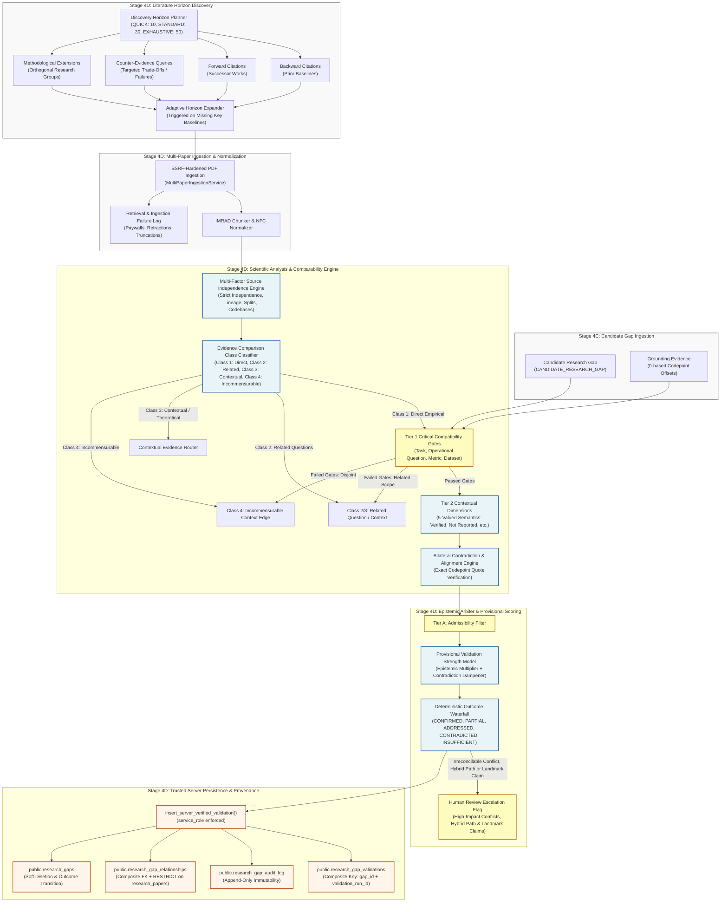

# Anvīkṣā — Stage 4D Architecture Specification (Revised)
## Cross-Literature Validation & Contradiction Detection Engine
### Architecture Specification: Version 4.1.0-REVISED (Stage 4D Final Consistency Amendment)

**Document Version:** 4.1.0-STAGE4D-ARCH-FINAL  
**Status:** ARCHITECTURE FROZEN — IMPLEMENTATION STRICTLY PROHIBITED  
**Milestone:** Stage 4D — Cross-Literature Validation & Contradiction Detection  
**Author:** Principal Supabase PostgreSQL Architect & AI Systems Safety Engineer  
**Date:** 2026-11-18  

---

## 1. Truthful Scope & Live Database Status Disclosure

> [!IMPORTANT]
> **EXPLICIT DATABASE DISCLOSURE:**
> Neither `public.research_gap_relationships` nor any Stage 4D schema modifications have been applied to the live Supabase database (`dtlvtpntmtdmdawupylv`).
> The live database remains strictly at the accepted **Stage 4C** state (`20261118_stage4c_ai_gap_extraction.sql`).
> All DDL and RPC specifications in this document are **PROPOSED DESIGN SPECIFICATIONS ONLY**. No migrations have been created in `supabase/migrations` and no DDL has been executed on the live database.

---

## 2. Executive Summary & Problem Formulation

In Sub-stage 4C, Anvīkṣā established the automated extraction of candidate research limitations and open questions from isolated scholarly publications. However, an extraction derived from a single paper represents only a **local, unverified claim**:
$$\text{Local Claim} \in \mathcal{P}_{seed}$$

A single author concession or empirical observation cannot establish whether an identified limitation remains open across the scientific ecosystem, has been successfully addressed by subsequent literature, is actively contested by conflicting empirical trials, or was based on flawed or incommensurable experimental conditions.

**Sub-stage 4D (Cross-Literature Validation & Contradiction Detection Engine)** provides the multi-document epistemological engine that tests candidate gaps against independently retrieved and analyzed scholarly evidence from the broader literature. It operationalizes Popperian falsification and methodological comparability to assign a scientifically rigorous **Validation Outcome**:
- `CONFIRMED_UNRESOLVED` (Horizon-bounded empirical confirmation)
- `PARTIALLY_ADDRESSED` (Demonstrated resolution under subset conditions with remaining open scope)
- `ADDRESSED` (Methodologically verified empirical resolution across primary benchmarks — no arbitrary 3-year proof)
- `CONTRADICTED` (Bifurcated: inter-paper empirical dispute vs direct gap falsification)
- `INSUFFICIENT_EVIDENCE` (Horizon, retrieval, or comparability inadequate for defensible conclusion)

### Core Revision Objectives (Final Consistency Amendment)
1. **Canonical Paper Table Integrity:** Formally verified that the canonical paper table in Anvīkṣā is `public.research_papers(id UUID)`.
2. **Composite Validation-Run Referential Integrity with RESTRICT:** Enforces composite foreign key `(gap_id, validation_run_id)` referencing `public.research_gap_validations(gap_id, validation_run_id) ON DELETE RESTRICT`, guaranteeing historical validation runs remain intact.
3. **Four Dedicated Partial Unique Indexes:** Eliminates sentinel collisions and NULL variation bypasses by using four discrete partial unique indexes and explicitly forbidding nil UUIDs.
4. **Gap Archival & Soft Deletion:** Replaces cascading hard deletion with soft deletion (`is_archived = true`, `archived_at`), preserving immutable validation provenance and audit trails.
5. **Strict Independent-Replication & Hybrid-Path Semantics:** Standard path requires $\ge 2$ strictly independent groups. Hybrid path (1 independent + partially dependent) is explicitly labeled as a distinct, weaker pathway and requires human review (`requiresHumanReview = true`). Partially dependent evidence never counts as an independent replication.
6. **Nuanced Comparability-Class Routing:** Fails in Class 1 critical gates downgrade to Class 2 (Related Questions) or Class 3 (Contextual Evidence) when investigating related phenomena; Class 4 (`INCOMMENSURABLE_CONTEXT`) is strictly reserved for genuinely disjoint tasks or paradigms.
7. **Rigorous Phase 5 Calibration Protocol:** Defined the exact calibration event $Y = \mathbf{1}(\text{Assigned} = \text{Ground Truth})$, validation run unit, cluster-based leakage prevention, and fallback mechanism if target ECE $\le 0.08$ is unmet.

---

## 3. Mandatory Architectural Invariants

The Stage 4D validation engine operates under fourteen non-negotiable architectural invariants:

1. **Comparison-Specific Gate Invariant:** High coverage, recency, or superficial text similarity CANNOT compensate for a critical mismatch in research question, task definition, dataset distribution, or metric formulation. Critical comparability gates are non-negotiable boolean preconditions for direct empirical comparison.
2. **Nuanced Class Routing:** Failure of a Class 1 critical gate downgrades evidence to Class 2 or Class 3 when addressing related questions; Class 4 is reserved for genuinely disjoint paradigms.
3. **Canonical Paper Referential Integrity:** All paper foreign key relationships must strictly reference `public.research_papers(id)`. Paper references in relationship tables must use `ON DELETE RESTRICT` to preserve historical evidence integrity.
4. **Validation Run Scoping Invariant:** Every relationship record must reference a valid validation run for that specific gap via composite foreign key `(gap_id, validation_run_id) ON DELETE RESTRICT`.
5. **Soft Deletion & Provenance Preservation:** Gaps support archival via `is_archived = true`. Hard cascading deletions that destroy historical evidence graphs are prohibited.
6. **Strict Independent Replication Invariant:** Corroboration from partially dependent studies cannot satisfy independent replication requirements. Two partially dependent studies never equal an independent replication.
7. **Hybrid-Path Review Invariant:** The hybrid path (1 independent + partially dependent) must never be described as satisfying the standard two-independent-replication requirement, must be explicitly labeled, and requires mandatory human review.
8. **No Negative Proof Fallacy:** The absence of discovered counter-evidence in a finite retrieved corpus must NEVER be presented as mathematical proof that none exists ("absence of evidence is not evidence of absence"). Publication age is contextual evidence, not a resolution substitute.
9. **Empirical Artifacts Required for Landmark Resolution:** A single landmark study claiming `ADDRESSED` status must provide verifiable open-source artifacts, public checkpoints, and benchmark harnesses. Widespread community adoption alone is not empirical proof.
10. **Missing Data Disentanglement:** Incomplete reporting (`NOT_REPORTED`) or unindexed metadata (`UNKNOWN`) must not be equated with empirical incompatibility (`INCOMPATIBLE`).
11. **Contextual Retention of Incommensurable Evidence:** Papers failing direct empirical comparability gates are NOT discarded; they are retained in the evidence graph as contextual, theoretical, or scope-delineating evidence.
12. **Bilateral Traceable Grounding:** Every validation decision—especially contradiction—must be anchored in bilateral, verifiable source quotations with exact 0-based Unicode code-point offsets in both the candidate gap's seed paper and the corroborating/contradicting literature.
13. **Provisional Scoring vs Calibration:** Uncalibrated heuristic scores must be labeled `PROVISIONAL_VALIDATION_STRENGTH` on a $[0.0, 10.0]$ scale. They must never be displayed as probabilities until empirical benchmark calibration has achieved acceptance targets.
14. **Permanent Contradiction Preservation:** Contradictory evidence is never overwritten, averaged out, or discarded. Both sides of an empirical disagreement are retained in the evidence graph.

---

## 4. High-Level Architectural Topology



---

## 5. End-to-End Revised Execution Pipeline

```
[Candidate Gap (4C)]
         │
         ▼
[Phase 1: Horizon Discovery & Resource Budgeting]
  ├── Select budget: QUICK (10), STANDARD (30, default), EXHAUSTIVE (50)
  ├── Multi-vector query formulation (Forward, Backward, Counter-Evidence, Orthogonal)
  └── Adaptive horizon expansion check (triggers if forward citation yield == 0 or baselines absent)
         │
         ▼
[Phase 2: Ingestion, Provenance & Lineage Verification]
  ├── SSRF-safe retrieval & NFC normalization (v1.0-nfc-normalized)
  ├── Persist papers in canonical public.research_papers
  ├── Publication lineage resolution (Preprint <-> Conference deduplication)
  ├── Retraction check (Assign DISQUALIFIED_RETRACTED to retracted papers)
  └── Retrieval failure logging (Visibility into paywalls and incomplete text)
         │
         ▼
[Phase 3: Multi-Factor Source Independence Profiling]
  ├── Author network Jaccard & institutional affiliation analysis
  ├── Shared benchmark splits & codebase/pipeline re-use detection
  └── State assignment: INDEPENDENT | PARTIALLY_DEPENDENT | DEPENDENT | INDEPENDENCE_UNKNOWN
         │
         ▼
[Phase 4: Comparison-Specific Comparability Evaluation]
  ├── Classification into Class 1 (Direct), Class 2 (Related), Class 3 (Contextual), Class 4 (Incommensurable)
  ├── Class 1: Critical Compatibility Gates (Task, Operational Question, Metric, Dataset Domain)
  │     ├── Fails Gate (Related) ──► Routed to Class 2/3 (Scope/Theory context; trend corroboration)
  │     ├── Fails Gate (Disjoint) ──► Routed to Class 4 (Incommensurable context; negative audit)
  │     └── Passes Gate ──► Eligible for Direct Empirical Comparison
  └── Tier 2: Dimension-Specific Scoring (Five-Valued Semantics: Verified, Not Reported, etc.)
         │
         ▼
[Phase 5: Bilateral Contradiction & Corroboration Detection]
  ├── Bilateral verbatim quote extraction & 0-based codepoint offset verification
  └── Divergence classification: Direct Falsification vs Scope Restriction vs Metric Asymmetry
         │
         ▼
[Phase 6: Admissibility Filtering & Provisional Strength Scoring]
  ├── Non-compensatory admissibility filter (Coverage cannot compensate for poor grounding)
  ├── Multi-vector quality profile & temporal recency relative to evaluation date T_eval
  └── Compute PROVISIONAL_VALIDATION_STRENGTH (Heuristic index [0.0, 10.0]; NOT a probability)
         │
         ▼
[Phase 7: Deterministic Epistemic Arbitration]
  ├── Outcome: CONFIRMED_UNRESOLVED | PARTIALLY_ADDRESSED | ADDRESSED | CONTRADICTED | INSUFFICIENT_EVIDENCE
  ├── Path differentiation for ADDRESSED: Standard (2+ indep) vs Hybrid (1 indep + part) vs Landmark
  ├── Epistemic transition: CANDIDATE_RESEARCH_GAP -> CROSS_LITERATURE_VALIDATED or ADDRESSED_OR_SUPERSEDED
  └── High-impact conflict, hybrid path, or landmark claim flag -> Human review escalation
         │
         ▼
[Phase 8: PostgreSQL Persistence & Reproducibility Logging]
  ├── Atomic RPC insert_server_verified_validation() (service_role enforced)
  ├── Composite FK (gap_id, validation_run_id) ON DELETE RESTRICT
  ├── ON DELETE RESTRICT on public.research_papers foreign keys
  └── Complete horizon metadata (DOIs, chunk IDs, section distributions, corpusHash)
```

---

## 6. Service Decomposition & Interface Contracts

The revised Stage 4D architecture formalizes five specialized backend services in `server/`:

```
server/
├── crossLiteratureValidationService.ts  # Master facade, discovery budgeting, arbitration
├── sourceIndependenceService.ts         # Multi-factor independence & lineage resolution
├── methodologicalComparabilityEngine.ts # Critical gates & comparison class routing
├── contradictionDetectionService.ts     # Bilateral claim alignment & quote verification
└── validationPersistenceService.ts      # Database RPC execution & horizon metadata storage
```

### 6.1 Service Interface Signatures

#### `MethodologicalComparabilityEngine`
```typescript
export type EvidenceComparisonClass = 
  | 'DIRECT_EMPIRICAL_COMPARISON'
  | 'RELATED_RESEARCH_QUESTION'
  | 'CONTEXTUAL_THEORETICAL_EVIDENCE'
  | 'INCOMMENSURABLE_CONTEXT';

export type DimensionStatus = 
  | 'VERIFIED_COMPATIBLE'
  | 'INCOMPATIBLE'
  | 'NOT_REPORTED'
  | 'UNKNOWN'
  | 'NOT_APPLICABLE';

export interface CriticalCompatibilityGates {
  taskAlignmentPassed: boolean;
  operationalQuestionPassed: boolean;
  metricFormulationPassed: boolean;
  datasetDomainPassed: boolean;
  allCriticalGatesPassed: boolean;
  gateFailureReasons: string[];
}

export interface DimensionComparabilityScores {
  taskAlignment: { score: number; status: DimensionStatus; rationale: string; evidenceQuote?: string };
  operationalQuestion: { score: number; status: DimensionStatus; rationale: string; evidenceQuote?: string };
  metricFormulation: { score: number; status: DimensionStatus; rationale: string; evidenceQuote?: string };
  datasetDistribution: { score: number; status: DimensionStatus; rationale: string; evidenceQuote?: string };
  baselineEquivalence: { score: number; status: DimensionStatus; rationale: string };
  sampleSizeScale: { score: number; status: DimensionStatus; rationale: string };
  observedTrends: { score: number; status: DimensionStatus; rationale: string };
  concededLimitations: { score: number; status: DimensionStatus; rationale: string };
  threatsToValidity: { score: number; status: DimensionStatus; rationale: string };
  hardwareDeployment: { score: number; status: DimensionStatus; rationale: string };
}

export interface MethodologicalComparabilityResult {
  candidatePaperId: string;
  comparisonClass: EvidenceComparisonClass;
  criticalGates: CriticalCompatibilityGates;
  dimensionScores: DimensionComparabilityScores;
  isEligibleForDirectContradiction: boolean; // true ONLY if comparisonClass == DIRECT_EMPIRICAL_COMPARISON
  isEligibleForContextualEvidence: boolean;   // true for theoretical/scope context even if gates fail
  commensurabilityClassification: 'FULLY_COMMENSURABLE' | 'PARTIALLY_COMMENSURABLE' | 'INCOMMENSURABLE';
  missingInformationFlags: string[];
}
```

#### `ValidationPersistenceService`
```typescript
export interface TypedGapRelationshipInput {
  gap_id: string;
  validation_run_id: string;
  source_gap_id?: string;
  source_paper_id?: string; // References public.research_papers(id)
  target_gap_id?: string;
  target_paper_id?: string; // References public.research_papers(id)
  relationship_type: 
    | 'identifies_limitation'
    | 'addresses'
    | 'partially_addresses'
    | 'corroborates'
    | 'contradicts'
    | 'supersedes'
    | 'tests'
    | 'incommensurable_context';
  confidence_weight: number;
  bilateral_evidence_refs: Array<{
    seedChunkId: number;
    valChunkId: number;
    seedQuote: string;
    valQuote: string;
  }>;
}
```

---

## 7. Architectural Decision Records (ADRs)

### ADR-4D-01: Comparison-Specific Gates, Missing Data & Nuanced Routing
- **Final Decision:** Established 4 evidence classes (Direct, Related, Contextual, Incommensurable) and 5-valued dimensional semantics (`VERIFIED_COMPATIBLE`, `INCOMPATIBLE`, `NOT_REPORTED`, `UNKNOWN`, `NOT_APPLICABLE`). Fails in Class 1 critical gates downgrade to Class 2/3 when addressing related questions; Class 4 is reserved for genuinely disjoint paradigms.
- **Justification:** Conforms to scientific epistemology; prevents missing information from being conflated with empirical conflict and preserves contextual evidence.

### ADR-4D-02: Strict Independent-Replication & Hybrid-Path Semantics
- **Final Decision:** Strict definition of independent replication (disjoint authors, institutions, codebases, datasets). Specified that two `PARTIALLY_DEPENDENT` studies DO NOT constitute independent replication. Formulated Pathway B (Hybrid Path: 1 independent + partially dependent) as a distinct, weaker pathway with mandatory human review and explicit labeling.
- **Justification:** Eliminates correlated benchmark noise and shared test-split bias from masquerading as scientific corroboration.

### ADR-4D-03: Provisional Validation Strength Scoring & Phase 5 Calibration Protocol
- **Final Decision:** Relabeled as `PROVISIONAL_VALIDATION_STRENGTH` on a $[0.0, 10.0]$ index. Formulated rigorous Phase 5 protocol defining target event $Y = \mathbf{1}(\text{Assigned} = \text{Ground Truth})$, validation run unit, cluster-based split, and acceptance target ECE $\le 0.08$ with fallback to heuristic warning.
- **Justification:** Prevents uncalibrated heuristic scores from being misrepresented as probabilities of empirical truth.

### ADR-4D-04: Non-Tautological `ADDRESSED` Outcome & Landmark Empirical Artifacts
- **Final Decision:** Formally removed arbitrary 3-year requirement. Redefined `ADDRESSED` through defined scope, comparability, independent replication, and counter-evidence queries. Permitted single landmark result path requiring independently verifiable empirical artifacts (code, checkpoints, benchmark harness) and human review flag. Clarified that widespread adoption alone is never proof.
- **Justification:** Replaces arbitrary time heuristics with scientific verification standards; popularity alone is never empirical proof.

### ADR-4D-05: Canonical Entity & Composite Run Referential Integrity with RESTRICT
- **Final Decision:** Formally verified `public.research_papers(id UUID)` as canonical table. Enforced composite foreign key `(gap_id, validation_run_id)` referencing `public.research_gap_validations(gap_id, validation_run_id) ON DELETE RESTRICT`. Configured `ON DELETE RESTRICT` on paper references to prevent silent loss of validation provenance.
- **Justification:** Guarantees 100% database-level referential integrity without touching Stage 4A schema or risking silent loss of validation provenance.

### ADR-4D-06: Bifurcated Contradiction Semantics
- **Final Decision:** Disentangled inter-paper empirical dispute (recorded as graph edge `'contradicts'`) from direct gap falsification (`CONTRADICTED` outcome on the gap).
- **Justification:** A gap often documents an active scientific controversy; two papers disagreeing proves the limitation is an open question.

### ADR-4D-07: Four Partial Unique Indexes & Nil UUID Prohibition
- **Final Decision:** Enforced uniqueness through four discrete partial unique indexes (Gap-to-Gap, Gap-to-Paper, Paper-to-Gap, Paper-to-Paper) and explicit check constraints prohibiting nil UUIDs (`00000000-0000-0000-0000-000000000000`).
- **Justification:** Completely eliminates sentinel collisions and NULL variation bypasses across all PostgreSQL deployments.
