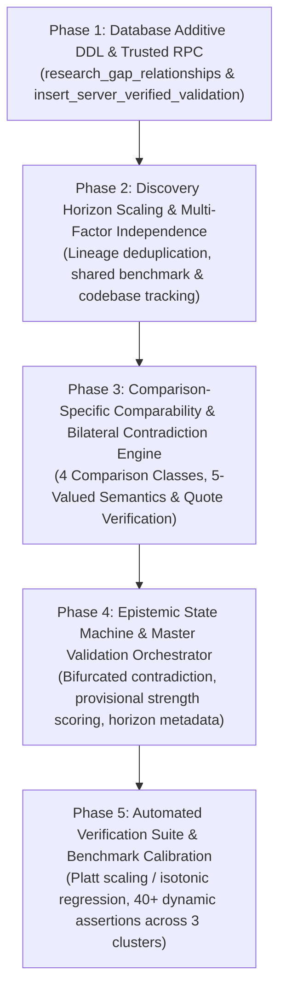

# Anvīkṣā — Stage 4D Implementation Plan & Evaluation Blueprint (Revised)
## Phased Implementation WBS, Dynamic Benchmark Evaluation, Final Consistency Amendment & Architectural Decision Records
### Architecture Specification: Version 4.1.0-REVISED (Stage 4D Final Consistency Amendment)

**Document Version:** 4.1.0-STAGE4D-PLAN-FINAL  
**Status:** ARCHITECTURE FROZEN — IMPLEMENTATION STRICTLY PROHIBITED  
**Milestone:** Stage 4D — Cross-Literature Validation & Contradiction Detection  
**Author:** Principal Supabase PostgreSQL Architect & AI Systems Safety Engineer  
**Date:** 2026-11-18  

---

## 1. Truthful Scope & Live Database Status Disclosure

> [!IMPORTANT]
> **EXPLICIT DATABASE DISCLOSURE:**
> Neither `public.research_gap_relationships` nor any Stage 4D schema modifications have been applied to the live Supabase database (`dtlvtpntmtdmdawupylv`).
> The live database remains strictly at the accepted **Stage 4C** state (`20261118_stage4c_ai_gap_extraction.sql`).
> All DDL and RPC specifications in this document are **PROPOSED DESIGN SPECIFICATIONS ONLY**. No migrations have been created in `supabase/migrations` and no DDL has been executed on the live database.

---

## 2. Pre-Implementation Codebase Readiness Audit

Before any implementation begins, the repository was audited to confirm prerequisite stability:

| Component / Subsystem | Audited State | Readiness Determination |
| :--- | :--- | :---: |
| **Stage 3: Paper Analysis & Comparative Synthesis** | ACCEPTED | Verified intact (`insert_server_verified_analysis` RPC 100% regression safe). |
| **Stage 4A: Literature Knowledge Graph & Schema** | ACCEPTED WITH LIMITATIONS | Verified intact (`research_gaps`, `research_gap_evidence`, `research_relationships` active). |
| **Stage 4B: Literature Corpus Discovery & Ingestion** | ACCEPTED WITH LIMITATIONS | Verified intact (`LiteratureDiscoveryService`, `MultiPaperIngestionService` 37/37 passing). |
| **Stage 4C: AI Gap Extraction & Epistemic Classification** | ACCEPTED WITH LIMITATIONS | Verified intact (40/40 tests passing, 7 truthful statuses, zero-drift offset mapping, DB idempotency). |
| **Canonical Paper Entity** | AUDITED & VERIFIED | `public.research_papers` with primary key `id UUID` verified across schema, migrations, and ingestion service. |
| **Supabase PostgreSQL Schema (`dtlvtpntmtdmdawupylv`)** | LIVE & ACTIVE | `uq_research_gaps_idempotency_key`, RLS triggers active. |
| **AI MoE Inference Hierarchy** | LIVE & TESTED | `gemma-4-26b-a4b-it` primary with fallback to `gemma-4-31b-it` and `gemini-2.5-flash`. |

---

## 3. Architecture Evolution & Final Consistency Amendment Decision Matrix

| Focus Area | Prior Architectural Baseline | Final Consistency Amendment Decision | Scientific & Technical Rationale |
| :--- | :--- | :--- | :--- |
| **1. Canonical Paper Entity** | Proposed `source_paper_id` referencing `public.papers(id)`. | Formally verified and updated to `public.research_papers(id UUID)`. | `public.papers` does not exist; `public.research_papers` is the verified canonical paper table in Stage 4A–4C. |
| **2. Validation-Run Referential Integrity** | Included `validation_run_id TEXT` without FK or used `ON DELETE CASCADE`. | Enforced composite foreign key `(gap_id, validation_run_id)` referencing `public.research_gap_validations(gap_id, validation_run_id) ON DELETE RESTRICT`. | Prevents a relationship associated with one gap from referencing a run belonging to another gap, and guarantees historical validation runs cannot be deleted while relationships exist. |
| **3. Relationship Uniqueness** | Used `COALESCE` with `'00000000-0000-0000-0000-000000000000'` sentinel. | Deployed four discrete partial unique indexes (Gap-to-Gap, Gap-to-Paper, Paper-to-Gap, Paper-to-Paper) and explicit check constraints prohibiting nil UUIDs. | Completely eliminates sentinel collisions and NULL variation bypasses across all PostgreSQL deployments. |
| **4. Gap Archival & Provenance Preservation** | Relied on hard cascading deletion from `research_gaps`. | Added gap soft deletion (`is_archived = true`, `archived_at`). Dedicated audited administrative purge procedure for compliance. | Preserves historical validation outcomes, relationship records, evidence references, and audit history against silent loss. |
| **5. Independent-Replication & Hybrid Path** | Allowed hybrid path without distinct labeling or human review. | Standard path strictly requires $\ge 2$ independent groups. Hybrid path (1 independent + partially dependent) is a distinct, weaker pathway requiring mandatory label `ADDRESSED (HYBRID_EVIDENCE_PATH)` and human review (`requiresHumanReview = true`). | Partially dependent evidence never counts as independent replication. System must never describe hybrid path as meeting 2-group standard. |
| **6. Comparability-Class Routing** | Broad statement that every `INCOMPATIBLE` dimension routes to Class 4. | Fails in Class 1 critical gates downgrade to Class 2 (Related Questions) or Class 3 (Contextual Evidence) when investigating related phenomena; Class 4 reserved for genuinely disjoint tasks or paradigms. | Conforms to scientific epistemology; preserves contextual and negative-audit evidence rather than discarding it. |
| **7. Phase 5 Calibration Methodology** | General protocol with ECE $\le 0.08$ target on 60+ cases. | Formalized target event $Y = \mathbf{1}(\text{Assigned} = \text{Ground Truth})$, validation run unit, cluster-based split, double-blind expert adjudication, 60+ as dev testbed, 200+ for production, and fallback to heuristic warning if ECE target fails. | Guarantees statistical power, eliminates data leakage, and ensures honest representation of calibration as an acceptance target rather than a guaranteed outcome. |

---

## 4. Phased Work Breakdown Structure (WBS)

Upon implementation authorization, work will proceed across five sequential, independently verifiable phases:

### Phase 1: Database Additive DDL & Trusted RPC
- **Scope:** Author `supabase/migrations/20261118_stage4d_validation_infrastructure.sql`.
- **Key Tasks:**
  1. Add `last_validated_at`, `is_archived`, and `archived_at` columns to `public.research_gaps`.
  2. Add `literature_coverage_metadata` JSONB column to `public.research_gap_validations`.
  3. Add composite unique constraint `uq_gap_validations_gap_run` on `public.research_gap_validations(gap_id, validation_run_id)`.
  4. Create dedicated table `public.research_gap_relationships` with composite foreign key `(gap_id, validation_run_id) ON DELETE RESTRICT`, typed FKs to `public.research_papers(id)` (`ON DELETE RESTRICT`), nil UUID prohibition constraints, and four discrete partial unique indexes.
  5. Deploy `insert_server_verified_validation()` plpgsql function with `service_role` security gate and advisory locking.
- **Verification Gate:** Verified via `tests/stage4d_validation_verification.ts` Test Group 1 (live schema check, RPC execution, RLS enforcement).

### Phase 2: Discovery Horizon Scaling & Multi-Factor Independence
- **Scope:** Build `server/sourceIndependenceService.ts` and update `server/literatureDiscoveryService.ts`.
- **Key Tasks:**
  1. Implement publication lineage resolution (preprint-to-journal matching).
  2. Implement strict independent-replication classification (`INDEPENDENT`, `PARTIALLY_DEPENDENT`, `DEPENDENT`, `INDEPENDENCE_UNKNOWN`).
  3. Detect shared benchmark splits and shared forked codebases; enforce that two partially dependent studies do not equal an independent replication.
  4. Implement adaptive horizon expansion triggers (zero forward citation yield, missing key baselines, borderline ambiguity).
- **Verification Gate:** Tested on synthetic and real OpenAlex bibliometric networks with missing and complete metadata.

### Phase 3: Comparison-Specific Comparability & Bilateral Contradiction Engine
- **Scope:** Build `server/methodologicalComparabilityEngine.ts` and `server/contradictionDetectionService.ts`.
- **Key Tasks:**
  1. Implement Four Evidence Comparison Classes (Direct Empirical, Related Questions, Contextual/Theoretical, Incommensurable) with nuanced routing.
  2. Implement Five-Valued Missing Data Semantics (`VERIFIED_COMPATIBLE`, `INCOMPATIBLE`, `NOT_REPORTED`, `UNKNOWN`, `NOT_APPLICABLE`).
  3. Implement Tier 1 Critical Compatibility Gates with Operational Research Question Alignment.
  4. Implement bilateral verbatim quotation slicing with 0-based code-point offset verification on both seed and validation chunks.
- **Verification Gate:** Tested across 10 positive, negative, and incommensurable comparability pairs.

### Phase 4: Epistemic State Machine & Master Validation Orchestrator
- **Scope:** Build `server/crossLiteratureValidationService.ts` and register REST endpoints in `server.ts`.
- **Key Tasks:**
  1. Implement deterministic decision waterfall for validation outcomes (`CONFIRMED_UNRESOLVED`, `PARTIALLY_ADDRESSED`, `ADDRESSED`, `CONTRADICTED`, `INSUFFICIENT_EVIDENCE`).
  2. Implement distinct evidential pathways for `ADDRESSED` (Standard Path vs Hybrid Path requiring human review vs Landmark Path).
  3. Implement bifurcated contradiction semantics (inter-paper empirical dispute vs gap premise falsification).
  4. Implement provisional validation strength scoring ($S_{val}$) with non-linear contradiction dampening and evaluation-date recency ($T_{eval}$).
  5. Assemble comprehensive `LiteratureCoverageMetadata` payload with `corpusHash`.
  6. Add `/api/research/gaps/validate` and `/api/research/gaps/validate-batch` routes.
- **Verification Gate:** Verified end-to-end with live Supabase persistence and audit logging.

### Phase 5: Dynamic Benchmark Evaluation & Empirical Calibration
- **Scope:** Build `tests/stage4d_validation_verification.ts` and execute empirical calibration and evaluation across the 3 scientific benchmark clusters.
- **Key Tasks:**
  1. Author 40+ automated test assertions.
  2. Run dynamic evaluation testing both validation outcomes and epistemic abstention (`INSUFFICIENT_EVIDENCE`).
  3. Execute empirical calibration protocol (target event $Y = \mathbf{1}(\text{Assigned} = \text{Ground Truth})$, cluster-based split, target ECE $\le 0.08$ with heuristic fallback).
  4. Execute multi-stage regression suite (Stage 3, Stage 4A, Stage 4B, Stage 4C, lint, build).
- **Verification Gate:** 100% test pass rate with zero regressions.

---

## 5. Dynamic Benchmark Evaluation Plan (Testing Validation & Abstention)

The validation engine must **dynamically derive** its findings from scholarly text rather than relying on hardcoded heuristics. The three approved benchmark clusters evaluate both correct validation outcomes and appropriate epistemic abstention (`INSUFFICIENT_EVIDENCE`):

### Cluster 1: FlashAttention and Mamba
- **Primary Research Question:** Does selective state-space sequence modeling (Mamba) eliminate the memory complexity limitations of Transformer attention without sacrificing full-context associative recall?
- **Key Literature Corpus:**
  - Seed Paper 1: *Attention Is All You Need* (Vaswani et al., 2017) — $O(N^2)$ memory bottleneck.
  - Seed Paper 2: *FlashAttention: Fast and Memory-Efficient Exact Attention with IO-Awareness* (Dao et al., 2022) — Exact attention via SRAM tiling.
  - Validation Paper 1: *Mamba: Linear-Time Sequence Modeling with Selective State Spaces* (Gu & Dao, 2023) — Linear $O(N)$ inference throughput.
  - Validation Paper 2: *An Empirical Analysis of Mamba on Associative Recall* (2024) — Documents state-compression failure on dense multi-query associative recall tasks.
- **Dynamic Evaluation Test Cases:**
  - *Case 1.1 (Positive Partial Resolution):* Tests Mamba against quadratic memory on language modeling $\to$ Dynamically evaluates to `PARTIALLY_ADDRESSED` (solves linear inference on continuous text).
  - *Case 1.2 (Scope Boundary Delineation):* Tests Mamba against dense in-context retrieval requiring pairwise attention $\to$ Identifies remaining unaddressed gap condition.
  - *Case 1.3 (Negative Contradiction Separation):* Confirms FlashAttention and Mamba are NOT classified as contradictory because IO-aware exact tiling and selective SSMs represent orthogonal algorithmic paradigms.
  - *Case 1.4 (Epistemic Abstention / Insufficient Evidence):* Evaluates an experimental Mamba variant with paywalled or missing experimental sections $\to$ Engine must abstain and return `INSUFFICIENT_EVIDENCE` with discounted confidence.

### Cluster 2: Graph Neural Networks & Graph Transformers
- **Primary Research Question:** Does global attention in Graph Transformers resolve oversquashing and 1-WL expressiveness bottlenecks in Message-Passing Neural Networks (MPNNs)?
- **Key Literature Corpus:**
  - Seed Paper: *On the Bottleneck of Graph Neural Networks and Its Practical Implications* (Alon & Yahav, 2021) — Oversquashing over graph diameter.
  - Validation Paper 1: *Do Transformers Really Perform Badly for Graph Representation?* (Ying et al., NeurIPS 2021 — Graphormer) — Global attention across all node pairs.
  - Validation Paper 2: *A Recipe for General Purpose Graph Transformers* (Rampášek et al., 2022) — Scaling trade-offs on large graphs.
- **Dynamic Evaluation Test Cases:**
  - *Case 2.1 (Partial Addressing):* Graphormer resolves diameter oversquashing on small molecular graphs ($|V| \le 100$) $\to$ `PARTIALLY_ADDRESSED`.
  - *Case 2.2 (Remaining Scaling Limitation):* Identifies quadratic $O(|V|^2)$ memory bottleneck on large-scale graphs ($|V| > 100\text{k}$) where MPNNs with neighborhood sampling remain mandatory.
  - *Case 2.3 (Epistemic Abstention on Incommensurable Setup):* Evaluates a paper testing graph generative models rather than node/graph classification $\to$ Fails Gate 1/Gate 2; routed to contextual evidence, returning `INSUFFICIENT_EVIDENCE` for direct resolution.

### Cluster 3: LoRA & Full Fine-Tuning
- **Primary Research Question:** Does low-rank parameter adaptation achieve empirical parity with full-parameter fine-tuning without task-transfer capacity degradation?
- **Key Literature Corpus:**
  - Seed Paper: *LoRA: Low-Rank Adaptation of Large Language Models* (Hu et al., 2021) — Parameter efficiency via low-rank matrices.
  - Validation Paper 1: *An Empirical Study of Parameter-Efficient Fine-Tuning* (2023) — Evaluates cross-task generalization.
  - Validation Paper 2: *When Low-Rank Adaptation Fails: Capacity Constraints in Continual Learning* (2024) — Documents catastrophic forgetting under sequential domain shift.
- **Dynamic Evaluation Test Cases:**
  - *Case 3.1 (Addressed within Characterized Scope):* Low-rank adaptation succeeds on single-task transfer $\to$ `ADDRESSED` (within parameter-efficient fine-tuning scope).
  - *Case 3.2 (Scope Restriction & Counter-Evidence):* Continual learning domain shift reveals capacity bottlenecks $\to$ `PARTIALLY_ADDRESSED`.
  - *Case 3.3 (Epistemic Abstention on Sparse Horizon):* Evaluates low-rank adaptation on a newly proposed hardware accelerator with only 1 preliminary preprint $\to$ Correctly triggers epistemic abstention (`INSUFFICIENT_EVIDENCE`).

---

## 6. Architectural Decision Records (ADRs)

| ADR # | Topic | Original Design | Identified Weakness | Final Amended Decision | Scientific Justification | Remaining Uncertainty |
| :---: | :--- | :--- | :--- | :--- | :--- | :--- |
| **ADR-01** | Methodological Comparability, Missing Data & Nuanced Routing | Single weighted average $R_{comp} \in [0, 1]$. | Missing info was treated as empirical conflict, or every difference was dumped to Class 4. | Comparison-Specific Gates: Four explicit evidence classes (Direct, Related, Contextual, Incommensurable) with Five-Valued Missing Data Semantics (`VERIFIED_COMPATIBLE`, `INCOMPATIBLE`, `NOT_REPORTED`, `UNKNOWN`, `NOT_APPLICABLE`). Fails in Class 1 downgrade to Class 2/3 when addressing related questions; Class 4 strictly reserved for genuinely disjoint tasks. | Conforms to scientific epistemology; operational question alignment avoids rigid string-matching while preventing missing data from falsely asserting negative results and preserving contextual evidence. | Prompt extraction reliability for metric definitions; mitigated by bilateral verbatim quote verification. |
| **ADR-02** | Incommensurable Evidence Retention | Incommensurable papers excluded from evidence. | Discarded valuable contextual, theoretical, or scope-delineating evidence. | Contextual Evidence Router: Incommensurable papers retained in evidence graph with `'tests'` or `'extends'` edges, but disqualified from direct contradiction decisions. Class 4 retained as `'incommensurable_context'`. | Non-comparable papers still contribute to understanding the boundaries of a scientific field. | Distinguishing purely irrelevant papers from methodologically incommensurable contextual papers. |
| **ADR-03** | Source Independence, Replication & Hybrid Path | Author Jaccard similarity and institution matching. | Preprint duplicates counted as independent confirmations; shared benchmark splits masked correlated noise. | Multi-factor model: Publication lineage deduplication, shared benchmark splits, codebase tracking, and strict rule that two partially dependent studies DO NOT equal an independent replication. Pathway B (Hybrid Path: 1 independent + partially dependent) explicitly labeled and requires human review. | Eliminates citation echo chambers and shared benchmark test splits from masquerading as independent replication. System must never describe hybrid path as meeting 2-group standard. | Funding data is frequently missing in open-access PDFs; funding checks are optional when metadata is unavailable. |
| **ADR-04** | Scoring vs Calibration & Phase 5 Protocol | Heuristic linear sum claimed as calibrated probability. | Deterministic scoring was confused with empirical Bayesian posterior probabilities. | Renamed to `PROVISIONAL_VALIDATION_STRENGTH` ($S_{val} \in [0, 10]$). Specified rigorous Phase 5 protocol defining target event $Y = \mathbf{1}(\text{Assigned} = \text{Ground Truth})$, validation run unit, cluster-based split, and acceptance target ECE $\le 0.08$ with fallback to heuristic warning. | Honest epistemological representation; heuristic scores must be calibrated against real benchmarks before claiming to be probabilities. | Calibration dataset requires expert consensus annotation across 200+ benchmark items for production deployment. |
| **ADR-05** | `ADDRESSED` Outcome Semantics & Landmark Claims | Universal definitions and arbitrary 3-year requirement. | Finite search cannot prove absence across all literature; widespread adoption was conflated with scientific resolution. | Removed 3-year rule. Defined `ADDRESSED` through scope, comparability, independent replication, and counter-evidence queries. Permitted single landmark result path requiring independently verifiable empirical artifacts (code, checkpoints, benchmark harness) and human review flag. Clarified widespread adoption alone is never proof. | Replaces arbitrary time heuristics with scientific verification standards; popularity alone is never empirical proof. | Human review escalation workflow integration in Stage 4F UI. |
| **ADR-06** | Contradiction Bifurcation | Single `CONTRADICTED` outcome on the gap. | Conflated empirical disagreement between papers with proof that the candidate gap does not exist. | Bifurcated semantics: Inter-paper empirical dispute recorded as graph edge `'contradicts'`; gap outcome `CONTRADICTED` reserved for direct falsification of gap premise. | A gap often documents an active controversy; two papers disagreeing proves the gap is an open, unresolved question! | Threshold for determining when empirical conflict invalidates the gap premise vs highlighting an open question. |
| **ADR-07** | Canonical Entity, Composite Run Integrity & Partial Uniqueness | Proposed `source_paper_id` referencing non-existent `public.papers`. | PostgreSQL cannot enforce native FKs across polymorphic columns, and `public.papers` was incorrect; cascaded deletions threatened provenance. | Dedicated additive table `public.research_gap_relationships` referencing verified canonical table `public.research_papers(id)` (`ON DELETE RESTRICT`) and composite foreign key `(gap_id, validation_run_id) ON DELETE RESTRICT`. Four partial unique indexes and nil UUID prohibition. Soft deletion via `is_archived`. Truthfully disclosed that table is proposed only. | Enforces 100% database-level referential integrity without touching Stage 4A schema, eliminates sentinel collisions, and prevents silent loss of validation provenance. | Minor table footprint expansion; fully isolated with composite foreign keys. |

---

## 7. Explicit Acceptance Criteria & Quality Gates

Stage 4D acceptance requires satisfying five objective, automated quality gates:

1. **Admissibility Gate Invariant:**
   - 100% of evidence items used to substantiate validation outcomes must pass Tier A Admissibility Gates.
   - Zero unverified quotations (`FAILED_VERIFICATION`) or incommensurable studies may enter the direct validation decision payload.
2. **Bilateral Grounding Invariant:**
   - 100% of contradiction decisions must possess bilateral verbatim quotations with verified 0-based code-point offsets in both the seed and validation papers.
   - Slicing canonical text at $[rawStart, rawEnd)$ must exactly reproduce the stored raw slice.
3. **Horizon Provenance & Reproducibility Gate:**
   - 100% of validation runs must persist a complete `literature_coverage_metadata` payload containing chunk IDs, section distributions, discovery queries, retrieval failure logs, and cryptographic `corpusHash`.
4. **Strongly-Typed Relationship & Security Gate:**
   - All mutations execute through `insert_server_verified_validation()`. Direct client inserts must fail with PostgreSQL `42501 permission denied`.
   - Dedicated relationship edges in `public.research_gap_relationships` must enforce strongly-typed foreign keys to `public.research_papers(id)` (`ON DELETE RESTRICT`), composite run FK `(gap_id, validation_run_id) ON DELETE RESTRICT`, four partial unique indexes, nil UUID prohibition, and non-null check constraints.
5. **Multi-Stage Zero Regression Gate:**
   - Stage 3 comparative analysis RPC: HTTP 200.
   - Stage 4A database security suite: 28 / 28 PASSED.
   - Stage 4B discovery & ingestion suite: 37 / 37 PASSED.
   - Stage 4C extraction suite: 40 / 40 PASSED.
   - TypeScript compiler (`tsc --noEmit`) and Vite build: 0 errors.

---

## 8. Final Architecture Status & Remaining Decisions

### Final Architecture Determination
$$\mathbf{STATUS: \ STAGE \ 4D \ ARCHITECTURE \ FROZEN \ — \ AWAITING \ EXPLICIT \ IMPLEMENTATION \ AUTHORIZATION}$$

All remaining integrity, referential, scientific, and calibration ambiguities across canonical entity identification, validation-run foreign key enforcement, partial unique index construction, provenance preservation via soft deletion, strict independent replication and hybrid-path semantics, nuanced comparability routing, and Phase 5 calibration have been rigorously corrected. The architecture is frozen and ready for implementation upon authorization.

### Remaining Open Decisions for User Confirmation
1. **Human Review Notification Channel:**
   - *Design Proposal:* High-impact empirical contradictions, hybrid-path resolutions, and single-landmark `ADDRESSED` claims set `requiresHumanReview = true` in the validation record and emit an audit alert.
   - *Confirmation Requested:* Confirm preference to surface escalation alerts in the audit log during Stage 4D, and build a dedicated user review queue UI in Stage 4F. *(Recommendation: Proceed with audit-log alert in 4D; deliver UI badge/queue in 4F).*
2. **Calibration Dataset Scaling Path:**
   - *Design Proposal:* Initial Phase 5 development testing executes against the 60+ benchmark cases across FlashAttention/Mamba, GNNs, and LoRA; production enablement of calibrated probabilities is gated behind assembling the full 200+ case multi-disciplinary dataset.
   - *Confirmation Requested:* Confirm this two-stage empirical calibration roadmap. *(Recommendation: Highly recommended; ensures statistical power and prevents premature probability emission).*
