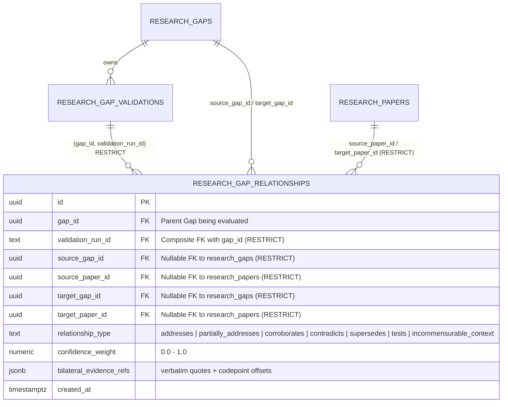

# Anvīkṣā — Stage 4D Security, Persistence & Provenance Architecture (Revised)
## Canonical Paper Referential Integrity, Composite Validation-Run Keys, Partial Unique Indexes, Soft Deletion & Immutable Provenance
### Architecture Specification: Version 4.1.0-REVISED (Stage 4D Final Consistency Amendment)

**Document Version:** 4.1.0-STAGE4D-SEC-FINAL  
**Status:** ARCHITECTURE FROZEN — IMPLEMENTATION STRICTLY PROHIBITED  
**Milestone:** Stage 4D — Cross-Literature Validation & Contradiction Detection  
**Author:** Principal Supabase PostgreSQL Architect & AI Systems Safety Engineer  
**Date:** 2026-11-18  

---

## 1. Truthful Scope & Live Database Status Disclosure

> [!IMPORTANT]
> **EXPLICIT DATABASE DISCLOSURE:**
> Neither `public.research_gap_relationships` nor any Stage 4D schema modifications have been applied to the live Supabase database (`dtlvtpntmtdmdawupylv`).
> The live database remains strictly at the accepted **Stage 4C** state (`20261118_stage4c_ai_gap_extraction.sql`).
> All DDL and RPC specifications in this document are **PROPOSED DESIGN SPECIFICATIONS ONLY**. No migrations have been created in `supabase/migrations` and no DDL has been executed on the live database.

---

## 2. Canonical Paper Table Verification & Referential Integrity

### 2.1 Codebase & Schema Verification of Canonical Paper Entity
An audit of the existing Stage 4A, Stage 4B, and Stage 4C implementation and schema files was performed to identify the canonical paper table:
- In `supabase/schema.sql` (Line 56):
  `CREATE TABLE IF NOT EXISTS public.research_papers ( id UUID PRIMARY KEY DEFAULT gen_random_uuid(), ... )`
- In `supabase/migrations/20261118_stage4a_literature_knowledge_graph.sql` (Line 105):
  `paper_id UUID REFERENCES public.research_papers(id) ON DELETE CASCADE`
- In `server/multiPaperIngestionService.ts` (Lines 35, 206, 218):
  The literature ingestion pipeline idempotently persists and queries papers in `public.research_papers`.

**Definitive Architectural Determination:**
The canonical paper table in Anvīkṣā is **`public.research_papers`** with primary key **`id UUID`**.
There is no `public.papers` table in the database; all references in earlier drafts to `public.papers` were drafting discrepancies and are now formally corrected to `public.research_papers`.

---

## 3. Dedicated Gap Relationships Table with Composite Validation-Run Referential Integrity

### 3.1 Composite Foreign Key Enforcement: `(gap_id, validation_run_id)`
To guarantee that every relationship record belongs to a real, verified validation run and that a relationship associated with one gap cannot reference a validation run belonging to another gap, the schema enforces a **composite foreign key**:
- The parent table `public.research_gap_validations` is extended with a unique constraint:
  `UNIQUE (gap_id, validation_run_id)`
- The relationship table `public.research_gap_relationships` enforces:
  `FOREIGN KEY (gap_id, validation_run_id) REFERENCES public.research_gap_validations(gap_id, validation_run_id) ON DELETE RESTRICT`
- `ON DELETE RESTRICT` guarantees that a validation run cannot be deleted while relationship evidence exists, preserving the immutability of historical validation snapshots.
- Both columns share identical types: `gap_id UUID NOT NULL` and `validation_run_id TEXT NOT NULL`.

### 3.2 Provenance Preservation & Soft Deletion Architecture
A critical scientific safety requirement is preventing accidental deletions from silently cascading and destroying historical validation evidence:
1. **Paper Provenance Preservation (`ON DELETE RESTRICT`):**
   - `source_paper_id` and `target_paper_id` use **`ON DELETE RESTRICT`**. A paper in `public.research_papers` that forms part of an active research gap relationship graph cannot be hard-deleted.
   - If a paper is retracted, superseded, or corrected, it is flagged via metadata (`is_retracted = true` or `retraction_status = 'DISQUALIFIED_RETRACTED'`), preserving historical provenance without breaking referential integrity.
2. **Gap Archival & Soft Deletion over Hard Deletion:**
   - Research gaps support soft deletion via `is_archived = true` and `archived_at TIMESTAMPTZ`. Soft-deleted gaps retain all historical validation runs, relationship edges, and audit records.
   - If a hard deletion is legally or operationally required (e.g. GDPR right-to-be-forgotten on private user uploads), a dedicated administrative procedure `purge_archived_research_gap()` executes under strict administrative oversight, recording the deletion reason in an immutable purge log.
3. **Validation Run Immutability:**
   - Validation runs are append-only. Each validation execution generates a new `validation_run_id`, preserving past runs intact.

### 3.3 Exact Relationship Uniqueness & Elimination of Sentinel Collisions
Earlier drafts proposed a `COALESCE` index using the nil UUID sentinel `'00000000-0000-0000-0000-000000000000'`. To guarantee that no sentinel collisions can ever occur and that duplicate relationships cannot be inserted through `NULL` variations, Stage 4D specifies:
1. **Nil UUID Prohibition Constraints:**
   Explicit check constraints forbid the nil UUID sentinel from ever being used as an entity identifier:
   `CHECK (source_gap_id <> '00000000-0000-0000-0000-000000000000'::uuid)`
   `CHECK (source_paper_id <> '00000000-0000-0000-0000-000000000000'::uuid)`
   `CHECK (target_gap_id <> '00000000-0000-0000-0000-000000000000'::uuid)`
   `CHECK (target_paper_id <> '00000000-0000-0000-0000-000000000000'::uuid)`
2. **Four Dedicated Partial Unique Indexes:**
   Because each relationship edge represents one of four mutually exclusive typed pairings, uniqueness is enforced through four discrete partial unique indexes with zero `NULL` ambiguity:
   - *Index 1 (Gap $\to$ Gap):* `(gap_id, validation_run_id, source_gap_id, target_gap_id, relationship_type) WHERE source_gap_id IS NOT NULL AND target_gap_id IS NOT NULL`
   - *Index 2 (Gap $\to$ Paper):* `(gap_id, validation_run_id, source_gap_id, target_paper_id, relationship_type) WHERE source_gap_id IS NOT NULL AND target_paper_id IS NOT NULL`
   - *Index 3 (Paper $\to$ Gap):* `(gap_id, validation_run_id, source_paper_id, target_gap_id, relationship_type) WHERE source_paper_id IS NOT NULL AND target_gap_id IS NOT NULL`
   - *Index 4 (Paper $\to$ Paper):* `(gap_id, validation_run_id, source_paper_id, target_paper_id, relationship_type) WHERE source_paper_id IS NOT NULL AND target_paper_id IS NOT NULL`

This guarantees mathematical uniqueness: no duplicate edge can be inserted under any combination of non-null IDs or `NULL` representations.

### 3.4 Strongly-Typed Entity Architecture (ADR-4D-07)



### 3.5 Proposed Additive Migration DDL

```sql
-- ====================================================================
-- Anvīkṣā — Stage 4D Additive Migration: Validation Infrastructure & Dedicated Relationships
-- Version: 4.1.0-REVISED (Stage 4D Final Consistency Amendment)
-- Safety: ADDITIVE ONLY, NON-DESTRUCTIVE, PRESERVES EXISTING TABLES & RLS
-- NOTE: PROPOSED DESIGN ONLY — DO NOT APPLY UNTIL FORMALLY AUTHORIZED
-- ====================================================================

-- 1. Add archival and validation tracking to public.research_gaps
ALTER TABLE public.research_gaps 
    ADD COLUMN IF NOT EXISTS last_validated_at TIMESTAMPTZ,
    ADD COLUMN IF NOT EXISTS is_archived BOOLEAN NOT NULL DEFAULT false,
    ADD COLUMN IF NOT EXISTS archived_at TIMESTAMPTZ;

-- 2. Add literature_coverage_metadata to public.research_gap_validations
ALTER TABLE public.research_gap_validations 
    ADD COLUMN IF NOT EXISTS literature_coverage_metadata JSONB NOT NULL DEFAULT '{}'::jsonb;

-- 3. Add composite unique constraint to public.research_gap_validations
-- Required as target for composite foreign key from public.research_gap_relationships
DO $$
BEGIN
    IF NOT EXISTS (
        SELECT 1 FROM pg_constraint WHERE conname = 'uq_gap_validations_gap_run'
    ) THEN
        ALTER TABLE public.research_gap_validations 
            ADD CONSTRAINT uq_gap_validations_gap_run UNIQUE (gap_id, validation_run_id);
    END IF;
END $$;

-- 4. Dedicated Additive Table: public.research_gap_relationships
CREATE TABLE IF NOT EXISTS public.research_gap_relationships (
    id UUID PRIMARY KEY DEFAULT gen_random_uuid(),
    gap_id UUID NOT NULL,
    validation_run_id TEXT NOT NULL,
    
    -- Explicit typed foreign keys for Source Entity (RESTRICT on paper to preserve evidence)
    source_gap_id UUID REFERENCES public.research_gaps(id) ON DELETE RESTRICT,
    source_paper_id UUID REFERENCES public.research_papers(id) ON DELETE RESTRICT,
    
    -- Explicit typed foreign keys for Target Entity (RESTRICT on paper to preserve evidence)
    target_gap_id UUID REFERENCES public.research_gaps(id) ON DELETE RESTRICT,
    target_paper_id UUID REFERENCES public.research_papers(id) ON DELETE RESTRICT,
    
    relationship_type TEXT NOT NULL CHECK (relationship_type IN (
        'identifies_limitation',
        'addresses',
        'partially_addresses',
        'corroborates',
        'contradicts',
        'supersedes',
        'tests',
        'incommensurable_context'
    )),
    
    confidence_weight NUMERIC CHECK (confidence_weight >= 0.0 AND confidence_weight <= 1.0),
    bilateral_evidence_refs JSONB NOT NULL DEFAULT '[]'::jsonb,
    created_at TIMESTAMPTZ NOT NULL DEFAULT timezone('utc'::text, now()),

    -- Composite Foreign Key to research_gap_validations:
    -- Guarantees validation_run_id belongs strictly to the associated gap_id.
    -- Uses ON DELETE RESTRICT to guarantee historical validation runs cannot be deleted while relationships exist!
    CONSTRAINT fk_gap_rel_validation_run 
        FOREIGN KEY (gap_id, validation_run_id) 
        REFERENCES public.research_gap_validations(gap_id, validation_run_id) 
        ON DELETE RESTRICT,

    -- Non-Compensatory Mutually Exclusive Entity Constraints
    CONSTRAINT chk_source_entity CHECK (num_nonnulls(source_gap_id, source_paper_id) = 1),
    CONSTRAINT chk_target_entity CHECK (num_nonnulls(target_gap_id, target_paper_id) = 1),

    -- Explicit Prohibition of Nil UUID Sentinel
    CONSTRAINT chk_source_gap_not_nil CHECK (source_gap_id IS NULL OR source_gap_id <> '00000000-0000-0000-0000-000000000000'::uuid),
    CONSTRAINT chk_source_paper_not_nil CHECK (source_paper_id IS NULL OR source_paper_id <> '00000000-0000-0000-0000-000000000000'::uuid),
    CONSTRAINT chk_target_gap_not_nil CHECK (target_gap_id IS NULL OR target_gap_id <> '00000000-0000-0000-0000-000000000000'::uuid),
    CONSTRAINT chk_target_paper_not_nil CHECK (target_paper_id IS NULL OR target_paper_id <> '00000000-0000-0000-0000-000000000000'::uuid),

    -- Self-Reference Prevention Constraints
    CONSTRAINT chk_no_self_gap_relationship CHECK (
        NOT (source_gap_id IS NOT NULL AND target_gap_id IS NOT NULL AND source_gap_id = target_gap_id)
    ),
    CONSTRAINT chk_no_self_paper_relationship CHECK (
        NOT (source_paper_id IS NOT NULL AND target_paper_id IS NOT NULL AND source_paper_id = target_paper_id)
    )
);

-- 5. Four Discrete Partial Unique Indexes (Guarantees zero NULL ambiguity / sentinel collisions)
CREATE UNIQUE INDEX IF NOT EXISTS idx_uniq_gap_rel_gap_gap 
    ON public.research_gap_relationships (gap_id, validation_run_id, source_gap_id, target_gap_id, relationship_type)
    WHERE source_gap_id IS NOT NULL AND target_gap_id IS NOT NULL;

CREATE UNIQUE INDEX IF NOT EXISTS idx_uniq_gap_rel_gap_paper 
    ON public.research_gap_relationships (gap_id, validation_run_id, source_gap_id, target_paper_id, relationship_type)
    WHERE source_gap_id IS NOT NULL AND target_paper_id IS NOT NULL;

CREATE UNIQUE INDEX IF NOT EXISTS idx_uniq_gap_rel_paper_gap 
    ON public.research_gap_relationships (gap_id, validation_run_id, source_paper_id, target_gap_id, relationship_type)
    WHERE source_paper_id IS NOT NULL AND target_gap_id IS NOT NULL;

CREATE UNIQUE INDEX IF NOT EXISTS idx_uniq_gap_rel_paper_paper 
    ON public.research_gap_relationships (gap_id, validation_run_id, source_paper_id, target_paper_id, relationship_type)
    WHERE source_paper_id IS NOT NULL AND target_paper_id IS NOT NULL;

-- 6. Lookup & Performance Indexes
CREATE INDEX IF NOT EXISTS idx_gap_rel_gap_id ON public.research_gap_relationships (gap_id);
CREATE INDEX IF NOT EXISTS idx_gap_rel_composite_run ON public.research_gap_relationships (gap_id, validation_run_id);
CREATE INDEX IF NOT EXISTS idx_gap_rel_source_gap ON public.research_gap_relationships (source_gap_id) WHERE source_gap_id IS NOT NULL;
CREATE INDEX IF NOT EXISTS idx_gap_rel_source_paper ON public.research_gap_relationships (source_paper_id) WHERE source_paper_id IS NOT NULL;
CREATE INDEX IF NOT EXISTS idx_gap_rel_target_gap ON public.research_gap_relationships (target_gap_id) WHERE target_gap_id IS NOT NULL;
CREATE INDEX IF NOT EXISTS idx_gap_rel_target_paper ON public.research_gap_relationships (target_paper_id) WHERE target_paper_id IS NOT NULL;
CREATE INDEX IF NOT EXISTS idx_gap_validations_composite ON public.research_gap_validations (gap_id, validation_run_id);
CREATE INDEX IF NOT EXISTS idx_research_gaps_last_validated ON public.research_gaps (last_validated_at);
```

---

## 4. Server-Side Trusted Validation RPC: `insert_server_verified_validation`

All multi-paper validation outcomes, horizon metadata, and graph relationships are persisted atomically through a single PostgreSQL `SECURITY DEFINER` function with strict `service_role` authorization.

### 4.1 Rerun Semantics & Idempotency
- When a gap is validated again (e.g. after newly ingested literature), the RPC generates a new, unique `validation_run_id` (e.g. `VAL-YYYYMMDD-HH24MISS-<gap_id_prefix>`).
- New relationship records are inserted referencing the new `(gap_id, validation_run_id)`.
- Existing relationships from prior validation runs remain completely untouched and queryable via their respective historical `validation_run_id`, preserving full historical auditability.
- Within a single run, repeated insertions of an identical relationship edge trigger `ON CONFLICT DO NOTHING` across the partial unique indexes, guaranteeing idempotent execution.

### 4.2 Complete Plpgsql RPC Implementation

```sql
CREATE OR REPLACE FUNCTION public.insert_server_verified_validation(
    p_gap_id UUID,
    p_validation_outcome public.validation_outcome,
    p_new_epistemic_classification public.epistemic_classification,
    p_confidence_score NUMERIC,
    p_reasoning_summary TEXT,
    p_model_attribution TEXT,
    p_literature_coverage_timestamp TIMESTAMPTZ,
    p_supporting_evidence_references JSONB DEFAULT '[]'::jsonb,
    p_contradictory_evidence_references JSONB DEFAULT '[]'::jsonb,
    p_previously_addressed_research_references JSONB DEFAULT '[]'::jsonb,
    p_literature_coverage_metadata JSONB DEFAULT '{}'::jsonb,
    p_gap_relationships JSONB DEFAULT '[]'::jsonb,
    p_new_evidence_items JSONB DEFAULT '[]'::jsonb,
    p_search_methodology_version TEXT DEFAULT '4.1.0-multi-vector-discovery'
)
RETURNS UUID
LANGUAGE plpgsql
SECURITY DEFINER
SET search_path = public, pg_temp
AS $$
DECLARE
    v_validation_id UUID;
    v_prev_classification public.epistemic_classification;
    v_prev_outcome public.validation_outcome;
    v_val_run_id TEXT;
    v_rel RECORD;
    v_ev RECORD;
BEGIN
    -- 1. Security Check: Service Role Only
    IF auth.role() IS DISTINCT FROM 'service_role' THEN
        RAISE EXCEPTION 'Access denied: insert_server_verified_validation requires service_role'
            USING ERRCODE = '42501';
    END IF;

    -- 2. Input Sanity Checks
    IF p_gap_id IS NULL THEN
        RAISE EXCEPTION 'p_gap_id cannot be null' USING ERRCODE = '23502';
    END IF;

    IF p_confidence_score < 0.0 OR p_confidence_score > 10.0 THEN
        RAISE EXCEPTION 'Confidence score must be between 0.0 and 10.0, received %', p_confidence_score
            USING ERRCODE = '22003';
    END IF;

    -- 3. Lock Research Gap Row for Atomicity
    SELECT current_epistemic_classification, current_validation_outcome
    INTO v_prev_classification, v_prev_outcome
    FROM public.research_gaps
    WHERE id = p_gap_id
    FOR UPDATE;

    IF NOT FOUND THEN
        RAISE EXCEPTION 'Research gap with ID % does not exist', p_gap_id USING ERRCODE = 'P0002';
    END IF;

    -- 4. Generate Deterministic Validation Run ID
    v_val_run_id := 'VAL-' || to_char(timezone('utc'::text, now()), 'YYYYMMDD-HH24MISS') || '-' || substr(p_gap_id::text, 1, 8);

    -- 5. Insert Validation Run Record (Generates unique entry for composite FK)
    INSERT INTO public.research_gap_validations (
        gap_id,
        validation_outcome,
        confidence_score,
        reasoning_summary,
        model_attribution,
        supporting_evidence_references,
        contradictory_evidence_references,
        previously_addressed_research_references,
        search_methodology_version,
        literature_coverage_timestamp,
        validation_run_id,
        literature_coverage_metadata
    ) VALUES (
        p_gap_id,
        p_validation_outcome,
        p_confidence_score,
        p_reasoning_summary,
        p_model_attribution,
        p_supporting_evidence_references,
        p_contradictory_evidence_references,
        p_previously_addressed_research_references,
        p_search_methodology_version,
        p_literature_coverage_timestamp,
        v_val_run_id,
        p_literature_coverage_metadata
    ) RETURNING id INTO v_validation_id;

    -- 6. Insert Strongly-Typed Relationships with Composite FK
    IF jsonb_array_length(p_gap_relationships) > 0 THEN
        FOR v_rel IN SELECT * FROM jsonb_to_recordset(p_gap_relationships) AS x(
            source_gap_id UUID,
            source_paper_id UUID,
            target_gap_id UUID,
            target_paper_id UUID,
            relationship_type TEXT,
            confidence_weight NUMERIC,
            bilateral_evidence_refs JSONB
        )
        LOOP
            INSERT INTO public.research_gap_relationships (
                gap_id,
                validation_run_id,
                source_gap_id,
                source_paper_id,
                target_gap_id,
                target_paper_id,
                relationship_type,
                confidence_weight,
                bilateral_evidence_refs
            ) VALUES (
                p_gap_id,
                v_val_run_id,
                v_rel.source_gap_id,
                v_rel.source_paper_id,
                v_rel.target_gap_id,
                v_rel.target_paper_id,
                v_rel.relationship_type,
                v_rel.confidence_weight,
                COALESCE(v_rel.bilateral_evidence_refs, '[]'::jsonb)
            )
            ON CONFLICT DO NOTHING;
        END LOOP;
    END IF;

    -- 7. Insert New Bilateral Evidence Items referencing public.research_papers
    IF jsonb_array_length(p_new_evidence_items) > 0 THEN
        FOR v_ev IN SELECT * FROM jsonb_to_recordset(p_new_evidence_items) AS y(
            paper_id UUID,
            chunk_id INTEGER,
            quote TEXT,
            raw_start_offset INTEGER,
            raw_end_offset INTEGER,
            normalized_start_offset INTEGER,
            normalized_end_offset INTEGER,
            source_context_type TEXT,
            epistemic_class TEXT,
            verification_status TEXT
        )
        LOOP
            INSERT INTO public.research_gap_evidence (
                gap_id,
                paper_id,
                chunk_id,
                quote,
                raw_start_offset,
                raw_end_offset,
                normalized_start_offset,
                normalized_end_offset,
                source_context_type,
                epistemic_class,
                verification_status
            ) VALUES (
                p_gap_id,
                v_ev.paper_id,
                v_ev.chunk_id,
                v_ev.quote,
                v_ev.raw_start_offset,
                v_ev.raw_end_offset,
                v_ev.normalized_start_offset,
                v_ev.normalized_end_offset,
                COALESCE(v_ev.source_context_type, 'DIRECT_FINDING'),
                COALESCE(v_ev.epistemic_class, 'EMPIRICAL_OBSERVATION'),
                COALESCE(v_ev.verification_status, 'VERIFIED_EXACT_MATCH')
            )
            ON CONFLICT DO NOTHING;
        END LOOP;
    END IF;

    -- 8. Atomically Update Parent Research Gap
    UPDATE public.research_gaps
    SET current_validation_outcome = p_validation_outcome,
        current_epistemic_classification = p_new_epistemic_classification,
        evidence_confidence = p_confidence_score,
        last_validated_at = timezone('utc'::text, now()),
        updated_at = timezone('utc'::text, now())
    WHERE id = p_gap_id;

    -- 9. Insert Immutable Audit Log Record
    INSERT INTO public.research_gap_audit_log (
        gap_id,
        previous_classification,
        new_classification,
        previous_validation_outcome,
        new_validation_outcome,
        transition_reason,
        evidence_snapshot,
        validation_run_id,
        literature_coverage_date,
        model_identifier,
        prompt_methodology_version
    ) VALUES (
        p_gap_id,
        v_prev_classification,
        p_new_epistemic_classification,
        v_prev_outcome,
        p_validation_outcome,
        'Stage 4D Validation: ' || p_reasoning_summary,
        jsonb_build_object(
            'supporting', p_supporting_evidence_references,
            'contradictory', p_contradictory_evidence_references,
            'addressed', p_previously_addressed_research_references
        ),
        v_val_run_id,
        p_literature_coverage_timestamp,
        p_model_attribution,
        '4.1.0-REVISED'
    );

    RETURN v_validation_id;
END;
$$;
```

---

## 5. Row-Level Security (RLS) Policy Specifications

### 5.1 Strict Read/Write Policy for `public.research_gap_relationships`

```sql
ALTER TABLE public.research_gap_relationships ENABLE ROW LEVEL SECURITY;

-- SELECT Policy: Inherits visibility from parent research gap (excludes archived gaps for non-owners)
CREATE POLICY "rls_gap_relationships_select" ON public.research_gap_relationships
FOR SELECT TO public
USING (
    auth.role() = 'service_role' OR
    EXISTS (
        SELECT 1 FROM public.research_gaps g
        WHERE g.id = research_gap_relationships.gap_id
        AND g.is_archived = false
        AND (
            (g.visibility IN ('public', 'community') AND g.is_published = true) OR
            (auth.uid() IS NOT NULL AND g.created_by = auth.uid())
        )
    )
);

-- Mutation Policy: Strictly service_role ONLY (Direct client writes strictly rejected)
CREATE POLICY "rls_gap_relationships_write" ON public.research_gap_relationships
FOR ALL TO public
USING (auth.role() = 'service_role')
WITH CHECK (auth.role() = 'service_role');
```

---

## 6. Advisory Locking & Concurrency Protection

To serialize concurrent validation executions on the same research gap:

```typescript
export async function acquireValidationAdvisoryLock(admin: SupabaseClient, gapId: string): Promise<boolean> {
  const hash = crypto.createHash('sha256').update(gapId).digest();
  const lockKey = hash.readBigInt64BE(0);

  const { data, error } = await admin.rpc('pg_try_advisory_lock', { key: lockKey.toString() });
  if (error || !data) {
    return false; // Lock busy; another worker is validating this gap
  }
  return true;
}

export async function releaseValidationAdvisoryLock(admin: SupabaseClient, gapId: string): Promise<void> {
  const hash = crypto.createHash('sha256').update(gapId).digest();
  const lockKey = hash.readBigInt64BE(0);
  await admin.rpc('pg_advisory_unlock', { key: lockKey.toString() });
}
```
Combined with the RPC row lock `SELECT ... FOR UPDATE`, concurrent validation runs cannot conflict or produce inconsistent audit snapshots.
