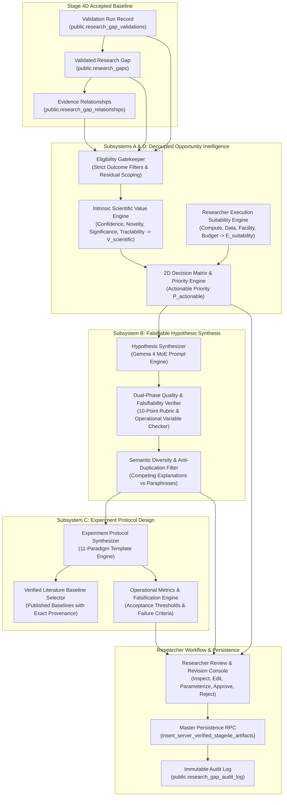
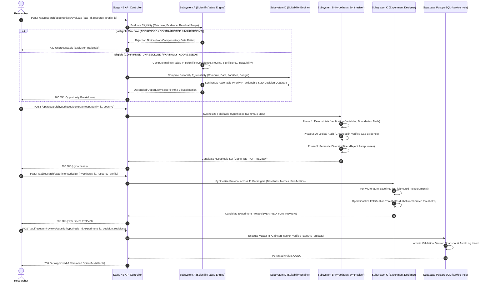

# Anvīkṣā — Stage 4E Architecture Specification
## Research Opportunity Intelligence, Falsifiable Hypothesis Synthesis & Experiment Protocol Design
### Revision 1: Decoupled Scientific Value, Execution Suitability & Model Provenance

**Document Version:** 4.1.0-STAGE4E-ARCH-REV1  
**Status:** REVISED ARCHITECTURE SPECIFICATION ONLY (Implementation Strictly Prohibited)  
**Milestone:** Stage 4E  
**Author:** Principal AI Systems Architect & Lead Scientific Methodologist  
**Baseline:** Version 4.1.0-REVISED (Stage 4E Revision 1)  
**Date:** 2026-11-20  

---

## 1. Executive Summary & Epistemic Mission

Stage 4A through Stage 4D.1 have established the evidence infrastructure, multi-paper literature ingestion, AI gap extraction, and cross-literature contradiction detection engines. These foundational capabilities establish whether an author-stated or extracted limitation is corroborated, unresolved, partially addressed, or contradicted across independent literature.

However, a validated research gap is **not yet an actionable research project**. A literature gap represents a historical diagnosis of an open problem:
$$\text{Validated Gap } \mathcal{G} = \langle \text{Statement}, \text{Category}, \text{Outcome}, \mathcal{E}_{evidence}, \mathcal{R}_{relationships} \rangle$$

To enable active, rigorous scientific discovery, Anvīkṣā requires **Sub-stage 4E**, which bridges the critical divide between retrospective literature analysis and prospective scientific research:

```
[Stage 4C] Candidate Gap Extraction (Local Paper Claims)
                       │
                       ▼
[Stage 4D/4D.1] Cross-Literature Validation & Contradiction Detection
                       │
                       ▼
================== STAGE 4E CORE LIFECYCLE (REVISION 1) ==================
[Subsystem A & D] Opportunity Intelligence & Decoupled Evaluation
                  ├─ Assessment A: Intrinsic Scientific Value (V_scientific)
                  └─ Assessment B: Researcher Execution Suitability (E_suitability)
                       │ (2D Strategic Decision Matrix & Non-Compensatory Gates)
                       ▼
[Subsystem B] Falsifiable Scientific Hypothesis Synthesis
                       │ (Popperian Variables, Boundary Conditions, Formal Claims)
                       ▼
[Subsystem C] Reproducible Experiment Protocol Design
                       │ (Baselines, Metrics, Statistical Analysis, Falsification Criteria)
                       ▼
[Human Review] Researcher Inspection, Calibration & Formal Approval
==========================================================================
                       │
                       ▼
[Stage 5 & Beyond] Community Challenge Publishing & Experimental Execution
```

### The Cardinal Rule of Stage 4E
Stage 4E must **never hallucinate speculative scientific claims, invent non-existent papers, synthesize mock baseline numbers, or claim that a proposed hypothesis has been empirically verified**. Stage 4E produces **structured research proposals and protocols** that require explicit researcher adjudication and future experimental execution before any scientific outcome can be claimed.

---

## 2. Pre-Design Audit of Repository Baseline & Model Configuration Verification

Stage 4E strictly reuses and integrates with the existing accepted codebase:

| Subsystem / Capability | Existing File / Database Entity | Stage 4E Reuse & Extension Boundary |
| :--- | :--- | :--- |
| **Canonical Paper Registry** | `public.research_papers(id UUID)` | Primary key target for all paper citations. Stage 4E creates zero duplicate paper tables. |
| **Research Gap Infrastructure** | `public.research_gaps` | Parent entity for all opportunities. Read-only consumption of `current_validation_outcome` and `current_epistemic_classification`. |
| **Bilateral Evidence Graph** | `public.research_gap_relationships` | Source of corroborations, contradictions, and addressing works via composite foreign key `(gap_id, validation_run_id)`. |
| **Validation Provenance** | `public.research_gap_validations` | Source of `literature_coverage_metadata`, `confidence_score` ($S_{val}$), and validation run references. |
| **Audit & Event History** | `public.research_gap_audit_log` | Immutable append-only audit trail. Stage 4E records opportunity, hypothesis, and protocol lifecycle events. |
| **Model Adapter & Fallback** | `src/lib/ai/modelAdapter.ts` | Resolves official Gemma 4 MoE (`gemma-4-26b-a4b-it` / `gemma-4-31b-it`) with fallback chain. |
| **Text Provenance Utilities** | `server/textProvenanceUtils.ts` | NFC Unicode normalization, exact 0-based code-point offset slicing, and SHA-256 chunk hashing. |
| **SSRF Perimeter Defense** | `server/ssrfValidator.ts` | Enforces URL boundaries for open-source code repositories, public datasets, and protocol links. |
| **Security & Persistence** | PostgreSQL RLS & `service_role` RPCs | All persistence is executed through server-only verified RPCs with advisory locking. Zero client-direct writes. |

### 2.1 Repository Model Adapter Verification (Section 6 Resolution)
Audit of `src/lib/ai/modelAdapter.ts` and `server/researchGapExtractionService.ts` confirms the exact multi-tier model configuration:
1. **Primary Model Target:** `OFFICIAL_GEMMA4_26B` (`'gemma-4-26b-a4b-it'`).
2. **Secondary Gemma Model:** `OFFICIAL_GEMMA4_31B` (`'gemma-4-31b-it'`).
3. **Default Fallback Model:** `DEFAULT_FALLBACK_MODEL` (`process.env.GEMINI_FALLBACK_MODEL || 'gemini-3-flash-preview'`).
4. **Overload Cascade Candidate:** `'gemini-2.5-flash'` (invoked if primary and secondary models encounter API rate limits or outages).
5. **Model Attribution Truthfulness:** Every generated artifact records `model_used`, `model_requested`, `is_fallback`, `fallback_reason`, `prompt_template_version`, and `inference_latency_ms`. Fallback execution is never falsely attributed to Gemma 4.

---

## 3. High-Level System Architecture & Component Topology

Stage 4E is structured into four decoupled subsystems operating under deterministic guards:



---

## 4. End-to-End Scientific Data Flow



---

## 5. Subsystem Responsibility Breakdown

### 5.1 Subsystem A: Research Opportunity Intelligence & Intrinsic Value
- **Responsibilities:**
  - Enforce non-compensatory eligibility gates based on Stage 4D validation outcomes.
  - Compute four explicit scientific scoring dimensions ($S_{confidence}, S_{novelty}, S_{significance}, S_{tractability}$) yielding Intrinsic Scientific Opportunity Value ($V_{scientific}$).
  - Preserve strict conceptual separation between Stage 4D provisional validation strength ($S_{val}$), Intrinsic Value ($V_{scientific}$), and Researcher Suitability ($E_{suitability}$).
  - Eliminate circular scoring: `S_priority` is strictly an output ($P_{actionable}$), never an input dimension.

### 5.2 Subsystem B: Falsifiable Scientific Hypothesis Synthesis
- **Responsibilities:**
  - Formulate mathematically and empirically testable hypotheses from eligible opportunities.
  - Structure hypotheses with operational independent, dependent, and control variables, directional predictions, and explicit boundary conditions.
  - Formulate statistical null/alternative hypotheses where mathematically appropriate, supporting 6 distinct research paradigms.
  - Execute a 10-point verification rubric rejecting tautologies, ungrounded causal assertions, and unfalsifiable claims.
  - Enforce semantic diversity to ensure generated candidates represent competing mechanisms rather than paraphrases.

### 5.3 Subsystem C: Experiment Protocol Design & Synthesis
- **Responsibilities:**
  - Translate verified hypotheses into reproducible research protocols across 11 scientific paradigms.
  - Select verified published baselines with verifiable citations and open-source implementations, prohibiting fabricated performance statistics.
  - Define operational metrics, exact measurement procedures, units, and directions of improvement.
  - Establish quantitative falsification decision thresholds, marking thresholds requiring domain calibration as `REQUIRES_RESEARCHER_SPECIFICATION`.
  - Design statistical analysis plans, including sample-size estimation, power analysis requirements, random seed schedules, and ablation matrices.

### 5.4 Subsystem D: Resource-Aware Planning & Feasibility Modeling
- **Responsibilities:**
  - Model empirical research execution costs across compute, storage, dataset availability, software licensing, and specialized laboratory facilities.
  - Compute Researcher Execution Suitability ($E_{suitability}$) without degrading intrinsic scientific significance.
  - Distinguish four epistemological resource states: Verified Available, User-Declared, Estimated Required, and Unknown Required.
  - Synthesize the 2D Strategic Research Decision Matrix ($V_{scientific}$ vs $E_{suitability}$).

---

## 6. AI and Deterministic Processing Boundary

```
┌─────────────────────────────────────────────────────────────────────────────┐
│                       DETERMINISTIC PROCESSING GUARANTEE                   │
│                                                                             │
│  - Validation outcome eligibility gates (CONFIRMED_UNRESOLVED only)         │
│  - Residual unresolved scope extraction for PARTIALLY_ADDRESSED             │
│  - Decoupled scoring: V_scientific and E_suitability separate calculations  │
│  - Non-compensatory exclusion gates (Contradiction cap, Feasibility floor)    │
│  - Literature baseline verification against canonical research_papers       │
│  - Citation & code-point offset integrity checks via textProvenanceUtils    │
│  - Operational variable completeness checks (independent + dependent req)   │
│  - Anti-duplication semantic similarity clustering                          │
│  - Compute & storage arithmetic when hardware requirements are specified    │
│  - Version hashing, cryptographic corpus invariants, and state transitions  │
│  - Database persistence authorization and RLS boundary enforcement         │
└──────────────────────────────────────┬──────────────────────────────────────┘
                                       │ Verified Inputs & Schema Constraints
                                       ▼
┌─────────────────────────────────────────────────────────────────────────────┐
│                          AI-ASSISTED SYNTHESIS (GEMMA 4)                    │
│                                                                             │
│  - Formulating falsifiable hypothesis statements from empirical gaps        │
│  - Proposing plausible underlying causal mechanisms and theoretical bridges │
│  - Suggesting alternative/competing explanations for observed bottlenecks   │
│  - Synthesizing ablation plans and perturbation matrices                    │
│  - Identifying potential threats to internal, external, and construct validity│
│  - Recommending domain-appropriate evaluation procedures and proxy metrics  │
└──────────────────────────────────────┬──────────────────────────────────────┘
                                       │ Raw Model Output Proposals
                                       ▼
┌─────────────────────────────────────────────────────────────────────────────┐
│                    DETERMINISTIC VERIFICATION & REJECTION GATE              │
│                                                                             │
│  - Verification of all quoted evidence against NFC text chunks              │
│  - Rejection of unfalsifiable or circular hypothesis statements             │
│  - Rejection of fabricated baseline measurements or ungrounded citations    │
│  - Enforcement of REQUIRES_RESEARCHER_SPECIFICATION on open thresholds      │
│  - Mandatory Researcher Review & Approval workflow                          │
└─────────────────────────────────────────────────────────────────────────────┘
```

---

## 7. Provenance, Versioning & Invalidation Architecture

### Invalidation & Stale-Marking Invariant
1. Every research opportunity, hypothesis, and experiment design contains an immutable reference to `(gap_id, validation_run_id)`.
2. When `crossLiteratureValidationService` executes a new validation run for `gap_id`, a database trigger marks all existing opportunities and hypotheses associated with prior validation runs as `is_stale = true`.
3. Stale artifacts remain fully readable and auditable in historical views, but are visually flagged in the workbench and cannot be transitioned to `RESEARCHER_APPROVED` without re-evaluation against the updated evidence corpus.
4. Under no circumstances are historical hypotheses or experiment designs silently overwritten or deleted. Every edit creates an immutable revision row in `public.research_hypothesis_versions` and `public.research_experiment_versions`.
