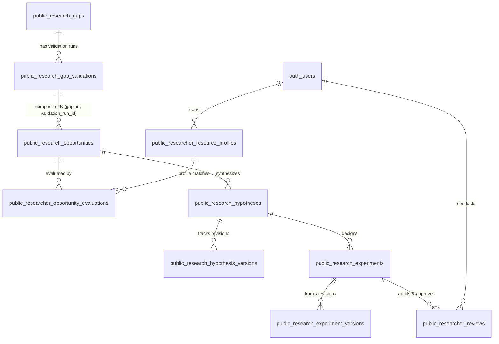

# Anvīkṣā — Stage 4E Database and API Implementation Plan
## Conceptual Data Modeling, Relational Integrity, RLS Policies, RPCs & REST Contracts

**Document Version:** 4.1.0-STAGE4E-DB-API-PLAN  
**Status:** ARCHITECTURAL SPECIFICATION ONLY (Implementation Strictly Prohibited)  
**Milestone:** Stage 4E  
**Date:** 2026-11-21  

---

# 1. Executive Summary & Database Scope

This plan specifies the complete data layer and API architecture required to support Stage 4E. 

> [!CAUTION]
> **NO SCHEMA MIGRATION DIRECTIVE:**
> The following table definitions represent **conceptual data modeling specifications**. No DDL has been executed on the live Supabase database (`dtlvtpntmtdmdawupylv`), and no SQL migration files have been created in `supabase/migrations/`.

---

# 2. Database Status Categorization

To maintain total transparency regarding live database infrastructure versus proposed future additions, all schema elements are classified into four mutually exclusive categories:

### Category A: Existing Implemented Database Functionality (Live in Supabase)
These tables and constraints were deployed and verified during Stages 4A–4D.1:
1. `public.research_papers`: Primary literature table (`id UUID PK`, `doi TEXT UNIQUE`, `openalex_id TEXT UNIQUE`, `title`, `authors`, `year`, `abstract`).
2. `public.paper_chunks`: Ingested chunk repository with UTF-8 offsets (`id UUID PK`, `paper_id UUID FK`, `chunk_hash`, `clean_text`, `start_char`, `end_char`).
3. `public.research_gaps`: Extracted research gaps (`id UUID PK`, `paper_id UUID FK`, `category`, `epistemic_classification`, `status`, `is_archived`).
4. `public.research_gap_validations`: Historical validation runs (`id UUID PK`, `gap_id UUID FK`, `validation_run_id TEXT`, `validation_outcome TEXT`, `composite unique (gap_id, validation_run_id)`).
5. `public.research_gap_relationships`: Dedicated Stage 4D relationship table with composite FK `(gap_id, validation_run_id) REFERENCES public.research_gap_validations(gap_id, validation_run_id) ON DELETE RESTRICT`, non-nil UUID checks, and 4 partial unique indexes.

### Category B: Proposed Schema Changes (Stage 4E Conceptual Tables)
New tables required to implement Stage 4E decoupled scoring, falsifiable hypotheses, experiment protocols, and multi-rater reviews:
1. `public.research_opportunities`: Objective scientific opportunities derived from validated gaps (independent of researcher resources).
2. `public.researcher_resource_profiles`: User-owned compute, hardware, and dataset boundaries with discrete typed evidence states.
3. `public.researcher_opportunity_evaluations`: Normalized lab-specific execution suitability ($E_{suitability}$) and 2D Strategic Decision Quadrant mapping.
4. `public.research_hypotheses`: Falsifiable scientific hypotheses adhering to the 27-field schema and 6 paradigms.
5. `public.research_hypothesis_versions`: Immutable revision audit log for hypotheses.
6. `public.research_experiments`: Reproducible experimental protocol artifacts across 11 paradigms.
7. `public.research_experiment_versions`: Immutable revision audit log for experimental protocols.
8. `public.researcher_reviews`: Human review, approval, rejection, and arbitration events.
9. `public.evaluation_benchmark_runs`: Recorded benchmark evaluations ($HFI, BAR, \tau_b, UCR, PCI, RUS$).

### Category C: Existing Functionality Requiring Extension
- `public.research_gaps`: Trigger additions to propagate `is_stale = true` across child opportunities upon outcome revisions.
- `public.research_gap_validations`: Index additions to support rapid lookup of `CONFIRMED_UNRESOLVED` and `PARTIALLY_ADDRESSED` runs.

### Category D: Items Requiring Architectural Review Prior to Implementation
- **Cloud OAuth Credentials Store:** Storage mechanism for external provider API keys versus user-managed secret vault.
- **Proof Script Sandbox Artifact Storage:** Large file storage for compiled Lean 4 / Coq AST proofs in Supabase Storage.

---

# 3. Conceptual Entity Specifications & Relational Constraints



### 3.1 `public.research_opportunities`
- **Columns:**
  - `id` (UUID, Primary Key, `gen_random_uuid()`)
  - `gap_id` (UUID, Not Null, FK to `public.research_gaps(id) ON DELETE RESTRICT`)
  - `validation_run_id` (TEXT, Not Null)
  - `status` (TEXT, Check: `ELIGIBLE`, `RANKED`, `UNDER_REVIEW`, `ACCEPTED`, `REJECTED`, `STALE`)
  - `intrinsic_scientific_value` (NUMERIC(4,2), Check: `0.00 <= intrinsic_scientific_value <= 10.00`)
  - `evidence_confidence_score` (NUMERIC(4,2), Check: `0.00 <= evidence_confidence_score <= 10.00`)
  - `novelty_score` (NUMERIC(4,2), Check: `0.00 <= novelty_score <= 10.00`)
  - `scientific_significance_score` (NUMERIC(4,2), Check: `0.00 <= scientific_significance_score <= 10.00`)
  - `methodological_tractability_score` (NUMERIC(4,2), Check: `0.00 <= methodological_tractability_score <= 10.00`)
  - `contradiction_status` (TEXT, Check: `'NO_CONTRADICTIONS_DETECTED'`, `'PREMISE_FALSIFIED'`, `'SCOPE_NARROWED'`, `'CONTRADICTION_STATUS_UNKNOWN'`)
  - `literature_density_status` (TEXT, Check: `'SPARSE_FRONTIER'`, `'ACTIVE_COMPETITIVE'`, `'SATURATED_EXACT_REPETITION'`, `'DIFFICULT_OPEN_DIRECTION'`)
  - `residual_unresolved_scope` (JSONB, Required if gap is `PARTIALLY_ADDRESSED`)
  - `weighting_regime` (TEXT, Default: `'BALANCED_DEFAULT'`)
  - `scoring_metadata` (JSONB, Not Null)
  - `structured_explanation` (JSONB, Not Null)
  - `is_stale` (BOOLEAN, Default: `false`)
  - `staleness_reason` (TEXT)
  - `created_by` (UUID, FK to `auth.users(id) ON DELETE SET NULL`)
  - `created_at` (TIMESTAMPTZ, Default: `now()`)
  - `updated_at` (TIMESTAMPTZ, Default: `now()`)
- **Relational Invariant:**
  - Composite FK: `FOREIGN KEY (gap_id, validation_run_id) REFERENCES public.research_gap_validations(gap_id, validation_run_id) ON DELETE RESTRICT`
  - Unique Index: `CREATE UNIQUE INDEX idx_uniq_active_opp ON public.research_opportunities(gap_id, validation_run_id, weighting_regime) WHERE status <> 'REJECTED';`

### 3.2 `public.researcher_resource_profiles`
- **Columns:**
  - `id` (UUID, Primary Key, `gen_random_uuid()`)
  - `user_id` (UUID, Not Null, FK to `auth.users(id) ON DELETE CASCADE`)
  - `profile_name` (TEXT, Not Null, Default: `'Primary Lab Profile'`)
  - `resource_claims` (JSONB, Not Null, Default: `'{}'::jsonb`, holds discrete evidence records)
  - `overall_verification_status` (TEXT, Check: `'VERIFIED'`, `'PARTIALLY_VERIFIED'`, `'SELF_DECLARED'`, `'UNVERIFIED'`)
  - `created_at` (TIMESTAMPTZ, Default: `now()`)
  - `updated_at` (TIMESTAMPTZ, Default: `now()`)
- **Constraint:** `UNIQUE (user_id, profile_name)`

### 3.3 `public.researcher_opportunity_evaluations`
- **Columns:**
  - `id` (UUID, Primary Key, `gen_random_uuid()`)
  - `opportunity_id` (UUID, Not Null, FK to `public.research_opportunities(id) ON DELETE CASCADE`)
  - `resource_profile_id` (UUID, Not Null, FK to `public.researcher_resource_profiles(id) ON DELETE CASCADE`)
  - `user_id` (UUID, Not Null, FK to `auth.users(id)`)
  - `execution_suitability_score` (NUMERIC(4,2), Nullable, Check: `execution_suitability_score IS NULL OR (0.00 <= execution_suitability_score <= 10.00)`)
  - `strategic_decision_quadrant` (TEXT, Check: `'IMMEDIATE_HIGH_PRIORITY'`, `'GRANT_OR_COLLABORATION_TARGET'`, `'FEASIBLE_RESEARCH_OPPORTUNITY'`, `'DEPRIORITIZED'`, `'SUITABILITY_UNDETERMINED'`)
  - `suitability_breakdown` (JSONB, Not Null)
  - `evaluated_at` (TIMESTAMPTZ, Default: `now()`)
- **Constraint:** `UNIQUE (opportunity_id, resource_profile_id)`

### 3.4 `public.research_hypotheses`
- **Columns:**
  - `id` (UUID, Primary Key, `gen_random_uuid()`)
  - `opportunity_id` (UUID, Not Null, FK to `public.research_opportunities(id) ON DELETE RESTRICT`)
  - `gap_id` (UUID, Not Null, FK to `public.research_gaps(id) ON DELETE RESTRICT`)
  - `validation_run_id` (TEXT, Not Null)
  - `current_version` (INTEGER, Not Null, Default: 1)
  - `paradigm_type` (TEXT, Check: `'CAUSAL_EMPIRICAL'`, `'ALGORITHMIC_SUPERIORITY'`, `'COMPONENT_ABLATION'`, `'SCALING_LAW'`, `'DISTRIBUTIONAL_INVARIANCE'`, `'FORMAL_INVARIANT'`)
  - `research_question` (TEXT, Not Null)
  - `hypothesis_statement` (TEXT, Not Null)
  - `scientific_rationale` (TEXT, Not Null)
  - `independent_variables` (JSONB, Not Null)
  - `dependent_variables` (JSONB, Not Null)
  - `control_variables` (JSONB, Not Null)
  - `boundary_conditions` (JSONB, Not Null)
  - `null_hypothesis` (TEXT, Not Null)
  - `alternative_hypothesis` (TEXT, Not Null)
  - `falsification_conditions` (JSONB, Not Null)
  - `falsifiability_rubric_score` (NUMERIC(4,2), Check: `0.00 <= falsifiability_rubric_score <= 10.00`)
  - `rubric_evaluation_payload` (JSONB, Not Null)
  - `status` (TEXT, Check: `'GENERATED'`, `'EVIDENCE_VERIFICATION_PENDING'`, `'VERIFIED_FOR_REVIEW'`, `'REQUIRES_REFINEMENT'`, `'REJECTED'`, `'RESEARCHER_APPROVED'`, `'SUPERSEDED'`, `'STALE'`)
  - `is_stale` (BOOLEAN, Default: `false`)
  - `generation_provenance` (JSONB, Not Null)
  - `created_by` (UUID, FK to `auth.users(id)`)
  - `created_at` (TIMESTAMPTZ, Default: `now()`)
- **Relational Invariant:**
  - Composite FK: `FOREIGN KEY (gap_id, validation_run_id) REFERENCES public.research_gap_validations(gap_id, validation_run_id) ON DELETE RESTRICT`

### 3.5 `public.research_experiments`
- **Columns:**
  - `id` (UUID, Primary Key, `gen_random_uuid()`)
  - `hypothesis_id` (UUID, Not Null, FK to `public.research_hypotheses(id) ON DELETE RESTRICT`)
  - `gap_id` (UUID, Not Null, FK to `public.research_gaps(id) ON DELETE RESTRICT`)
  - `validation_run_id` (TEXT, Not Null)
  - `title` (TEXT, Not Null)
  - `objective` (TEXT, Not Null)
  - `experimental_design_type` (TEXT, Not Null)
  - `verified_baselines` (JSONB, Not Null, contains verified DOIs and exact published numbers)
  - `datasets_and_materials` (JSONB, Not Null)
  - `execution_environment` (JSONB, Not Null, hardware, VRAM, dependencies)
  - `statistical_analysis_plan` (JSONB, Not Null, power calculation, sample size)
  - `ablation_matrix` (JSONB, Not Null)
  - `falsification_criteria` (JSONB, Not Null)
  - `threats_to_validity` (JSONB, Not Null, 4 quadrants)
  - `status` (TEXT, Check: `'GENERATED'`, `'VALIDATION_PENDING'`, `'VERIFIED_FOR_REVIEW'`, `'REQUIRES_REFINEMENT'`, `'REJECTED'`, `'RESEARCHER_APPROVED'`, `'READY_FOR_EXECUTION'`, `'EXECUTED'`, `'SUPERSEDED'`, `'STALE'`)
  - `is_stale` (BOOLEAN, Default: `false`)
  - `generation_provenance` (JSONB, Not Null)
  - `created_by` (UUID, FK to `auth.users(id)`)
  - `created_at` (TIMESTAMPTZ, Default: `now()`)

---

# 4. Row-Level Security (RLS) Policies

All Stage 4E tables enforce strict Row-Level Security:

1. **`public.research_opportunities`:**
   - `SELECT`: Publicly accessible (`auth.role() = 'anon' OR auth.role() = 'authenticated'`) for opportunities with `status <> 'REJECTED'`.
   - `INSERT/UPDATE/DELETE`: Restricted exclusively to `service_role` via SECURITY DEFINER server RPCs.
2. **`public.researcher_resource_profiles`:**
   - `SELECT`: `auth.uid() = user_id`.
   - `INSERT/UPDATE/DELETE`: `auth.uid() = user_id`.
3. **`public.researcher_opportunity_evaluations`:**
   - `SELECT`: `auth.uid() = user_id`.
   - `INSERT/UPDATE/DELETE`: `auth.uid() = user_id` OR `service_role`.
4. **`public.research_hypotheses` & `public.research_experiments`:**
   - `SELECT`: Publicly viewable when `status IN ('VERIFIED_FOR_REVIEW', 'RESEARCHER_APPROVED')`; owners view all statuses.
   - `INSERT/UPDATE/DELETE`: Strictly `service_role` via authenticated server endpoints.
5. **`public.researcher_reviews`:**
   - `SELECT`: Review owners (`auth.uid() = reviewer_id`) or public if review is published.
   - `INSERT`: Authenticated users (`auth.uid() IS NOT NULL`).

---

# 5. SECURITY DEFINER RPC Functions

Database mutations are executed strictly via PostgreSQL stored procedures to guarantee atomicity and enforce scientific invariants:

1. **`rpc_persist_research_opportunity`:**
   - *Signature:* `(p_gap_id UUID, p_validation_run_id TEXT, p_payload JSONB) -> UUID`
   - *Logic:* Validates that `(p_gap_id, p_validation_run_id)` exists in `public.research_gap_validations` with outcome in `('CONFIRMED_UNRESOLVED', 'PARTIALLY_ADDRESSED')`. Upserts into `public.research_opportunities`.
2. **`rpc_mutate_hypothesis_version`:**
   - *Signature:* `(p_hypothesis_id UUID, p_mutated_payload JSONB, p_rationale TEXT, p_user_id UUID) -> INT`
   - *Logic:* Archives current version into `public.research_hypothesis_versions`, increments `current_version`, updates `public.research_hypotheses`, and resets status to `VERIFIED_FOR_REVIEW`.
3. **`rpc_propagate_gap_staleness`:**
   - *Signature:* `(p_gap_id UUID, p_validation_run_id TEXT, p_reason TEXT) -> INT`
   - *Logic:* Updates `is_stale = true` across all opportunities, hypotheses, and experiments sharing `(p_gap_id, p_validation_run_id)`. Returns count of invalidated entities.

---

# 6. RESTful API Contracts

All endpoints enforce Bearer JWT authentication, SSRF request validation, and strict JSON schemas:

| Route | Method | Auth | Request Body | Response Body | Error Codes |
| :--- | :---: | :---: | :--- | :--- | :--- |
| `/api/stage4e/opportunities/synthesize` | `POST` | `Admin / Service` | `{ gapId: UUID, validationRunId: string, weightingRegime?: string }` | `{ opportunityId: UUID, intrinsicScore: number, quadrant: string }` | `400, 404, 409` |
| `/api/stage4e/opportunities/list` | `GET` | `Authenticated` | Query: `?status=ELIGIBLE&regime=BALANCED` | `{ opportunities: ResearchOpportunityPayload[], total: number }` | `401` |
| `/api/stage4e/hypotheses/generate` | `POST` | `Authenticated` | `{ opportunityId: UUID, preferredParadigm?: string, count?: number }` | `{ hypotheses: ResearchHypothesisPayload[] }` | `400, 404, 422` |
| `/api/stage4e/hypotheses/:id/approve` | `POST` | `Authenticated` | `{ decision: 'APPROVE' \| 'REJECT', rationale: string }` | `{ reviewId: UUID, updatedStatus: string }` | `403, 404, 409` |
| `/api/stage4e/protocols/generate` | `POST` | `Authenticated` | `{ hypothesisId: UUID, executionParadigm: string }` | `{ protocol: ExperimentProtocolPayload }` | `400, 404, 422` |
| `/api/stage4e/resources/profile` | `PUT` | `Authenticated` | `{ profileName: string, claims: ResourceClaimRecord[] }` | `{ profileId: UUID, verificationStatus: string }` | `400, 401` |
| `/api/stage4e/suitability/evaluate` | `POST` | `Authenticated` | `{ opportunityId: UUID, profileId: UUID }` | `{ quadrant: string, suitabilityScore: number \| null }` | `404, 422` |

```
═══════════════════════════════════════════════════════════════════════════════
  STAGE 4E DATABASE & API SPECIFICATION: RATIFIED
  DDL EXECUTION REMAINS STRICTLY BLOCKED PENDING AUTHORIZATION
═══════════════════════════════════════════════════════════════════════════════
```
