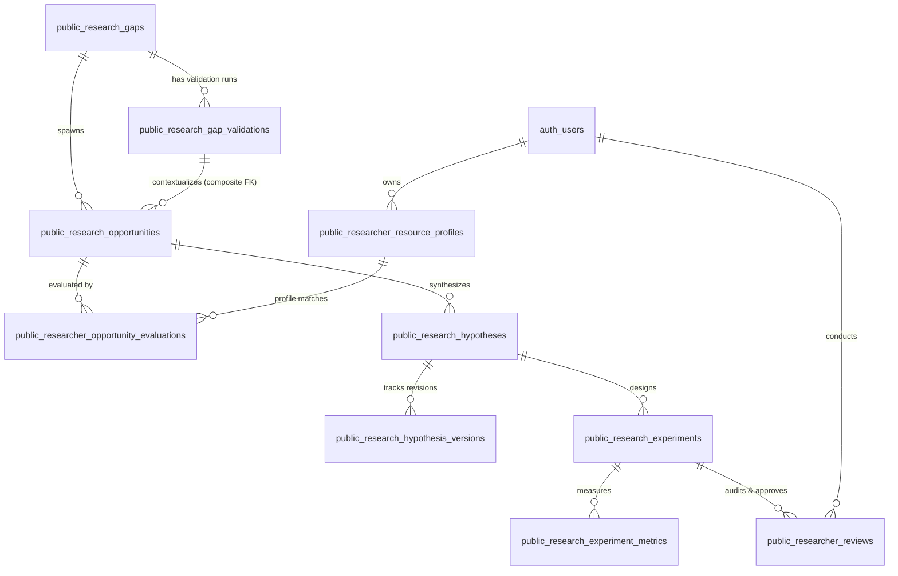

# Anvīkṣā — Stage 4E Conceptual Data Model & API Specification
## Relational Schema Design, State Machines & RESTful Interface Contracts
### Revision 1: Decoupled Value-Suitability Schema, Composite Provenance & Robust RLS

**Document Version:** 4.1.0-STAGE4E-DATA-API-REV1  
**Status:** REVISED ARCHITECTURE SPECIFICATION ONLY (Implementation Strictly Prohibited)  
**Milestone:** Stage 4E  
**Baseline:** Version 4.1.0-REVISED (Stage 4E Revision 1)  
**Date:** 2026-11-20  

---

## 1. Relational Knowledge Architecture & Data Model

Stage 4E builds directly on the accepted Stage 4A–4D.1 schema infrastructure. In Revision 1, the data model is updated to **cleanly decouple Intrinsic Scientific Value from Researcher Execution Suitability** into separate normalized entities, preventing researcher resource constraints from mutating the objective scientific value of an opportunity.

> [!IMPORTANT]
> **NO SCHEMA MIGRATION DIRECTIVE:**
> The following table definitions represent **conceptual data modeling specifications**. No DDL has been executed on the live Supabase database (`dtlvtpntmtdmdawupylv`), and no SQL migration files have been created in `supabase/migrations/`.



---

## 2. Conceptual Entity Specifications

### 2.1 `public.research_opportunities`
- **Purpose:** Represents an actionable, intrinsically significant research opportunity derived from a validated research gap. **Independent of researcher resources.**
- **Attributes:**
  - `id` (UUID, Primary Key, `gen_random_uuid()`)
  - `gap_id` (UUID, Not Null, FK to `public.research_gaps(id) ON DELETE RESTRICT`)
  - `validation_run_id` (TEXT, Not Null)
  - `status` (TEXT, Check: `ELIGIBLE`, `RANKED`, `UNDER_REVIEW`, `ACCEPTED`, `REJECTED`, `STALE`)
  - `intrinsic_scientific_value` (NUMERIC(4,2), Check: `0.00 <= intrinsic_scientific_value <= 10.00`)
  - `evidence_confidence_score` (NUMERIC(4,2), Check: `0.00 <= evidence_confidence_score <= 10.00`)
  - `novelty_score` (NUMERIC(4,2), Check: `0.00 <= novelty_score <= 10.00`)
  - `scientific_significance_score` (NUMERIC(4,2), Check: `0.00 <= scientific_significance_score <= 10.00`)
  - `research_tractability_score` (NUMERIC(4,2), Check: `0.00 <= research_tractability_score <= 10.00`)
  - `residual_unresolved_scope` (JSONB, Required if gap is `PARTIALLY_ADDRESSED`)
  - `weighting_regime` (TEXT, Default: `'BALANCED_DEFAULT'`)
  - `scoring_metadata` (JSONB, Not Null, includes sensitivity analysis & non-compensatory gate flags)
  - `structured_explanation` (JSONB, Not Null)
  - `is_stale` (BOOLEAN, Default: `false`)
  - `created_by` (UUID, FK to `auth.users(id) ON DELETE SET NULL`)
  - `created_at` (TIMESTAMPTZ, Default: `now()`)
  - `updated_at` (TIMESTAMPTZ, Default: `now()`)
- **Constraints & Indexes:**
  - Composite FK: `FOREIGN KEY (gap_id, validation_run_id) REFERENCES public.research_gap_validations(gap_id, validation_run_id) ON DELETE RESTRICT`
  - Unique Partial Index: `CREATE UNIQUE INDEX idx_uniq_active_opp ON public.research_opportunities(gap_id, validation_run_id, weighting_regime) WHERE status <> 'REJECTED';`

### 2.2 `public.researcher_opportunity_evaluations`
- **Purpose:** Normalized entity evaluating execution suitability and actionable priority for a specific researcher profile.
- **Attributes:**
  - `id` (UUID, Primary Key, `gen_random_uuid()`)
  - `opportunity_id` (UUID, Not Null, FK to `public.research_opportunities(id) ON DELETE CASCADE`)
  - `resource_profile_id` (UUID, Not Null, FK to `public.researcher_resource_profiles(id) ON DELETE CASCADE`)
  - `user_id` (UUID, Not Null, FK to `auth.users(id)`)
  - `execution_suitability_score` (NUMERIC(4,2), Check: `0.00 <= execution_suitability_score <= 10.00`)
  - `compute_suitability` (NUMERIC(4,2))
  - `data_accessibility` (NUMERIC(4,2))
  - `facility_suitability` (NUMERIC(4,2))
  - `budget_feasibility` (NUMERIC(4,2))
  - `strategic_decision_quadrant` (TEXT, Check: `'IMMEDIATE_HIGH_PRIORITY'`, `'GRANT_OR_COLLABORATION_TARGET'`, `'FEASIBLE_RESEARCH_OPPORTUNITY'`, `'DEPRIORITIZED'`, `'SUITABILITY_UNDETERMINED'`)
  - `suitability_breakdown` (JSONB, Not Null)
  - `evaluated_at` (TIMESTAMPTZ, Default: `now()`)
- **Constraint:** `UNIQUE (opportunity_id, resource_profile_id)`

### 2.3 `public.research_hypotheses`
- **Purpose:** Represents a falsifiable scientific hypothesis addressing an eligible research opportunity.
- **Attributes:**
  - `id` (UUID, Primary Key, `gen_random_uuid()`)
  - `opportunity_id` (UUID, Not Null, FK to `public.research_opportunities(id) ON DELETE RESTRICT`)
  - `gap_id` (UUID, Not Null, FK to `public.research_gaps(id) ON DELETE RESTRICT`)
  - `validation_run_id` (TEXT, Not Null)
  - `current_version` (INTEGER, Not Null, Default: 1)
  - `research_question` (TEXT, Not Null)
  - `hypothesis_statement` (TEXT, Not Null)
  - `scientific_rationale` (TEXT, Not Null)
  - `paradigm_type` (TEXT, Not Null)
  - `independent_variables` (JSONB, Not Null)
  - `dependent_variables` (JSONB, Not Null)
  - `control_variables` (JSONB, Not Null)
  - `boundary_conditions` (JSONB, Not Null)
  - `null_hypothesis` (TEXT)
  - `alternative_hypothesis` (TEXT)
  - `falsification_conditions` (JSONB, Not Null)
  - `falsifiability_rubric_score` (NUMERIC(4,2), Check: `0.00 <= falsifiability_rubric_score <= 10.00`)
  - `status` (TEXT, Check: `GENERATED`, `EVIDENCE_VERIFICATION_PENDING`, `VERIFIED_FOR_REVIEW`, `REQUIRES_REFINEMENT`, `REJECTED`, `RESEARCHER_APPROVED`, `SUPERSEDED`, `STALE`)
  - `is_stale` (BOOLEAN, Default: `false`)
  - `generation_provenance` (JSONB, Not Null)
  - `created_by` (UUID, FK to `auth.users(id)`)
  - `created_at` (TIMESTAMPTZ, Default: `now()`)

### 2.4 `public.research_hypothesis_versions`
- **Purpose:** Immutable audit log of all human and AI revisions to a hypothesis.
- **Attributes:**
  - `id` (UUID, Primary Key, `gen_random_uuid()`)
  - `hypothesis_id` (UUID, Not Null, FK to `public.research_hypotheses(id) ON DELETE CASCADE`)
  - `version_number` (INTEGER, Not Null)
  - `hypothesis_payload` (JSONB, Not Null)
  - `modified_by` (UUID, FK to `auth.users(id)`)
  - `modification_rationale` (TEXT, Not Null)
  - `created_at` (TIMESTAMPTZ, Default: `now()`)
- **Constraint:** `UNIQUE (hypothesis_id, version_number)`

### 2.5 `public.research_experiments`
- **Purpose:** Complete reproducible experimental protocol testing an approved or reviewed hypothesis.
- **Attributes:**
  - `id` (UUID, Primary Key, `gen_random_uuid()`)
  - `hypothesis_id` (UUID, Not Null, FK to `public.research_hypotheses(id) ON DELETE RESTRICT`)
  - `gap_id` (UUID, Not Null, FK to `public.research_gaps(id) ON DELETE RESTRICT`)
  - `validation_run_id` (TEXT, Not Null)
  - `title` (TEXT, Not Null)
  - `objective` (TEXT, Not Null)
  - `experimental_design_type` (TEXT, Not Null)
  - `verified_baselines` (JSONB, Not Null)
  - `datasets_and_materials` (JSONB, Not Null)
  - `execution_environment` (JSONB, Not Null)
  - `statistical_analysis_plan` (JSONB, Not Null)
  - `ablation_matrix` (JSONB, Not Null)
  - `falsification_criteria` (JSONB, Not Null)
  - `threats_to_validity` (JSONB, Not Null)
  - `status` (TEXT, Check: `GENERATED`, `VALIDATION_PENDING`, `VERIFIED_FOR_REVIEW`, `REQUIRES_REFINEMENT`, `REJECTED`, `RESEARCHER_APPROVED`, `READY_FOR_EXECUTION`, `EXECUTED`, `SUPERSEDED`, `STALE`)
  - `is_stale` (BOOLEAN, Default: `false`)
  - `generation_provenance` (JSONB, Not Null)
  - `created_by` (UUID, FK to `auth.users(id)`)
  - `created_at` (TIMESTAMPTZ, Default: `now()`)

### 2.6 `public.researcher_resource_profiles`
- **Purpose:** User-declared and verified compute, hardware, and dataset boundaries.
- **Attributes:**
  - `id` (UUID, Primary Key, `gen_random_uuid()`)
  - `user_id` (UUID, Not Null, FK to `auth.users(id) ON DELETE CASCADE`)
  - `gpu_count` (INTEGER, Default: 0)
  - `gpu_model` (TEXT)
  - `max_vram_gb` (INTEGER, Default: 0)
  - `monthly_compute_budget_usd` (NUMERIC(10,2), Default: 0.00)
  - `accessible_dataset_tiers` (TEXT[], Default: `ARRAY['PUBLIC_OPEN']`)
  - `resource_claims` (JSONB, Not Null, Default: `'{}'::jsonb`, holds discrete evidence states: `VERIFIED_AVAILABLE`, `DECLARED_AVAILABLE`, `VERIFIED_UNAVAILABLE`, `UNKNOWN`, `EXPIRED_EVIDENCE`)
  - `overall_verification_status` (TEXT, Check: `'VERIFIED'`, `'PARTIALLY_VERIFIED'`, `'SELF_DECLARED'`, `'UNVERIFIED'`)
  - `created_at` (TIMESTAMPTZ, Default: `now()`)

### 2.7 `public.researcher_reviews`
- **Purpose:** Explicit audit record of human researcher approval, rejection, or modification.
- **Attributes:**
  - `id` (UUID, Primary Key, `gen_random_uuid()`)
  - `entity_type` (TEXT, Check: `'HYPOTHESIS'`, `'EXPERIMENT'`, `'OPPORTUNITY'`)
  - `entity_id` (UUID, Not Null)
  - `reviewer_id` (UUID, Not Null, FK to `auth.users(id)`)
  - `decision` (TEXT, Check: `'APPROVED'`, `'REJECTED'`, `'MODIFIED_AND_APPROVED'`, `'REVISION_REQUESTED'`)
  - `review_comments` (TEXT, Not Null)
  - `parameter_modifications` (JSONB, Default: `'{}'::jsonb`)
  - `reviewed_at` (TIMESTAMPTZ, Default: `now()`)

---

## 3. RESTful API Architecture & Endpoint Contracts

### 3.1 Endpoint Inventory

| Method | Route | Purpose | Auth / Role |
| :--- | :--- | :--- | :--- |
| `POST` | `/api/research/opportunities/evaluate-scientific-value` | Computes intrinsic $V_{scientific}$ and dimensions | Authenticated |
| `POST` | `/api/research/opportunities/evaluate-suitability` | Computes $E_{suitability}$ and $P_{actionable}$ for profile | Authenticated |
| `GET` | `/api/research/opportunities/:id` | Fetches opportunity with value and suitability breakdown | Authenticated |
| `GET` | `/api/research/opportunities/gap/:gap_id/history` | Fetches opportunity version audit history | Authenticated |
| `POST` | `/api/research/hypotheses/generate` | Synthesizes falsifiable hypotheses (K=3) | Authenticated |
| `POST` | `/api/research/hypotheses/verify` | Executes 10-point falsifiability rubric | Authenticated |
| `PUT` | `/api/research/hypotheses/:id/revise` | Submits human revision to a hypothesis | Authenticated (Owner) |
| `POST` | `/api/research/experiments/design` | Synthesizes reproducible protocol across 11 paradigms | Authenticated |
| `POST` | `/api/research/experiments/verify` | Validates baselines & metrics completeness | Authenticated |
| `PUT` | `/api/research/experiments/:id/revise` | Submits human revision to a protocol | Authenticated (Owner) |
| `POST` | `/api/research/reviews/submit` | Records formal approval or rejection | Authenticated |

---

### 3.2 Representative API Contracts

#### Endpoint 1: `POST /api/research/opportunities/evaluate-scientific-value`
- **Request Body:**
  ```json
  {
    "gap_id": "0f0139a1-76d2-4f4c-b530-f98da61a48c5",
    "validation_run_id": "val-run-20261120-001",
    "weighting_regime": "BALANCED_DEFAULT"
  }
  ```
- **Response (`200 OK`):**
  ```json
  {
    "opportunity_id": "opp-98a71c2b-4f32-4d1e-8a21-9e7b6c5a4d3f",
    "gap_id": "0f0139a1-76d2-4f4c-b530-f98da61a48c5",
    "validation_run_id": "val-run-20261120-001",
    "status": "RANKED",
    "intrinsic_scientific_value": 8.85,
    "dimensions": {
      "evidence_confidence": 8.50,
      "novelty": 8.80,
      "scientific_significance": 9.40,
      "research_tractability": 8.20
    },
    "non_compensatory_gates_passed": true,
    "structured_explanation": {
      "rationale": "High-priority architectural bottleneck with low literature saturation.",
      "critical_strengths": ["Strong corroboration", "High cross-domain transferability"]
    },
    "is_stale": false,
    "created_at": "2026-11-20T22:30:00Z"
  }
  ```

#### Endpoint 2: `POST /api/research/opportunities/evaluate-suitability`
- **Request Body:**
  ```json
  {
    "opportunity_id": "opp-98a71c2b-4f32-4d1e-8a21-9e7b6c5a4d3f",
    "resource_profile_id": "prof-55a1b2c3-d4e5-4f6a-8b9c-0d1e2f3a4b5c"
  }
  ```
- **Response (`200 OK`):**
  ```json
  {
    "evaluation_id": "eval-77a8b9c0-d1e2-4f3a-8b9c-0d1e2f3a4b5c",
    "opportunity_id": "opp-98a71c2b-4f32-4d1e-8a21-9e7b6c5a4d3f",
    "intrinsic_scientific_value": 8.85,
    "execution_suitability_score": 3.20,
    "actionable_priority_score": 6.59,
    "strategic_decision_quadrant": "GRANT_OR_COLLABORATION_TARGET",
    "suitability_breakdown": {
      "compute_suitability": 2.00,
      "data_accessibility": 10.00,
      "facility_suitability": 10.00,
      "budget_feasibility": 4.00
    },
    "strategic_recommendation": "High-impact opportunity exceeding current local GPU capacity. Recommended for compute grant application or partnership."
  }
  ```
