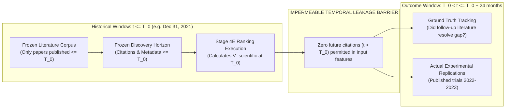

# Anvīkṣā — Stage 4E Evaluation & Scientific Benchmark Framework
## Empirical Validation Metrics, Multi-Rater Annotation Methodology & Leakage-Free Temporal Benchmarks
### Revision 1: Rigorous Metric Formalization, Krippendorff's Alpha & Temporal Invariants

**Document Version:** 4.1.0-STAGE4E-EVAL-REV1  
**Status:** REVISED EVALUATION SPECIFICATION ONLY (Implementation Strictly Prohibited)  
**Milestone:** Stage 4E  
**Baseline:** Version 4.1.0-REVISED (Stage 4E Revision 1)  
**Date:** 2026-11-20  

---

## 1. Executive Philosophy: Five Separate Evaluation Dimensions

A critical error in AI system evaluation is blending different dimensions into a single uninformative score. Stage 4E strictly separates **five distinct evaluation dimensions**:

```
┌────────────────────────────────────────────────────────────────────────┐
│ 1. Functional Correctness (Software Engineering: APIs, RLS, Schemas)   │
├────────────────────────────────────────────────────────────────────────┤
│ 2. Evidence-Grounding Accuracy (Bibliometrics: Exact Quotes, Offsets)   │
├────────────────────────────────────────────────────────────────────────┤
│ 3. Scientific Quality (Methodology: Falsifiability, Variables, Controls)│
├────────────────────────────────────────────────────────────────────────┤
│ 4. Researcher Usefulness (Utility: Strategic Value, Feasibility Fit)   │
├────────────────────────────────────────────────────────────────────────┤
│ 5. Statistical Calibration (Empirical Truth: ECE, Brier Score)         │
└────────────────────────────────────────────────────────────────────────┘
```

Synthetic integration fixtures evaluate Dimension 1 exclusively. Evaluating Dimensions 2 through 5 requires **authentic peer-reviewed literature**, **multi-rater expert panels**, and **temporal leakage-free back-testing**.

---

## 2. Rigorous Formalization of the Six Evaluation Metrics

Every proposed metric is formally specified below across all 10 required architectural criteria:

---

### 2.1 Metric 1: Hypothesis Falsifiability Index ($HFI$)
1. **Full Name:** Automated Hypothesis Falsifiability Index.
2. **Exact Measurement:** The proportion of generated scientific hypotheses that meet all 10 non-negotiable criteria of the Popperian falsifiability rubric.
3. **Mathematical Formula:**
   $$HFI = \frac{\sum_{i=1}^{N} \mathbf{1}\left(\text{RubricScore}(\mathcal{H}_i) \ge 8.0 \;\land\; \text{DeterministicGatesPassed}(\mathcal{H}_i) = \text{true}\right)}{N}$$
4. **Numerator & Denominator:**
   - *Numerator:* Count of generated hypotheses passing all deterministic gates (explicit independent/dependent variables, failure thresholds, anti-tautology check) and achieving AI audit $\ge 8.0/10.0$.
   - *Denominator:* Total count of synthesized hypotheses evaluated ($N$).
5. **Evaluation Unit:** Individual synthesized hypothesis artifact (`public.research_hypotheses`).
6. **Annotation Process:** Automated execution of the 10-point falsifiability pipeline followed by blind expert audit on a sample of $n=100$.
7. **Evaluation Dataset:** 100 candidate gaps across Benchmark Clusters A, B, and C.
8. **Target Threshold Justification:** $\mathbf{\ge 90.0\%}$ (Target). A production research tool cannot present unfalsifiable statements to investigators in more than 1 in 10 generations.
9. **Confidence Intervals & Uncertainty:** Reported as a Wilson score binomial confidence interval:
   $$\hat{p} \pm \frac{z}{1 + \frac{z^2}{N}}\sqrt{\frac{\hat{p}(1-\hat{p})}{N} + \frac{z^2}{4N^2}}$$
10. **Gaming & Failure Modes:** A model can game $HFI$ by appending trivial numeric clauses (*"...throughput will drop by >= 0.001%"*). Prevented by Gate 4 requiring realistic effect size justification.

---

### 2.2 Metric 2: Baseline Authenticity Rate ($BAR$)
1. **Full Name:** Literature Baseline Citation & Performance Authenticity Rate.
2. **Exact Measurement:** The percentage of experimental baselines in generated protocols that correspond to authentic, published scholarly literature with non-fabricated performance numbers.
3. **Mathematical Formula:**
   $$BAR = \frac{\sum_{i=1}^{M} \mathbf{1}\left(\text{PaperExistsInOpenAlex}(B_i) \;\land\; \text{DOIValid}(B_i) \;\land\; \text{NumbersMatchSourcePDF}(B_i)\right)}{M} \times 100\%$$
4. **Numerator & Denominator:**
   - *Numerator:* Count of baseline entries where the cited paper exists in OpenAlex/Crossref, the DOI resolves, and cited baseline performance numbers exactly match the published source PDF tables.
   - *Denominator:* Total count of cited baselines across all generated protocols ($M$).
5. **Evaluation Unit:** Individual baseline entry within an experiment protocol (`public.research_experiments.verified_baselines`).
6. **Annotation Process:** Automated verification against `public.research_papers` and DOI API, supplemented by human verification of extracted numbers against published tables.
7. **Evaluation Dataset:** All baseline references cited across benchmark evaluation runs ($M \ge 150$).
8. **Target Threshold Justification:** $\mathbf{100.0\%}$ (Mandatory Invariant). An automated scientific tool that invents baseline numbers or citations has zero scientific utility. Fabricated citations are a catastrophic failure mode; hence the target is strictly $100\%$.
9. **Confidence Intervals & Uncertainty:** Exact Clopper-Pearson binomial interval. A single verified hallucination triggers immediate acceptance failure.
10. **Gaming & Failure Modes:** A model might cite only well-known papers (e.g. BERT/ResNet) to ensure authenticity. Prevented by requiring baselines to match the specific task operational domain.

---

### 2.3 Metric 3: Ranking Concordance ($\tau_{rank}$)
1. **Full Name:** Kendall's Rank Correlation Concordance of Intrinsic Opportunity Value.
2. **Exact Measurement:** Rank-order agreement between the system's Intrinsic Scientific Opportunity Value ($V_{scientific}$) and the median ranking established by an independent expert panel.
3. **Mathematical Formula:**
   $$\tau = \frac{C - D}{\frac{1}{2} n (n - 1)}$$
   where $C$ is the count of concordant pairs and $D$ is the count of discordant pairs across $n$ ranked opportunities.
4. **Numerator & Denominator:**
   - *Numerator:* Excess of concordant pairs over discordant pairs ($C - D$).
   - *Denominator:* Total possible distinct pairs among $n$ items: $\binom{n}{2}$.
5. **Evaluation Unit:** Ordered list of research opportunities within a scientific domain.
6. **Annotation Process:** Expert panel ranks $n=20$ validated gaps in each domain from most to least promising independently.
7. **Evaluation Dataset:** 60 curated research gaps across Clusters A, B, and C.
8. **Target Threshold Justification:** $\mathbf{\tau \ge 0.70}$ (Target). Indicates strong positive monotonic association between algorithmic ranking and human expert consensus.
9. **Confidence Intervals & Uncertainty:** Asymptotic standard error computed via Fieller's formula: $\text{Var}(\tau) = \frac{2(2n + 5)}{9n(n-1)}$.
10. **Gaming & Failure Modes:** Susceptible to rater bias toward high-citation topics. Controlled by blinding annotators to citation counts and providing only the scientific problem statements.

---

### 2.4 Metric 4: Unsupported Claim Rate ($UCR$)
1. **Full Name:** Proportion of Unsupported Scientific Claims in Synthesized Rationale.
2. **Exact Measurement:** The proportion of causal assertions or mechanistic claims in a hypothesis rationale that lack empirical literature grounding or violate domain physics/mathematics.
3. **Mathematical Formula:**
   $$UCR = \frac{\sum_{j=1}^{K} \mathbf{1}\left(\text{ClaimHasNoEvidenceRef}(C_j) \;\lor\; \text{ViolatesDomainLaws}(C_j)\right)}{K} \times 100\%$$
4. **Numerator & Denominator:**
   - *Numerator:* Number of distinct causal assertions in the scientific rationale flagged as unsupported or ungrounded.
   - *Denominator:* Total number of causal assertions identified in the synthesized rationale text ($K$).
5. **Evaluation Unit:** Individual causal clause in hypothesis rationale statements.
6. **Annotation Process:** Double-blind expert panel labels each causal claim as: Grounded in Citation, Reasonable Extrapolation, or Unsupported Hallucination.
7. **Evaluation Dataset:** 100 randomly sampled generated hypotheses ($K \ge 400$ total causal assertions).
8. **Target Threshold Justification:** $\mathbf{\le 5.0\%}$ (Target). Guarantees that at least $95\%$ of all generated explanatory statements are verifiable.
9. **Confidence Intervals & Uncertainty:** Bootstrapped 95% confidence interval over 1,000 resamples.
10. **Gaming & Failure Modes:** A model might output vague or platitudinous claims (*"transformers process tokens"*). Prevented by pairing $UCR$ with $HFI$ and novelty evaluation.

---

### 2.5 Metric 5: Protocol Completeness Index ($PCI$)
1. **Full Name:** Structural & Operational Protocol Completeness Index.
2. **Exact Measurement:** Degree to which a generated experiment protocol provides all necessary technical parameters required for independent execution.
3. **Mathematical Formula:**
   $$PCI = \frac{1}{N} \sum_{i=1}^{N} \left(\frac{1}{10} \sum_{c=1}^{10} w_c \cdot \mathbf{1}(\text{CriterionMet}(\mathcal{P}_i, c))\right) \times 10.0$$
   Criteria: (1) Hardware specified, (2) VRAM estimated, (3) Software dependencies pinned, (4) Datasets with licenses, (5) Metrics with units, (6) Statistical power plan, (7) Random seed schedule, (8) Ablation plan, (9) Falsification threshold defined, (10) Threats to validity analyzed.
4. **Numerator & Denominator:** Sum of weighted satisfied criteria divided by 10, scaled to $[0.0, 10.0]$.
5. **Evaluation Unit:** Generated experiment protocol artifact (`public.research_experiments`).
6. **Annotation Process:** Automated structural schema validation combined with expert verification that parameters are realistic.
7. **Evaluation Dataset:** 50 synthesized experiment protocols.
8. **Target Threshold Justification:** $\mathbf{\ge 8.5 / 10.0}$ (Target). Ensures protocols are directly operationalizable.
9. **Confidence Intervals & Uncertainty:** Sample mean $\pm t_{0.025, N-1} \cdot \frac{s}{\sqrt{N}}$.
10. **Gaming & Failure Modes:** A protocol can fill fields with dummy text ("seed=42", "metric=accuracy"). Mitigated by checking semantic consistency between metrics and hypothesis variables.

---

### 2.6 Metric 6: Researcher Utility Score ($RUS$)
1. **Full Name:** Active Researcher Utility & Willingness-to-Adopt Score.
2. **Exact Measurement:** Subjective assessment by active PhD and postdoctoral researchers on a 5-point Likert scale: *"Would you consider executing this protocol or using it as the foundation for a research project?"*
3. **Mathematical Formula:**
   $$RUS = \frac{1}{N_{surveys}} \sum_{s=1}^{N_{surveys}} \text{LikertRating}_s \quad (\text{Range: } 1.0 - 5.0)$$
4. **Numerator & Denominator:** Sum of Likert ratings divided by total completed evaluations ($N_{surveys} \ge 60$).
5. **Evaluation Unit:** Completed researcher review survey per experiment protocol.
6. **Annotation Process:** Blind survey administered to external researchers provided with the gap, hypothesis, and protocol.
7. **Evaluation Dataset:** 30 protocols evaluated by at least 2 independent researchers each.
8. **Target Threshold Justification:** $\mathbf{\ge 4.2 / 5.0}$ (Target). Reflects strong positive endorsement from the scientific community.
9. **Confidence Intervals & Uncertainty:** Standard error of the mean with 95% Student's t-distribution interval.
10. **Gaming & Failure Modes:** Social desirability bias (raters being overly polite). Controlled by strictly anonymous review and including deliberately flawed control protocols to verify rater vigilance.

---

## 3. Multi-Rater Expert Annotation Methodology

### 3.1 Inter-Rater Reliability Statistics
Cohen's kappa ($\kappa$) is mathematically invalid for multi-rater panels ($>2$ annotators) or incomplete ratings. Stage 4E mandates three specific statistical measures based on data type:

1. **Fleiss' Kappa ($\kappa_{Fleiss}$):** Applied to categorical ratings across all annotators:
   - Evaluates inter-rater agreement on whether a hypothesis passes all deterministic falsifiability gates (Binary: Falsifiable vs Unfalsifiable).
   - Acceptance Standard: $\kappa_{Fleiss} \ge 0.75$.
2. **Krippendorff's Alpha ($\alpha_{Kripp}$):** Applied to ordinal rubric ratings (e.g. 1–5 quality scales) and datasets with missing ratings:
   - Robust to missing data when not all annotators evaluate all artifacts.
   - Acceptance Standard: $\alpha_{Kripp} \ge 0.80$.
3. **Intraclass Correlation Coefficient ($\text{ICC}(2, k)$):** Applied to continuous numerical scores ($RUS$, $PCI$, $V_{scientific}$):
   - Uses two-way random effects model measuring absolute agreement across $k$ raters:
     $$\text{ICC}(2, k) = \frac{\text{MS}_R - \text{MS}_E}{\text{MS}_R + \frac{\text{MS}_C - \text{MS}_E}{n}}$$
   - Acceptance Standard: $\text{ICC} \ge 0.75$.

### 3.2 Expert Panel Structure & Blinding
- **Panel Composition:** 12 independent researchers holding Ph.D. degrees in relevant sub-fields (Machine Learning Systems, Computational Biology, Natural Language Processing).
- **Raters per Artifact:** Exactly 3 independent raters evaluate each candidate hypothesis and protocol.
- **Double-Blinding:** Raters cannot see whether an artifact was produced by Gemma 4 MoE, human experts, or baseline generators, nor can they view the ratings of other annotators.
- **Disagreement Resolution:** If the rating delta exceeds $1.5$ on a 5-point scale or annotators disagree on binary falsifiability, the artifact is escalated to a Senior Scientific Arbitrator who provides a binding adjudication with written rationale.

### 3.3 Pilot Annotation Study Protocol
Prior to executing the full benchmark evaluation, a **Pilot Annotation Study** must be conducted:
- Sample: $N = 20$ artifacts evaluated by 3 raters.
- Objective: Measure baseline $\alpha_{Kripp}$, identify ambiguous rubric language, and calibrate rater scoring ranges.
- If pilot $\alpha_{Kripp} < 0.70$, the rubric definitions must be refined and annotators re-calibrated before launching the main evaluation.

---

## 4. Leakage-Free Temporal Benchmarking Protocol

Using retrospective literature trajectories (e.g. 2020–2022 papers) to validate opportunity ranking poses severe risks of **data leakage** (future citations and subsequent breakthroughs improperly informing past predictions).

Stage 4E establishes a **strict temporal freeze protocol**:



### 4.1 Strict Temporal Invariants
1. **Corpus Freezing ($t \le T_0$):** When evaluating a historical gap from date $T_0$, the literature discovery engine is restricted exclusively to OpenAlex records with `publication_date <= T_0`.
2. **Zero Future Feature Leakage:** Citation counts, forward citations, and related works published after $T_0$ are strictly excluded from $S_{novelty}$ and $S_{significance}$ calculations.
3. **Retrieval-Date Provenance:** Every query stores `temporal_cutoff_date = T_0`.
4. **Separation of Outcome Labels:** The future trajectory (citations and papers published in $t > T_0$) is used **exclusively as the target label** to measure whether high-ranked opportunities actually yielded breakthroughs, and never as an input feature.
5. **Four Distinct Ground-Truth Concepts:** The evaluation framework strictly distinguishes:
   - *Historical Prediction Accuracy:* Did the model identify what was open at $T_0$?
   - *Expert Assessment:* Did expert researchers agree it was an important problem?
   - *Citation Velocity:* Did the problem cluster attract subsequent publication volume?
   - *Actual Scientific Impact:* Did resolution of the gap yield lasting algorithmic or physical improvements?
