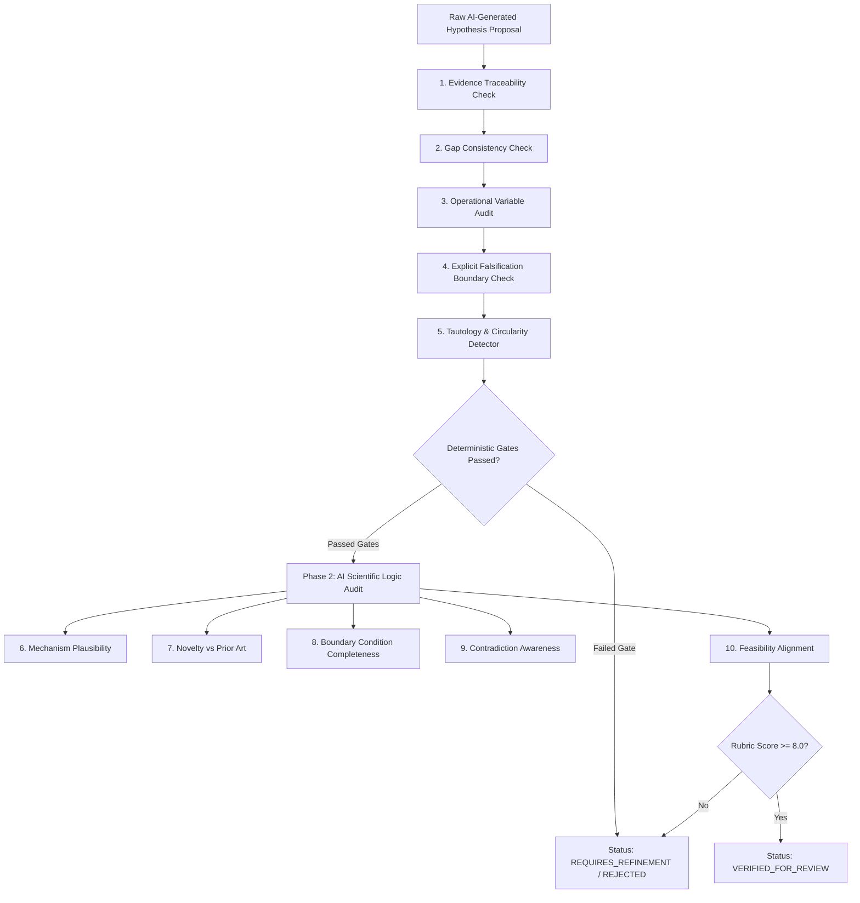

# Anvīkṣā — Stage 4E Falsifiable Hypothesis Synthesis Methodology
## Structured Scientific Schema, Operational Variables & Popperian Falsifiability Verification
### Revision 1: Paradigm Rigor, Anti-Tautology Gates & Evidence Traceability

**Document Version:** 4.1.0-STAGE4E-HYPOTHESIS-REV1  
**Status:** REVISED METHODOLOGY SPECIFICATION ONLY (Implementation Strictly Prohibited)  
**Milestone:** Stage 4E — Subsystem B  
**Baseline:** Version 4.1.0-REVISED (Stage 4E Revision 1)  
**Date:** 2026-11-20  

---

## 1. Executive Philosophy: Popperian Falsification over Speculative AI Brainstorming

A prevalent pathology in AI-generated scientific writing is the generation of **vacuous or unfalsifiable hypotheses**. LLMs frequently output:
- **Tautological assertions:** *"If we train a larger model with more compute, accuracy will improve."*
- **Vague feature proposals:** *"Adding a memory module to the Transformer will enhance its reasoning capabilities."*
- **Unmeasurable aspirations:** *"Our approach will make the representation more semantically meaningful."*
- **Rephrased gap statements:** Re-stating the empirical gap as if it were a novel hypothesis.

Under the epistemological framework of Karl Popper, **a statement is scientific if and only if it is capable of being empirically or formally falsified**:
$$\exists \, \mathcal{O}_{critical} : \quad P(\mathcal{O}_{critical} \mid \mathcal{H}) = 0 \quad \land \quad P(\mathcal{O}_{critical} \mid \neg \mathcal{H}) > 0$$

Subsystem B transforms eligible research opportunities into rigorous, structured scientific hypotheses that define exactly **what observations would disprove them**, specify operational variables, and map the precise causal mechanisms under test.

---

## 2. Structured Hypothesis Representation Schema

Every synthesized hypothesis is modeled as an immutable, typed scientific artifact containing 27 mandatory fields:

```typescript
export interface ScientificHypothesisArtifact {
  // Identifiers & Provenance Links
  hypothesis_id: string;                     // UUID
  parent_gap_id: string;                     // UUID referencing public.research_gaps(id)
  parent_validation_run_id: string;          // Scoped validation run identifier
  research_opportunity_id: string;           // UUID referencing public.research_opportunities(id)
  version_number: number;                    // Monotonically increasing version (v1, v2, ...)

  // Scientific Content & Core Statement
  research_question: string;                 // Precise interrogative question
  hypothesis_statement: string;              // Formal conditional statement (If-Then-Because)
  scientific_rationale: string;              // Theoretical / empirical justification grounded in literature
  paradigm_type:                             // Research methodology paradigm
    | 'EMPIRICAL_QUANTITATIVE'
    | 'COMPARATIVE_BENCHMARK'
    | 'THEORETICAL_FORMAL'
    | 'COMPUTATIONAL_COMPLEXITY'
    | 'QUALITATIVE_SYSTEMS'
    | 'ABLATION_MECHANISTIC';

  // Evidence Grounding & Context
  grounding_evidence_references: Array<{     // Exact citations from Stage 4C/4D
    paper_id: string;
    doi: string | null;
    quote: string;
    offsets: [number, number];
    role: 'PRIMARY_BOTTLENECK' | 'SUPPORTING_OBSERVATION' | 'PRIOR_PARTIAL_SOLUTION';
  }>;
  known_counter_evidence_references: Array<{ // Potential contradicting findings
    paper_id: string;
    doi: string | null;
    contradictory_finding: string;
  }>;
  underlying_assumptions: string[];          // Preconditions assumed to hold true
  boundary_conditions: string[];             // Operational envelope where hypothesis applies

  // Operationalized Variables & Predictions
  independent_variables: Array<{             // Manipulated / Explanatory factors
    name: string;
    description: string;
    operational_definition: string;
    measurement_unit: string;
    allowed_values_or_range: string;
  }>;
  dependent_variables: Array<{               // Measured outcome factors
    name: string;
    description: string;
    operational_definition: string;
    measurement_unit: string;
    expected_direction: 'INCREASE' | 'DECREASE' | 'INVARIANT' | 'NON_LINEAR';
  }>;
  control_variables: Array<{                 // Confounding factors held constant
    name: string;
    constant_value_or_protocol: string;
  }>;

  // Statistical & Falsification Formalism
  statistical_formalism_applicable: boolean; // False for pure theory/proofs
  null_hypothesis: string | null;            // H_0: No effect / baseline equivalence
  alternative_hypothesis: string | null;     // H_1: Directional effect of manipulation
  falsification_conditions: string[];        // Explicit observations that DISPROVE the hypothesis
  critical_failure_threshold: string;        // Quantitative boundary triggering rejection

  // Scope, Quality & Provenance
  scope_and_limitations: string;             // Stated domain boundaries
  falsifiability_rubric_score: number;       // [0.0 - 10.0] derived from 10-point check
  generation_provenance: {
    model_used: string;
    model_requested: string;
    is_fallback: boolean;
    prompt_version: string;
    evidence_corpus_hash: string;
    generation_timestamp: string;
  };
  review_state:                              // Lifecycle review status
    | 'GENERATED'
    | 'EVIDENCE_VERIFICATION_PENDING'
    | 'VERIFIED_FOR_REVIEW'
    | 'REQUIRES_REFINEMENT'
    | 'REJECTED'
    | 'RESEARCHER_APPROVED'
    | 'SUPERSEDED'
    | 'STALE';
}
```

---

## 3. Diverse Methodological Paradigms

Subsystem B **does not force statistical null/alternative hypothesis formalism** onto research questions where it is epistemologically inappropriate. It supports 6 explicit scientific paradigms:

```
                                Scientific Research Question
                                              │
         ┌────────────────────────────────────┼────────────────────────────────────┐
         ▼                                    ▼                                    ▼
[Empirical / Statistical]           [Theoretical / Complexity]            [Systems / Qualitative]
- Independent & Dependent Vars      - Formal Mathematical Theorems        - Architectural Mechanisms
- Null ($H_0$) & Alt ($H_1$)        - Asymptotic Complexity Bounds ($O$)  - Invariant Guarantees
- p-value / Bayes Factor Thresholds - Counter-example Invalidation        - Failure Mode Ablation
- Statistical Power Analysis        - Formal Proof Verification           - Systematic Stress Trials
```

1. **Empirical Quantitative:** Standard statistical design with explicit $H_0$ and $H_1$, power analysis, effect size metrics, and confidence intervals.
2. **Comparative Benchmark:** Side-by-side performance on standardized task suites evaluating multi-metric Pareto frontiers.
3. **Theoretical & Formal:** Mathematical conjectures, formal proof obligations, and asymptotic complexity bounds ($O(N)$ vs $O(N^2)$), where falsification is achieved by producing a single counter-example or proof of contradiction.
4. **Computational Complexity:** Empirical scaling laws relating parameter count, dataset size, memory footprint, or communication latency.
5. **Ablation & Mechanistic:** Controlled removal or isolation of sub-components to demonstrate causal necessity for an observed capability.
6. **Systems & Qualitative:** Architecture designs evaluated on fault tolerance, security invariants, or streaming latency bounds.

---

## 4. The 10-Point Falsifiability & Quality Verification Rubric

Every generated hypothesis must undergo an automated verification evaluation across 10 non-negotiable criteria before being presented to a researcher:



### Detailed Rubric Breakdown

| # | Quality Dimension | Evaluation Standard | Gate Type | Failure Action |
| :-: | :--- | :--- | :---: | :--- |
| **1** | **Evidence Traceability** | Citations link directly to verified Stage 4C chunks with valid SHA-256 hashes. | **DETERMINISTIC** | Hard Rejection if citations are missing or fabricated. |
| **2** | **Logical Consistency** | Hypothesis directly addresses the verified unresolved condition of the gap. | **DETERMINISTIC** | Reject if hypothesis targets a different, unvalidated topic. |
| **3** | **Variable Operationalization** | At least 1 independent and 1 dependent variable with units and definitions. | **DETERMINISTIC** | Reject if variables are vague concepts lacking units/metrics. |
| **4** | **Explicit Falsification** | Contains concrete conditions under which the hypothesis is deemed false. | **DETERMINISTIC** | Reject if no falsification condition or failure threshold exists. |
| **5** | **Anti-Tautology Gate** | Checks for circular reasoning (*"X improves because X is better"*). | **DETERMINISTIC** | Reject if dependent variable is identical to manipulation. |
| **6** | **Mechanism Plausibility** | Proposed causal mechanism is physically, mathematically, or algorithmically plausible. | AI-Assisted | Flag if mechanism violates known conservation laws/theorems. |
| **7** | **Scientific Novelty** | Hypothesis represents an unexplored direction, not an already tested trick. | AI-Assisted | Flag if hypothesis repeats standard practice in recent papers. |
| **8** | **Boundary Completeness** | Explicitly specifies regimes where the hypothesis is expected to hold or fail. | AI-Assisted | Flag if claims are universalized without domain boundary. |
| **9** | **Contradiction Awareness** | Discloses and accounts for known counter-evidence identified in Stage 4D. | AI-Assisted | Flag if hypothesis ignores established contradictory trials. |
| **10**| **Resource Feasibility** | Manipulation can be executed within reasonable domain boundaries. | AI-Assisted | Flag if manipulation demands impossible physical apparatus. |

---

## 5. Multiple Candidate Generation & Semantic Diversity Filter

When researchers request hypothesis generation, the system generates a candidate pool of $K = 5$ hypotheses, filters out low-quality candidates, and selects the $N = 2$ or $3$ most **semantically and mechanistically diverse** hypotheses:

```mermaid
flowchart LR
    Opp[Research Opportunity] --> Gen[Gemma 4 Multi-Candidate Generator (K=5)]
    Gen --> Rubric[10-Point Falsifiability Rubric]
    Rubric --> Cluster[Semantic & Variable Embedding Clustering]
    Cluster --> Select[Diverse Candidate Selection]
    Select --> Out[Output: 2-3 Distinct Research Directions]
```

### 5.1 Anti-Duplication & Clustering Mechanism
1. **Variable Overlap Matrix:** Computes Jaccard similarity between the independent/dependent variable sets of all generated candidates.
2. **Embedding Cosine Distance:** Generates sentence embeddings of the proposed underlying mechanisms. If two candidates have cosine similarity $> 0.85$, they are classified as **linguistic paraphrases**.
3. **Competing Explanation Routing:** The system prioritizes candidates that propose **competing explanations** for the same empirical bottleneck:
   - *Example:* For Attention quadratic complexity:
     - *Candidate A (Algorithmic Hardware):* Fused SRAM tiling maintains exact attention in sub-quadratic memory (IO-aware mechanism).
     - *Candidate B (Approximation):* Low-rank projection of keys/values preserves associative recall within $\epsilon$-error (spectral mechanism).
     - *Candidate C (State-Space / Recurrent):* Continuous-time linear state transitions replace attention entirely (recurrent hidden state mechanism).
   These represent three genuinely distinct scientific trajectories, rather than three wordings of "make attention faster."

---

## 6. Deterministic Abstention Protocol

The system **must refuse to generate a hypothesis** and output an explicit abstention notice when:
1. The research opportunity is flagged as `CONTRADICTED` or `ADDRESSED`.
2. The empirical gap is formulated without measurable variables, and the AI cannot identify objective metrics in related literature (`NOT_OPERATIONALIZED`).
3. The underlying literature coverage is flagged as unindexed or sparse (`INSUFFICIENT_EVIDENCE`).
4. All generated candidates fail the deterministic falsifiability gates.

### Format of Abstention Output
```json
{
  "status": "ABSTAINED",
  "reason": "CANNOT_SYNTHESIZE_FALSIFIABLE_HYPOTHESIS",
  "explanation": "The research opportunity lacks measurable dependent variables and established baseline benchmarks. Generating a hypothesis in this state would produce unfalsifiable speculation.",
  "recommended_action": "Conduct exploratory empirical trials to operationalize measurement metrics before formulating formal hypotheses."
}
```
