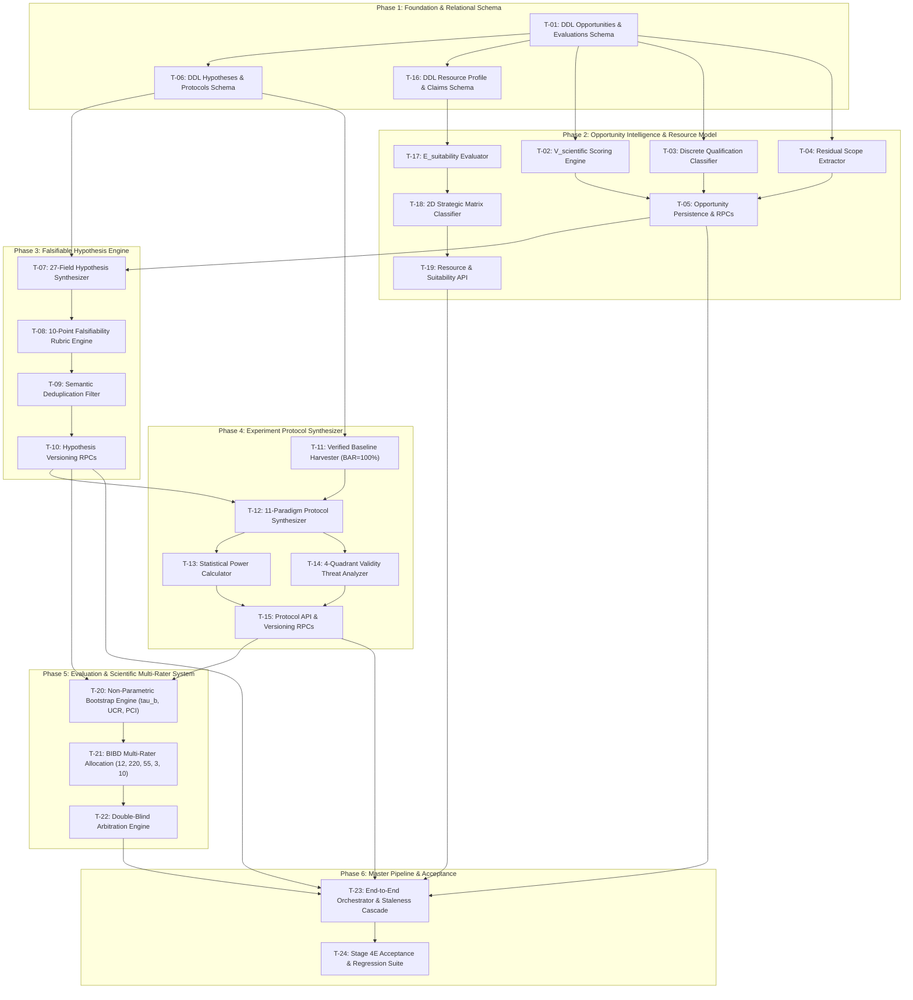

# Anvīkṣā — Stage 4E Implementation Dependency Graph
## Directed Acyclic Task Graph, Critical Path Analysis & Phase Execution Schedule

**Document Version:** 4.1.0-STAGE4E-DEPGRAPH  
**Status:** SPECIFICATION ONLY (Implementation Strictly Prohibited)  
**Milestone:** Stage 4E  
**Date:** 2026-11-21  

---

# 1. Executive Summary & Graph Overview

This document formalizes the topological ordering, predecessor-successor constraints, critical path, and execution phases for implementing Stage 4E.

Stage 4E contains **six core work packages** comprising **24 granular technical tasks**, spanning:
- Schema migrations and SECURITY DEFINER RPCs.
- Mathematical scoring and qualification engines.
- AI prompt templates and structured output schemas.
- Non-parametric evaluation statistical engines.
- RESTful API routers and middleware.
- Automated end-to-end integration and adversarial testing suites.

---

# 2. Comprehensive Implementation Task Inventory

| Task ID | Task Title | Work Package | Primary Nature | Est. Complexity |
| :--- | :--- | :---: | :---: | :---: |
| **T-01** | Stage 4E Database Migration: Opportunities & Evaluations | 4E-IMP-01 / 04 | Database DDL & RLS | Medium |
| **T-02** | Research Opportunity Intelligence Engine & $V_{scientific}$ Scoring | 4E-IMP-01 | Backend Algorithm | High |
| **T-03** | Discrete Contradiction & Frontier Classification Module | 4E-IMP-01 | Backend Logic | Medium |
| **T-04** | Residual Scope Extractor for Partially Addressed Gaps | 4E-IMP-01 | AI Structured Parser | Medium |
| **T-05** | Opportunity REST API & Idempotent Persistence RPCs | 4E-IMP-01 | API & SQL RPC | Medium |
| **T-06** | Stage 4E Database Migration: Hypotheses & Protocols | 4E-IMP-02 / 03 | Database DDL & RLS | Medium |
| **T-07** | 27-Field Falsifiable Hypothesis Synthesizer (6 Paradigms) | 4E-IMP-02 | AI Prompt & Schema | High |
| **T-08** | 10-Point Deterministic Falsifiability Rubric Engine | 4E-IMP-02 | Deterministic Parser | High |
| **T-09** | Semantic Deduplication & Diversity Filter | 4E-IMP-02 | Embedding / Heuristic | Medium |
| **T-10** | Hypothesis Versioning & Mutation RPCs | 4E-IMP-02 | SQL RPC & Audit | Low |
| **T-11** | Verified Literature Baseline Harvester & Number Extractor | 4E-IMP-03 | Backend Pipeline | High |
| **T-12** | 11-Paradigm Experiment Protocol Synthesizer | 4E-IMP-03 | AI Prompt & Schema | High |
| **T-13** | Statistical Power & Sample Size Calculator | 4E-IMP-03 | Mathematical Engine | Medium |
| **T-14** | Four-Quadrant Validity Threat Analyzer | 4E-IMP-03 | AI Structured Parser | Medium |
| **T-15** | Protocol REST API & Versioning RPCs | 4E-IMP-03 | API & SQL RPC | Medium |
| **T-16** | Researcher Resource Profile Schema & Typed Evidence Model | 4E-IMP-04 | Database DDL & RLS | Low |
| **T-17** | Execution Suitability ($E_{suitability}$) Evaluator | 4E-IMP-04 | Backend Algorithm | Medium |
| **T-18** | 2D Strategic Research Decision Matrix Classifier | 4E-IMP-04 | Backend Logic | Low |
| **T-19** | Resource Profile & Evaluation API Endpoints | 4E-IMP-04 | API & Middleware | Low |
| **T-20** | Non-Parametric Bootstrap & Permutation Evaluation Suite | 4E-IMP-05 | Statistical Engine | High |
| **T-21** | BIBD Multi-Rater Allocation & COI Permutation Engine | 4E-IMP-05 | Combinatorial Logic | Medium |
| **T-22** | Double-Blind Review & Arbitration Workflow Engine | 4E-IMP-05 | API & State Machine | Medium |
| **T-23** | End-to-End Scientific Orchestration Pipeline & Staleness Cascade | 4E-IMP-06 | Master Orchestrator | High |
| **T-24** | Stage 4E Comprehensive Acceptance & Regression Test Suite | 4E-IMP-06 | Testing Automation | High |

---

# 3. Directed Acyclic Dependency Graph (DAG)



---

# 4. Critical Path Analysis

The critical path determines the minimum elapsed engineering time required to deliver Stage 4E safely. 

$$\text{Critical Path} = \mathbf{T\text{-}01} \longrightarrow \mathbf{T\text{-}06} \longrightarrow \mathbf{T\text{-}07} \longrightarrow \mathbf{T\text{-}08} \longrightarrow \mathbf{T\text{-}10} \longrightarrow \mathbf{T\text{-}12} \longrightarrow \mathbf{T\text{-}15} \longrightarrow \mathbf{T\text{-}23} \longrightarrow \mathbf{T\text{-}24}$$

### Rationale:
1. **Schema Prerequisites:** Database tables for opportunities and hypotheses must be declared and verified before any scoring or synthesis engines can persist state.
2. **Sequential Scientific Pipeline:**
   - A hypothesis cannot be synthesized (`T-07`) without an eligible opportunity (`T-01`, `T-05`).
   - An experiment protocol (`T-12`) cannot be designed without an approved hypothesis (`T-10`).
   - The master orchestrator (`T-23`) requires completed APIs across opportunities, hypotheses, and protocols.
   - Acceptance verification (`T-24`) requires a functioning end-to-end pipeline.

### Parallelizable Tracks:
- **Track A (Resource & Suitability):** Tasks `T-16`, `T-17`, `T-18`, and `T-19` run in parallel with the Hypothesis Engine (`T-07` through `T-10`).
- **Track B (Baseline Harvester):** Task `T-11` (OpenAlex baseline citation matching) proceeds in parallel with the Falsifiability Rubric (`T-08`).
- **Track C (Statistical Evaluation Engine):** Task `T-20` (BCa bootstrap and permutation testing) proceeds independently of protocol API formatting.

---

# 5. Phased Implementation Roadmap

### Phase 1: Database Infrastructure & Security Definer RPCs (Tasks T-01, T-06, T-16)
- Declares schema migrations in `supabase/migrations/` for all Stage 4E tables.
- Applies RLS policies and composite foreign keys `(gap_id, validation_run_id) REFERENCES public.research_gap_validations(gap_id, validation_run_id) ON DELETE RESTRICT`.
- Enforces strict zero-nil UUID sentinel prohibitions.

### Phase 2: Opportunity Intelligence & Suitability Model (Tasks T-02, T-03, T-04, T-05, T-17, T-18, T-19)
- Implements `server/opportunityIntelligenceService.ts` and `server/researcherSuitabilityService.ts`.
- Implements $V_{scientific}$ linear weighted scoring and discrete qualification states.
- Implements 2D Strategic Decision Matrix mapping `StrategicQuadrant(V, E)`.

### Phase 3: Falsifiable Hypothesis Engine (Tasks T-07, T-08, T-09, T-10)
- Implements `server/hypothesisSynthesisService.ts`.
- Implements 27-field schema and 10-point automated falsifiability rubric.
- Enforces primary model adapter routing (`gemma-4-26b-a4b-it`) with fallback tracking.

### Phase 4: Experiment Protocol Synthesizer (Tasks T-11, T-12, T-13, T-14, T-15)
- Implements `server/experimentProtocolService.ts`.
- Implements verified baseline harvesting ($BAR = 100\%$) and 11 paradigm schemas.
- Implements statistical power calculator and validity threat analyzer.

### Phase 5: Evaluation Framework & Multi-Rater BIBD System (Tasks T-20, T-21, T-22)
- Implements `server/evaluationBenchmarkService.ts`.
- Implements Kendall's $\tau_b$ paired bootstrap, cluster-aware $UCR$, and bounded $PCI$ BCa bootstrap.
- Implements $(12, 220, 55, 3, 10)$ BIBD allocation and arbitration workflow.

### Phase 6: Orchestration, Staleness Cascade & Final Acceptance (Tasks T-23, T-24)
- Implements master pipeline orchestrator in `server/stage4eOrchestrator.ts`.
- Builds automated staleness propagation triggers.
- Executes full acceptance test suite in `tests/stage4e_acceptance_verification.ts`.

---

# 6. Dependency Risk Matrix & External Blockers

| Dependency | Required By | Nature of Risk | Architectural Fallback |
| :--- | :--- | :--- | :--- |
| **OpenAlex Live API** | `T-11: Baseline Harvester` | Rate limits, network latency, missing DOIs. | Local cache in `public.research_papers` + retry backoff. |
| **Gemma 4 MoE Token Quota** | `T-07, T-12: AI Synthesis` | Vertex/AI Studio 429 quota exhaustion. | Seamless Model Adapter fallback to `gemini-3-flash-preview`. |
| **Cloud Provider SSO / OAuth** | `T-17: Suitability Evaluator` | Deferred to Stage 4E.1. | Discrete typed status `DECLARED_AVAILABLE` with audit badge. |
| **Lean 4 Proof Daemon** | `T-12: Paradigm 6 Protocols` | Complex local compiler environment. | Syntactic script verification + async background task. |
| **Human Expert Availability** | `T-21, T-22: BIBD Reviews` | Reviewer latency or dropouts. | Linear Mixed-Effects Model (LMM) handles incomplete blocks. |

```
═══════════════════════════════════════════════════════════════════════════════
  STAGE 4E DEPENDENCY GRAPH SPECIFICATION: VERIFIED
  EXECUTION REMAINS STRICTLY BLOCKED PENDING IMPLEMENTATION AUTHORIZATION
═══════════════════════════════════════════════════════════════════════════════
```
