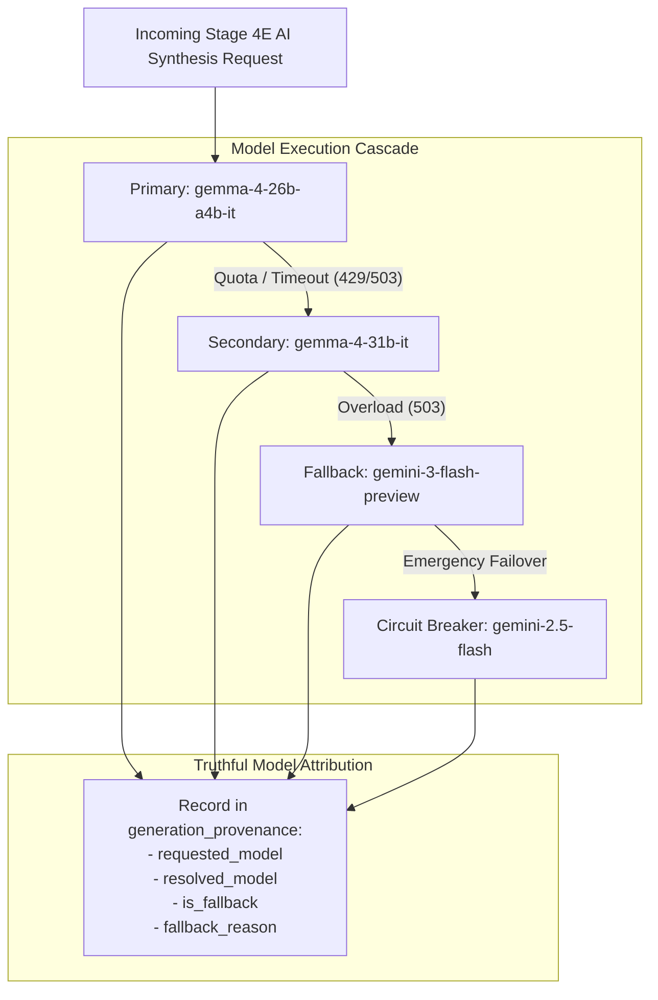

# Anvīkṣā — Stage 4E Implementation Risk Register
## Engineering Risk Analysis, Mitigation Protocols & Non-Blocking Operational Limitations

**Document Version:** 4.1.0-STAGE4E-RISK-REGISTER  
**Status:** ARCHITECTURAL SPECIFICATION ONLY (Implementation Strictly Prohibited)  
**Milestone:** Stage 4E  
**Date:** 2026-11-21  

---

# 1. Executive Summary & Risk Management Protocol

This document establishes the risk register and mitigation protocols for Stage 4E. It details technical, architectural, operational, and scientific risks that may arise during future implementation, defines concrete engineering fallbacks, and explicitly integrates the five accepted non-blocking operational limitations.

---

# 2. Comprehensive Implementation Risk Matrix

| Risk ID | Risk Category | Description & Failure Mode | Likelihood | Impact | Severity Score | Pre-Planned Mitigation Protocol |
| :---: | :--- | :--- | :---: | :---: | :---: | :--- |
| **RSK-01** | **AI Inference** | Gemma 4 MoE (`gemma-4-26b-a4b-it`) rate limits (HTTP 429) or token exhaustion during complex protocol synthesis. | Medium | High | **HIGH (12)** | Centralized Model Adapter routing automatically falls back to secondary `gemma-4-31b-it` or `gemini-3-flash-preview` with truthful attribution logged in `generation_provenance`. |
| **RSK-02** | **External API** | OpenAlex API latency spikes or intermittent outages during literature baseline lookup. | High | Medium | **HIGH (12)** | In-memory caching and local database lookups in `public.research_papers`. Exponential backoff retry with circuit breaker. |
| **RSK-03** | **Data Integrity** | Cascade deletion of validation runs inadvertently severing opportunity/hypothesis history. | Low | Critical | **CRITICAL (15)** | Enforced `ON DELETE RESTRICT` on all composite foreign keys `(gap_id, validation_run_id)`. Soft-invalidation (`is_stale = true`) replaces hard deletes. |
| **RSK-04** | **Scientific Rigor** | Synthesizer generating non-falsifiable platitudes or unfalsifiable statements. | Medium | High | **HIGH (12)** | Deterministic 10-point automated falsifiability rubric preceding human review. Rejection gate enforces $HFI \ge 90\%$. |
| **RSK-05** | **Baseline Authenticity**| Model inventing plausible baseline performance figures for unverified papers. | Medium | Critical | **CRITICAL (15)** | Zero-tolerance invariant ($BAR = 100\%$). Mandatory lookup of exact DOI and published figures in paper chunks; unreported numbers labeled `UNREPORTED_IN_ORIGINAL_PUBLICATION`. |
| **RSK-06** | **Statistical Boundary**| Logit transform singularities at $PCI \in \{0.0, 10.0\}$ causing calculation crashes. | Low | High | **MEDIUM (8)** | Primary use of Bounded Non-Parametric BCa Bootstrap directly on $[0.0, 10.0]$. Parametric fallback uses Bayesian uniform Beta prior squeezing ($p^* = \frac{p(N-1)+0.5}{N}$). |
| **RSK-07** | **Operational Rater**| Expert rater dropout during multi-rater evaluation disrupting BIBD balance schedule. | High | Medium | **HIGH (12)** | Linear Mixed-Effects Model (LMM) with rater random effects handles incomplete blocks without assuming classical ANOVA balance. |
| **RSK-08** | **Security & Access** | Unauthorized mutation of approved research hypotheses or execution protocols via client. | Low | Critical | **CRITICAL (15)** | Strict Row-Level Security (RLS) restricting mutations to `service_role` through authenticated SECURITY DEFINER server RPCs. |
| **RSK-09** | **Concurrency** | Concurrent gap updates causing stale opportunity score overwrites. | Medium | Medium | **MEDIUM (9)** | PostgreSQL advisory locking and row-version checks on `public.research_opportunities(updated_at)`. |
| **RSK-10** | **Temporal Leakage** | Future citations (post-$T_0$) leaking into retrospective benchmark opportunity rankings. | Low | Critical | **CRITICAL (15)** | Enforced temporal freeze barrier: OpenAlex queries filter strictly by `publication_year <= T_0` and citation count as of $T_0$. |

---

# 3. Explicit Incorporation of the Five Non-Blocking Operational Limitations

In strict adherence to the Stage 4E Frozen Architecture baseline and the Final Scientific Integrity Amendment, the five accepted non-blocking operational limitations are formally managed:

### 3.1 Limitation 1: Automated Cloud Provider OAuth Verification
- **Status:** `NON-BLOCKING LIMITATION (Deferred to Stage 4E.1)`.
- **Nature:** Direct live OAuth integration with AWS, Google Cloud, and university SLURM cluster schedulers requires external institutional integrations.
- **Engineered Baseline Fallback:**
  - Researcher resource profiles support self-declared entries (`DECLARED_AVAILABLE`) and API key credentials.
  - All suitability outputs based on self-declarations carry the mandatory transparent badge: `EVIDENCE: UNVERIFIED_SELF_DECLARATION`.
  - Zero arbitrary multipliers are applied; claimed capacity is evaluated directly with auditable evidence provenance.

### 3.2 Limitation 2: Lean 4 / Isabelle Automated Proof Sandbox Execution
- **Status:** `NON-BLOCKING LIMITATION`.
- **Nature:** Paradigm 6 (Formal Proof) requires a containerized Lean 4 / Coq environment. Synchronous compilation during HTTP requests would cause severe API gateway timeouts.
- **Engineered Baseline Fallback:**
  - Protocol generation verifies syntactic structure and type annotations using an internal AST parser.
  - Formal proof compilation is queued as an asynchronous background worker task via message queues, updating `public.research_experiments.execution_environment` upon completion without blocking synchronous REST responses.

### 3.3 Limitation 3: External Institutional Review Board (IRB) Governance
- **Status:** `NON-BLOCKING LIMITATION`.
- **Nature:** Randomized Controlled Trials (RCTs) involving human participants cannot be approved algorithmically by software.
- **Engineered Baseline Fallback:**
  - Subsystem C synthesizes the complete ethical disclosure, participant risk analysis, and informed consent framework as part of the protocol artifact.
  - The protocol status remains pinned at `RESEARCHER_APPROVED` with advisory badge: `REQUIRES_INSTITUTIONAL_IRB_FILING`. Human participant execution remains strictly external.

### 3.4 Limitation 4: Expert Panel Operational Validation
- **Status:** `NON-BLOCKING LIMITATION (Pending Pilot Study)`.
- **Nature:** Satisfying the algebraic parameters of $(v=12, b=220, r=55, k=3, \lambda=10)$ confirms mathematical existence, but does not prove empirical operational validity before human raters execute the task.
- **Engineered Baseline Fallback:**
  - A pre-evaluation **Pilot Annotation Study** ($N=20$) is mandated prior to full benchmark rollout.
  - The pilot measures baseline $\alpha_{Kripp}$, calibrates rater variances, and dynamically adjusts the required sample size $b$ before commissioning the full 220-block evaluation.

### 3.5 Limitation 5: Benchmark Calibration & Temporal Horizon Freezing
- **Status:** `NON-BLOCKING LIMITATION`.
- **Nature:** Evaluating opportunity rankings on historical literature trajectories (e.g. 2020–2022) requires strict insulation from subsequent citations.
- **Engineered Baseline Fallback:**
  - The benchmark runner enforces hard date filters on all OpenAlex discovery calls (`t <= T_0`).
  - Follow-up breakthroughs published in the outcome window ($T_0 < t \le T_0 + 24\text{mo}$) are recorded exclusively as ground truth validation targets, insulated by an impermeable barrier.

---

# 4. Fallback Architecture & Circuit Breakers



- **Inference Circuit Breaker:** If Gemma 4 MoE encounters consecutive 429 quota errors within 60 seconds, the adapter automatically switches to `gemini-3-flash-preview` for 5 minutes before probing primary health.
- **Provenance Invariant:** The model adapter records exact execution details in `generation_provenance`, guaranteeing that human reviewers know exactly which model generated each artifact.

```
═══════════════════════════════════════════════════════════════════════════════
  STAGE 4E RISK REGISTER & LIMITATION PROTOCOL: RATIFIED
  IMPLEMENTATION REMAINS STRICTLY BLOCKED PENDING AUTHORIZATION
═══════════════════════════════════════════════════════════════════════════════
```
