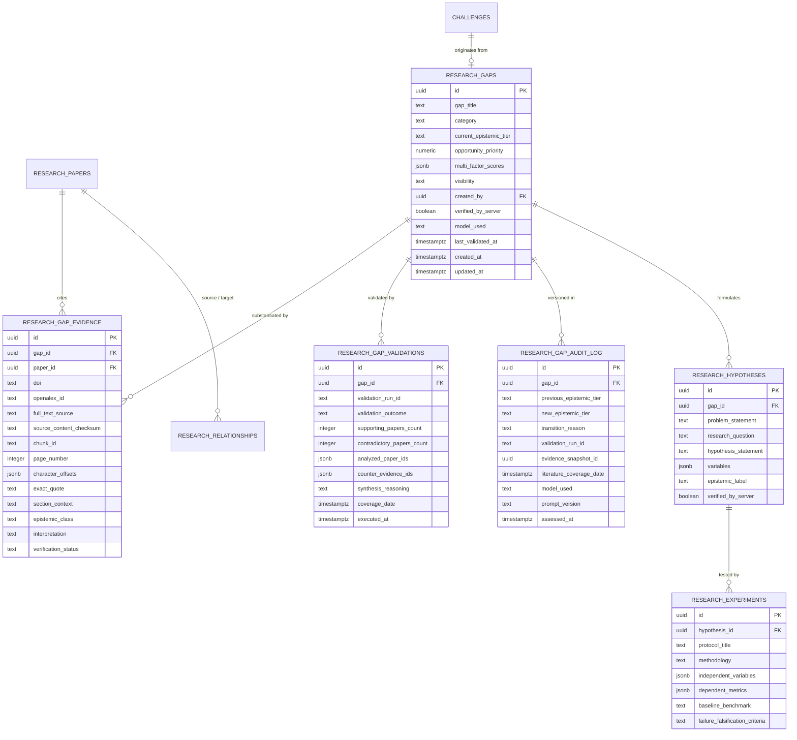

# Anvīkṣā — Stage 4: Database Design & Literature Knowledge Graph
## PostgreSQL Relational Knowledge Representation, Schema DDL & Security Architecture

**Document Version:** 4.1.0-REVISED  
**Status:** Database Architecture & Schema Specification (Migrations Prohibited in this Phase)  
**Author:** Principal Supabase PostgreSQL Architect & Security Auditor  
**Target Milestone:** Stage 4 — Research Gap Discovery & Validation Engine  

---

## 1. Architectural Strategy: Why Relational PostgreSQL?

A critical engineering decision in Stage 4 is how to model the **Literature Knowledge Graph (LKG)**.

### Evaluation Matrix

| Criteria | PostgreSQL (Relational + CTEs) | Dedicated Graph DB (Neo4j / Memgraph) | pgvector Vector Database |
| :--- | :--- | :--- | :--- |
| **Architectural Complexity** | **Zero new infrastructure.** Native to Supabase stack. | **High.** Requires separate host, auth layer, backup, and sync pipelines. | Moderate. Extension required. |
| **ACID & Provenance Safety** | **Maximum.** Strict transactional integrity, foreign keys, and trigger enforcement. | Moderate. Multi-database synchronization introduces eventual consistency risks. | High. Runs within PostgreSQL. |
| **Row Level Security (RLS)** | **Native Supabase RLS.** Seamless per-row authorization across public and private visibility. | **None.** Graph databases require bespoke authorization proxies. | Native Supabase RLS. |
| **Graph Traversal Capability** | **High.** Fast recursive CTEs (`WITH RECURSIVE`) traverse up to 10 hops in single-digit milliseconds. | Very High. Native graph traversal for arbitrary depth ($N > 20$). | Low. Vector distance queries, not graph traversals. |
| **Exact Evidence Traceability** | **Deterministic.** Exact page/section citations, byte offsets, SHA-256 checksums, audit tables. | Moderate. Node/property labels often divorce data from schemas. | Low. Semantic similarity does not guarantee exact citation locators. |
| **Operational Overhead** | **Zero additional cost.** Reuses existing Supabase instance. | High. Additional hosting, licensing, and operational maintenance. | Low to Moderate. Index build memory requirements. |

### Technical Decision
**Stage 4 implements the Literature Knowledge Graph directly within Supabase PostgreSQL.**
- Standard academic citation graphs and evidence relationships have a known, bounded traversal depth (typically 2 to 4 degrees of separation: Paper $\to$ Limitation $\to$ Gap $\to$ Hypothesis $\to$ Challenge).
- PostgreSQL handles join tables and recursive CTEs with extreme efficiency when supported by compound B-tree and GIN indexes.
- No external graph database or vector extension is required for Stage 4 core validation, avoiding operational fragility and credential sprawl.

---

## 2. Revised Entity-Relationship Data Model



---

## 3. Schema DDL Specification (Planned for Sub-Stage 4A Migration)

*(Note: The SQL below is a formal architectural specification. Migration execution is strictly prohibited during this blueprint phase.)*

### 3.1 Primary Table: `public.research_gaps`

```sql
CREATE TYPE public.research_gap_category AS ENUM (
    'METHODOLOGICAL', 'THEORETICAL', 'EMPIRICAL',
    'DATASET_BENCHMARK', 'EVALUATION_MEASUREMENT', 'COMPUTATIONAL_SCALABILITY',
    'SECURITY_ROBUSTNESS_PRIVACY', 'REPRODUCIBILITY', 'GENERALIZATION',
    'CONTRADICTORY_FINDINGS', 'APPLICATION_DOMAIN', 'DEPLOYMENT_IMPLEMENTATION'
);

CREATE TYPE public.epistemic_validation_tier AS ENUM (
    'AUTHOR_STATED_LIMITATION',
    'PAPER_SUPPORTED_OBSERVATION',
    'AI_INFERRED_LIMITATION',
    'CANDIDATE_RESEARCH_GAP',
    'CONFIRMED_UNRESOLVED',
    'PARTIALLY_ADDRESSED',
    'ADDRESSED_OR_SUPERSEDED',
    'CONTRADICTED_FINDING',
    'INSUFFICIENT_EVIDENCE'
);

CREATE TYPE public.gap_visibility AS ENUM ('private', 'community', 'public');

CREATE TABLE public.research_gaps (
    id UUID PRIMARY KEY DEFAULT gen_random_uuid(),
    gap_title TEXT NOT NULL,
    category public.research_gap_category NOT NULL,
    current_epistemic_tier public.epistemic_validation_tier NOT NULL DEFAULT 'CANDIDATE_RESEARCH_GAP',
    
    -- Explainable Multi-Factor Scores (Range 0.0 - 10.0)
    opportunity_priority NUMERIC(4,2) CHECK (opportunity_priority >= 0.0 AND opportunity_priority <= 10.0),
    multi_factor_scores JSONB NOT NULL DEFAULT '{}'::jsonb,
    
    -- Ownership & Visibility
    visibility public.gap_visibility NOT NULL DEFAULT 'private',
    created_by UUID REFERENCES auth.users(id) ON DELETE SET NULL,
    
    -- Server-Enforced Provenance
    verified_by_server BOOLEAN NOT NULL DEFAULT FALSE,
    model_used TEXT NOT NULL,
    model_requested TEXT NOT NULL,
    is_fallback BOOLEAN NOT NULL DEFAULT FALSE,
    fallback_reason TEXT,
    
    -- Temporal Coverage Tracking
    last_validated_at TIMESTAMPTZ,
    created_at TIMESTAMPTZ NOT NULL DEFAULT timezone('utc'::text, now()),
    updated_at TIMESTAMPTZ NOT NULL DEFAULT timezone('utc'::text, now())
);

-- Compound Indexes for Fast Traversal & Filtering
CREATE INDEX idx_research_gaps_category_tier ON public.research_gaps (category, current_epistemic_tier);
CREATE INDEX idx_research_gaps_priority ON public.research_gaps (opportunity_priority DESC NULLS LAST);
CREATE INDEX idx_research_gaps_visibility_user ON public.research_gaps (visibility, created_by);
```

### 3.2 Evidence Grounding Table: `public.research_gap_evidence`

```sql
CREATE TABLE public.research_gap_evidence (
    id UUID PRIMARY KEY DEFAULT gen_random_uuid(),
    gap_id UUID NOT NULL REFERENCES public.research_gaps(id) ON DELETE CASCADE,
    paper_id UUID REFERENCES public.research_papers(id) ON DELETE CASCADE,
    
    -- Canonical Identifiers & Provenance
    doi TEXT,
    openalex_id TEXT,
    full_text_source TEXT,
    source_content_checksum TEXT NOT NULL, -- SHA-256 hash of source chunk
    chunk_id TEXT NOT NULL,
    page_number INTEGER,
    character_offsets JSONB NOT NULL, -- {"start": 1240, "end": 1450}
    
    -- Exact Quotation & Analysis
    exact_quote TEXT NOT NULL,
    section_context TEXT NOT NULL,
    epistemic_class TEXT NOT NULL CHECK (epistemic_class IN ('AUTHOR_CONCESSION', 'EMPIRICAL_TABLE', 'AI_DEDUCTION')),
    interpretation TEXT NOT NULL,
    hedging_flags JSONB DEFAULT '[]'::jsonb,
    
    -- Verification Status
    verification_status TEXT NOT NULL DEFAULT 'PENDING' CHECK (verification_status IN ('VERIFIED_EXACT_MATCH', 'VERIFIED_APPROXIMATE', 'FAILED_VERIFICATION')),
    
    created_at TIMESTAMPTZ NOT NULL DEFAULT timezone('utc'::text, now())
);

CREATE INDEX idx_gap_evidence_gap_id ON public.research_gap_evidence (gap_id);
CREATE INDEX idx_gap_evidence_paper_id ON public.research_gap_evidence (paper_id);
CREATE INDEX idx_gap_evidence_checksum ON public.research_gap_evidence (source_content_checksum);
```

### 3.3 Epistemic Audit Log Table: `public.research_gap_audit_log`

```sql
CREATE TABLE public.research_gap_audit_log (
    id UUID PRIMARY KEY DEFAULT gen_random_uuid(),
    gap_id UUID NOT NULL REFERENCES public.research_gaps(id) ON DELETE CASCADE,
    previous_epistemic_tier public.epistemic_validation_tier,
    new_epistemic_tier public.epistemic_validation_tier NOT NULL,
    transition_reason TEXT NOT NULL,
    validation_run_id TEXT NOT NULL,
    evidence_snapshot JSONB NOT NULL DEFAULT '{}'::jsonb,
    literature_coverage_date TIMESTAMPTZ NOT NULL,
    model_used TEXT NOT NULL,
    prompt_version TEXT NOT NULL,
    assessed_at TIMESTAMPTZ NOT NULL DEFAULT timezone('utc'::text, now())
);

CREATE INDEX idx_gap_audit_log_gap_id ON public.research_gap_audit_log (gap_id);
CREATE INDEX idx_gap_audit_log_assessed_at ON public.research_gap_audit_log (assessed_at);
```

---

## 4. Row Level Security (RLS) & Provenance Trigger

### 4.1 RLS Policies for Visibility & Ownership

```sql
ALTER TABLE public.research_gaps ENABLE ROW LEVEL SECURITY;
ALTER TABLE public.research_gap_evidence ENABLE ROW LEVEL SECURITY;
ALTER TABLE public.research_gap_audit_log ENABLE ROW LEVEL SECURITY;

-- 1. Read Policy: Anyone can view public and community gaps; users view their own private gaps
CREATE POLICY "rls_research_gaps_select"
ON public.research_gaps FOR SELECT
USING (
    visibility IN ('public', 'community') OR
    (auth.uid() IS NOT NULL AND created_by = auth.uid())
);

-- 2. Evidence Read Policy: Follows the gap's visibility
CREATE POLICY "rls_gap_evidence_select"
ON public.research_gap_evidence FOR SELECT
USING (
    EXISTS (
        SELECT 1 FROM public.research_gaps g
        WHERE g.id = research_gap_evidence.gap_id
        AND (
            g.visibility IN ('public', 'community') OR
            (auth.uid() IS NOT NULL AND g.created_by = auth.uid())
        )
    )
);

-- 3. Write Disablement: Deny direct INSERT/UPDATE/DELETE from anon and authenticated roles
CREATE POLICY "rls_research_gaps_insert_denied" ON public.research_gaps FOR INSERT TO anon, authenticated WITH CHECK (false);
CREATE POLICY "rls_research_gaps_update_denied" ON public.research_gaps FOR UPDATE TO anon, authenticated USING (false);
CREATE POLICY "rls_research_gaps_delete_denied" ON public.research_gaps FOR DELETE TO anon, authenticated USING (false);
```

### 4.2 Security Trigger & Server RPC

```sql
-- Trigger to protect verified provenance
CREATE OR REPLACE FUNCTION public.protect_research_gaps_provenance()
RETURNS TRIGGER
LANGUAGE plpgsql
SECURITY DEFINER
SET search_path = public
AS $$
BEGIN
    IF (NEW.verified_by_server = true) THEN
        IF (current_user <> 'service_role' AND auth.role() <> 'service_role') THEN
            RAISE EXCEPTION 'Access Denied: Only server service_role can persist verified research gaps.';
        END IF;
    END IF;
    RETURN NEW;
END;
$$;

CREATE TRIGGER trg_protect_research_gaps_provenance
BEFORE INSERT OR UPDATE ON public.research_gaps
FOR EACH ROW EXECUTE FUNCTION public.protect_research_gaps_provenance();

-- Trusted RPC Function
CREATE OR REPLACE FUNCTION public.insert_server_verified_gap(
    p_gap_title TEXT,
    p_category public.research_gap_category,
    p_epistemic_tier public.epistemic_validation_tier,
    p_opportunity_priority NUMERIC,
    p_multi_factor_scores JSONB,
    p_visibility public.gap_visibility,
    p_created_by UUID,
    p_model_used TEXT,
    p_model_requested TEXT,
    p_is_fallback BOOLEAN,
    p_fallback_reason TEXT
)
RETURNS UUID
LANGUAGE plpgsql
SECURITY DEFINER
SET search_path = public
AS $$
DECLARE
    v_gap_id UUID;
BEGIN
    IF (current_user <> 'service_role' AND auth.role() <> 'service_role') THEN
        RAISE EXCEPTION 'Access Denied: Function execute strictly limited to service_role.';
    END IF;

    INSERT INTO public.research_gaps (
        gap_title, category, current_epistemic_tier, opportunity_priority,
        multi_factor_scores, visibility, created_by, verified_by_server,
        model_used, model_requested, is_fallback, fallback_reason
    ) VALUES (
        p_gap_title, p_category, p_epistemic_tier, p_opportunity_priority,
        p_multi_factor_scores, p_visibility, p_created_by, TRUE,
        p_model_used, p_model_requested, p_is_fallback, p_fallback_reason
    ) RETURNING id INTO v_gap_id;

    RETURN v_gap_id;
END;
$$;

REVOKE ALL ON FUNCTION public.insert_server_verified_gap FROM PUBLIC, anon, authenticated;
GRANT EXECUTE ON FUNCTION public.insert_server_verified_gap TO service_role;
```
