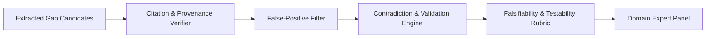

# Anvīkṣā — Stage 4: Evaluation & Acceptance Framework
## Empirical Metrics, Benchmark Literature Datasets & Scientific Validation Protocols

**Document Version:** 4.1.0-REVISED  
**Status:** Evaluation Framework & Benchmark Specification (Implementation Prohibited in this Phase)  
**Author:** Lead Evaluation Architect & AI Safety Auditor  
**Target Milestone:** Stage 4 — Research Gap Discovery & Validation Engine  

---

## 1. Evaluation Philosophy: Empirical Grounding Over Synthetic Heuristics

A core failure of generative AI systems in science is calculating artificial evaluation metrics against self-generated mock data or claiming unverified high performance prior to trial execution. Anvīkṣā strictly prohibits evaluating AI modules against fabricated benchmarks.

Stage 4 evaluation is governed by four non-negotiable principles:
1. **Real Literature Exclusively:** Evaluation must be executed against peer-reviewed scientific papers with verifiable DOIs and OpenAlex IDs.
2. **Targets vs. Results:** Quantitative metrics are explicitly documented as **TARGETS** to be met, never reported as achieved until the test suite is executed.
3. **No Unsubstantiated Percentages:** Accuracy metrics may only be cited if derived from documented ground-truth evaluation runs.
4. **Independent Benchmark Papers with Known Ground-Truth Trajectories:** The benchmark must contain genuinely independent papers and include examples where an apparent gap is already addressed, partially addressed, contradicted, or unresolved.

---

## 2. Evaluation Targets & Scientific Metric Formulations

### 2.1 Metric Target Standards & Formulations

| Metric | Target Standard | Calculation Methodology | Verification Method |
| :--- | :---: | :--- | :--- |
| **Citation Accuracy ($C_{acc}$)** | **$\ge 95\%$ (Target)** | $\frac{\text{Citations exactly matching PDF section, page \& char offsets}}{\text{Total extracted citations}}$ | Automated exact substring search & SHA-256 chunk hash check against raw PDF text. |
| **Epistemic Class Separation ($E_{sep}$)** | **$100\%$ (Target)** | $\frac{\text{Accurately labeled author concessions}}{\text{Total author-stated claims}} = 1.0$ | Human expert verification against Discussion/Limitations section. Zero false author attribution allowed. |
| **False Gap Detection Rate ($FGR$)** | **$\le 10\%$ (Target)** | $\frac{\text{Gaps fabricated or misrepresenting author claims}}{\text{Total proposed candidate gaps}}$ | Expert audit: does the paper actually exhibit this limitation under stated conditions? |
| **Contradiction Detection F1 ($F1_{contra}$)** | **$\ge 85\%$ (Target)** | Harmonic mean of precision & recall on benchmark contradiction pairs | Comparison against ground-truth contradictory findings dataset. |
| **Resolution Classification Accuracy ($RCA$)** | **$\ge 90\%$ (Target)** | $\frac{\text{Correctly classified validation outcomes}}{\text{Total benchmark gaps evaluated across follow-up literature}}$ | Evaluated across confirmed outcomes: `CONFIRMED_UNRESOLVED`, `PARTIALLY_ADDRESSED`, `ADDRESSED`, `CONTRADICTED`, `INSUFFICIENT_EVIDENCE`. |
| **Hypothesis Falsifiability Score ($HFS$)** | **$\ge 4.5 / 5.0$ (Target)** | Percentage of generated hypotheses possessing identifiable independent & dependent variables with concrete failure criteria | Structured schema validation & expert logic review across 5-point rubric. |
| **Researcher Utility Score ($RUS$)** | **$\ge 4.2 / 5.0$ (Target)** | Blind researcher evaluation on novelty, clarity, and experiment feasibility | 5-point Likert scale assessed by active PhD / post-doc researchers. |

---

## 3. Real Benchmark Scholarly Datasets (Corrected Scientific Claims)

To ensure rigorous multi-paper validation, Stage 4 defines three real-world multi-paper benchmark evaluation clusters with accurately represented scientific trade-offs and verified publication dates.

---

### Cluster A: Sequence Modeling & Efficient Attention (AI / Machine Learning)

#### Papers:
1. **Paper 1 (Foundational Attention):** *Attention Is All You Need* (Vaswani et al., NeurIPS 2017. DOI: `10.48550/arxiv.1706.03762`)
   - *Core Claim:* Scaled dot-product attention achieves state-of-the-art translation.
   - *Author-Stated Limitation:* $O(N^2)$ computational complexity and memory consumption with respect to sequence length $N$.
2. **Paper 2 (IO-Aware Exact Attention Optimization):** *FlashAttention: Fast and Memory-Efficient Exact Attention with IO-Awareness* (Dao et al., NeurIPS 2022. DOI: `10.48550/arxiv.2205.14135`)
   - *Core Contribution:* Tiles attention to reduce HBM reads/writes; computes **mathematically exact** attention in $O(N^2)$ FLOPs but $O(N)$ memory footprint.
   - *Author-Stated Limitation:* Does not change the $O(N^2)$ FLOP complexity; work-partitioning across thread blocks leaves GPU compute underutilized on certain head dimensions.
3. **Paper 3 (Algorithmic Parallelism Refinement):** *FlashAttention-2: Faster Attention with Better Parallelism and Work Partitioning* (Dao, ICLR 2024. DOI: `10.48550/arxiv.2307.08691`)
   - *Core Contribution:* Re-orders loops over sequence dimension and optimizes warp-level work partitioning, reaching $73\%$ of theoretical A100 peak throughput.
   - *Status relative to FlashAttention-1:* Conclusively **`ADDRESSED`** the work-partitioning and scheduling inefficiencies of FlashAttention-1.
4. **Paper 4 (Alternative Sequence Modeling Paradigm):** *Mamba: Linear-Time Sequence Modeling with Selective State Spaces* (Gu & Dao, 2023. DOI: `10.48550/arxiv.2312.00752`)
   - *Core Contribution:* Selective state spaces (SSMs) achieving $O(N)$ linear-time inference and training throughput.
   - *Crucial Scientific Distinction:* **Mamba DOES NOT supersede FlashAttention.**
     - FlashAttention computes *exact* pairwise attention required for arbitrary in-context associative recall, multi-query key-value retrieval, and bidirectional cross-attention.
     - Mamba models sequences via compressed recurrent hidden states, trading off exact associative recall on complex multi-hop induction heads for linear throughput.
     - Mamba requires specialized hardware-aware fused scan implementations and cannot natively serve as a drop-in replacement for pretrained Transformer cross-attention modules.
   - *Expected Validation Outcome:* Marked as **`PARTIALLY_ADDRESSED`** regarding long-context throughput, with active **`CONFIRMED_UNRESOLVED`** trade-offs on discrete associative recall and hardware-dependent compilation.

---

### Cluster B: Computational Structural Biology & Protein Folding

#### Papers:
1. **Paper 1 (Seed / Breakthrough):** *Highly accurate protein structure prediction with AlphaFold* (Jumper et al., Nature 2021. DOI: `10.1038/s41586-021-03819-2`)
   - *Core Contribution:* Atomic accuracy structural prediction via Evoformer neural architecture combining pair representations with Multiple Sequence Alignments (MSA).
   - *Author-Stated / Empirical Limitations:*
     - Heavy reliance on MSA generation: searching genetic databases (UniRef, BFD) takes tens of minutes per target sequence, dominating total runtime.
     - Severe performance degradation on orphan proteins, single-sequence de novo designs, and viral proteins lacking evolutionary homologs.
     - Inability to predict dynamic multi-state conformations and non-equilibrium conformational ensembles from static MSAs alone.
2. **Paper 2 (Language Model Alternative):** *Language models of protein sequences at the scale of evolution with ESM2 / ESMFold* (Lin et al., Science 2023. DOI: `10.1126/science.ade2574`)
   - *Core Contribution:* Direct single-sequence structure prediction using evolutionary representations learned across 15 billion sequence parameters, accelerating prediction by up to $60\times$ compared to AlphaFold 2.
   - *Crucial Scientific Distinction:* **ESMFold DOES NOT automatically resolve AlphaFold 2's limitations.**
     - ESMFold resolves the *database search runtime bottleneck* by predicting directly from primary sequence without MSA retrieval.
     - However, ESMFold exhibits lower average prediction accuracy (TM-score and lDDT) than AlphaFold 2 on complex targets with deep MSAs.
     - On orphan proteins and de novo designed sequences with zero evolutionary history in training corpora, both ESMFold and AlphaFold 2 face accuracy ceilings.
   - *Expected Validation Outcome:* The MSA runtime bottleneck is marked **`PARTIALLY_ADDRESSED`** with documented accuracy trade-offs. The orphan protein generalization gap is marked **`CONFIRMED_UNRESOLVED`**.
3. **Paper 3 (Dynamic Conformation Analysis):** *Sampling alternative conformations of transporters and receptors with AlphaFold2* (del Alamo et al., eLife 2022. DOI: `10.7554/eLife.75751`)
   - *Core Contribution / Finding:* Proves AlphaFold 2 can sample alternative functional conformations if MSA depth is artificially subsampled.
   - *Expected Validation Outcome:* Validates that dynamic conformational ensemble prediction was an unaddressed empirical gap in baseline AlphaFold 2, partially unblocked via stochastic subsampling heuristics.

---

### Cluster C: Open-Weight Frontier Language Architectures

#### Papers:
1. **Paper 1 (Dense Open Foundation):** *LLaMA: Open and Efficient Foundation Language Models* (Touvron et al., 2023. DOI: `10.48550/arxiv.2302.13971`)
   - *Core Contribution:* Dense Transformer trained on 1.4 trillion public tokens, demonstrating that smaller models trained longer outperform larger models.
   - *Author-Stated Limitations:* Context length bounded at 2048 tokens; quadratic KV cache memory footprint; susceptibility to toxic generations and factual hallucinations.
2. **Paper 2 (Sparse Mixture-of-Experts & Long Context):** *Mixtral of Experts* (Jiang et al., 2024. DOI: `10.48550/arxiv.2401.04088`)
   - *Core Contribution:* Sparse Mixture-of-Experts (MoE) with 8 routed experts per layer (2 active per token), handling 32k context with 46.7B total parameters but 12.9B active parameters per token.
   - *Expected Validation Outcome:* Solves dense parameter-to-throughput trade-off (**`ADDRESSED`** for compute efficiency), but introduces high VRAM routing and expert load-balancing overhead.
3. **Paper 3 (Gemma Family Foundation):** *Gemma: Open Models Based on Gemini Research and Technology* (Gemma Team, Google, Released February 2024. DOI: `10.48550/arxiv.2403.08295`)
   - *Core Contribution:* Dense open-weights (2B and 7B) leveraging Gemini pretraining infrastructure.
   - *Author-Stated Limitations:* Bounded context (8192 tokens); lacks sparse activation efficiency.
4. **Paper 4 (Frontier Open Architecture — Gemma 4):** *Gemma 4 Architecture and Capabilities Report* (Google DeepMind, **Initially Released March 31, 2026**)
   - *Core Contribution:* Frontier open-weight MoE architecture (`gemma-4-26b-a4b-it` with 4 active experts; `gemma-4-31b-it` dense).
   - *Chronological Accuracy Note:* Gemma 4 was released on **March 31, 2026**, distinct from the original Gemma family released in February 2024.
   - *Expected Validation Outcome:* Evaluates whether Gemma 4's selective routing resolves KV-cache memory saturation over 64k+ context windows while preserving factual reasoning stability.

---

## 4. Ground-Truth Annotation & Expert Review Protocol

To benchmark the Stage 4 engine rigorously:

### 4.1 Annotation Methodology & Inter-Annotator Agreement
- **Annotator Pool:** Minimum of 3 independent domain experts (postdoctoral or PhD researchers in Computer Science and Computational Biology).
- **Independent Blind Labeling:** Annotators evaluate paper pairs without knowing the engine's output.
- **Inter-Annotator Agreement Metric:** Cohen's Kappa ($\kappa$) and Fleiss' Kappa ($\kappa \ge 0.75$) required across gap categorization and resolution classifications.
- **Discrepancy Resolution:** Where annotators disagree, a senior principal researcher reviews the source text to establish gold-standard ground truth.

### 4.2 Five-Point Hypothesis Falsifiability Rubric ($HFS$)

Every generated hypothesis is evaluated on this formal rubric:
- **Score 5 (Exemplary):**
  - Identifies concrete independent variables with measurable physical/algorithmic manipulation.
  - Identifies precise dependent metrics with established numerical baselines.
  - States an explicit, quantifiable falsification boundary (e.g., *"If accuracy does not improve by $>2.5\%$ on GLUE with $p < 0.01$, hypothesis is falsified"*).
  - Protocol specifies publicly accessible datasets and open checkpoints.
- **Score 4 (Strong):**
  - Clear variables and baselines; failure criteria specified but lacks statistical significance threshold.
- **Score 3 (Acceptable with Flaws):**
  - Scientifically sound, but dependent variable relies on human subjective rating rather than automated metric.
- **Score 2 (Weak / Speculative):**
  - Broad conjecture lacking precise independent variable manipulation; falsification threshold vague.
- **Score 1 (Unfalsifiable / Tautological):**
  - Statement cannot be proven false by any empirical observation; circular reasoning.
