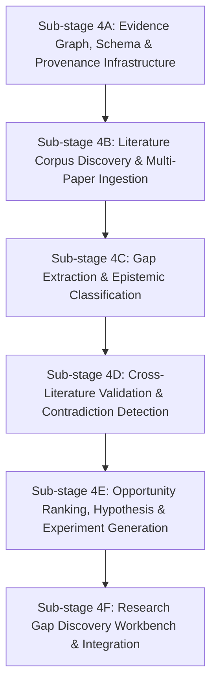

# Anvīkṣā — Stage 4: Implementation Roadmap
## Phased Sub-Stage Engineering Plan, Module Breakdown & Dependency Graph

**Document Version:** 4.1.0-REVISED  
**Status:** Engineering Roadmap & Execution Plan (Implementation Prohibited in this Phase)  
**Author:** Principal Software Engineer & Delivery Lead  
**Target Milestone:** Stage 4 — Research Gap Discovery & Validation Engine  

---

## 1. Revised Sub-Stage Ordering & Dependency Graph

To respect logical dependencies—specifically ensuring literature discovery and ingestion precede extraction, and extraction precedes cross-validation—the execution sequence is structured as follows:

---

## 2. Detailed Sub-Stage Specifications

---

### Sub-stage 4A: Evidence Graph, Schema & Provenance Infrastructure
- **Objective:** Establish the relational knowledge graph in Supabase PostgreSQL, create supporting evidence link tables with SHA-256 chunk hashes, implement epistemic audit logs, and enforce provenance protection triggers and RLS policies.
- **Files & Modules:**
  - `supabase/migrations/20261118_stage4_knowledge_graph.sql`
  - `src/types/researchGaps.ts`
  - `src/utils/researchGraphStore.ts`
- **Database Changes:**
  - Create tables: `public.research_gaps`, `public.research_gap_evidence`, `public.research_gap_validations`, `public.research_gap_audit_log`.
  - Create trigger: `protect_research_gaps_provenance()`.
  - Create RPC: `insert_server_verified_gap()`.
  - Implement RLS: private candidate gaps viewable only by creator; public/community gaps viewable by all.
- **API Endpoints:**
  - `GET /api/research/gaps` (list/filter gaps with RLS enforcement)
  - `GET /api/research/gaps/:id` (fetch gap with evidence and audit history)
- **Tests & Verification:**
  - `tests/stage4a_schema_rls.test.ts` (verify anon vs auth vs service-role security boundaries and RLS isolation).
- **Dependencies:** Stage 3 PostgreSQL configuration & `SUPABASE_SERVICE_ROLE_KEY`.

---

### Sub-stage 4B: Literature Corpus Discovery & Multi-Paper Ingestion
- **Objective:** Build an expandable literature discovery engine using OpenAlex keyword search, forward/backward citation traversal, targeted counter-evidence queries, and batch-bounded full-text retrieval with SSRF defense.
- **Files & Modules:**
  - `server/literatureDiscoveryService.ts`
  - `server/fullTextService.ts`
  - `server.ts`
- **Database Changes:** None.
- **API Endpoints:**
  - `POST /api/research/literature/discover` (searches, expands citations, deduplicates, and retrieves candidate papers)
  - `POST /api/research/literature/ingest-batch` (fetches full text, computes SHA-256 checksums, and partitions into IMRAD chunks)
- **Deterministic Responsibilities:** OpenAlex API requests, DOI deduplication, citation graph traversal, SSRF validation, text hash generation, and character offset mapping.
- **AI Responsibilities:** None (pure factual retrieval).
- **Tests & Verification:**
  - `tests/stage4b_literature_discovery.test.ts` (test forward/backward expansion, deduplication, and SSRF blocking).
- **Dependencies:** Sub-stage 4A schema.

---

### Sub-stage 4C: Gap Extraction & Epistemic Classification
- **Objective:** Implement the 12-category research gap extraction pipeline leveraging Gemma 4 MoE (`gemma-4-26b-a4b-it`) with exact substring verification, character offsets, and epistemic labeling (`AUTHOR_CONCESSION`, `EMPIRICAL_TABLE`, `AI_DEDUCTION`).
- **Files & Modules:**
  - `server/gapExtractionService.ts`
  - `server/evidenceGroundingValidator.ts`
  - `server.ts`
- **Database Changes:** None.
- **API Endpoints:**
  - `POST /api/research/gaps/extract-paper` (extracts candidate gaps from single paper)
  - `POST /api/research/gaps/extract-batch` (extracts across bounded batch of 3–12 papers)
- **Deterministic Responsibilities:** Exact substring matching, byte/character offset extraction, SHA-256 hash checking against source chunk, and Zod output schema enforcement.
- **AI Responsibilities:** Semantic extraction of subtle limitations across 12 dimensions via Gemma 4 MoE.
- **Tests & Verification:**
  - `tests/stage4c_gap_extraction.test.ts` (verifies extraction accuracy and exact quote verification).
- **Dependencies:** Sub-stage 4B ingestion.

---

### Sub-stage 4D: Cross-Literature Validation & Contradiction Detection
- **Objective:** Validate candidate gaps across independent scholarly works, detect contradictory evidence under matched conditions, evaluate 5 explicit validation outcomes (`CONFIRMED_UNRESOLVED`, `PARTIALLY_ADDRESSED`, `ADDRESSED`, `CONTRADICTED`, `INSUFFICIENT_EVIDENCE`), and record transitions in `research_gap_audit_log`.
- **Files & Modules:**
  - `server/crossLiteratureValidator.ts`
  - `server/contradictionDetector.ts`
  - `server.ts`
- **Database Changes:**
  - Record validation audit trails in `public.research_gap_validations` and `public.research_gap_audit_log`.
- **API Endpoints:**
  - `POST /api/research/gaps/:id/validate` (triggers multi-paper cross-validation)
  - `GET /api/research/gaps/:id/audit-trail` (fetches complete historical epistemic transitions)
- **Deterministic Responsibilities:** Chronological sorting, independent author verification, literature coverage date recording, and state-machine transitions.
- **AI Responsibilities:** Pairwise contradiction analysis, trade-off detection, and solution verification.
- **Tests & Verification:**
  - `tests/stage4d_cross_validation.test.ts` (evaluates FlashAttention vs FlashAttention-2 vs Mamba, and AlphaFold 2 vs ESMFold benchmark pairs).
- **Dependencies:** Sub-stage 4C extraction.

---

### Sub-stage 4E: Opportunity Ranking, Hypothesis & Experiment Generation
- **Objective:** Compute explainable multi-factor opportunity scores across 6 scientific dimensions ($S_{confidence}, S_{novelty}, S_{significance}, S_{feasibility}, S_{tractability}, S_{priority}$), and synthesize falsifiable hypotheses and experiment protocols.
- **Files & Modules:**
  - `server/opportunityScorer.ts`
  - `server/hypothesisSynthesisService.ts`
  - `server.ts`
- **Database Changes:**
  - Tables: `public.research_hypotheses`, `public.research_experiments`.
- **API Endpoints:**
  - `POST /api/research/gaps/:id/synthesize-hypothesis`
  - `GET /api/research/gaps/ranked`
- **Deterministic Responsibilities:** Mathematical score computation, field-specific normalization, non-linear contradiction penalties, and input validation.
- **AI Responsibilities:** Popperian falsifiable hypothesis synthesis (*"If [manipulation], then [observation] compared to [baseline], because [mechanism]"*).
- **Tests & Verification:**
  - `tests/stage4e_hypothesis_ranking.test.ts` (evaluates score consistency and 5-point falsifiability rubric).
- **Dependencies:** Sub-stage 4D validation.

---

### Sub-stage 4F: Research Gap Discovery Workbench & Integration
- **Objective:** Deliver the interactive frontend workbench in Anvīkṣā's beige/orange design aesthetic, featuring the multi-paper gap matrix, evidence inspection drawers, contradiction side-by-side comparators, and one-click challenge publishing.
- **Files & Modules:**
  - `src/views/ResearchGapWorkbenchView.tsx`
  - `src/components/research/ResearchGapMatrix.tsx`
  - `src/components/research/EvidenceInspectionDrawer.tsx`
  - `src/components/research/ContradictionComparator.tsx`
  - `src/App.tsx`
- **Database Changes:** None.
- **Tests & Verification:**
  - End-to-end user walkthrough test; TypeScript validation (`npx tsc --noEmit`); Vite production build (`npm run build`).
- **Dependencies:** Sub-stages 4A–4E.
